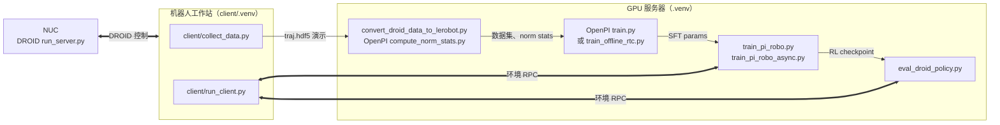
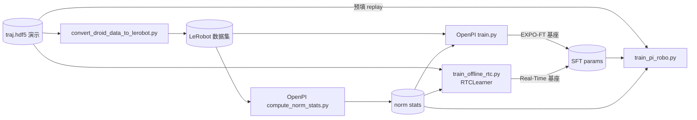
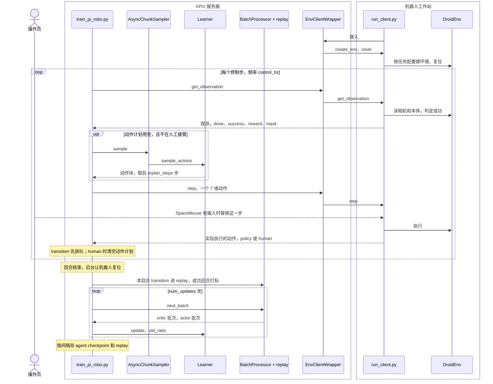
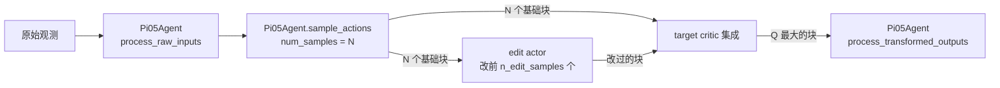
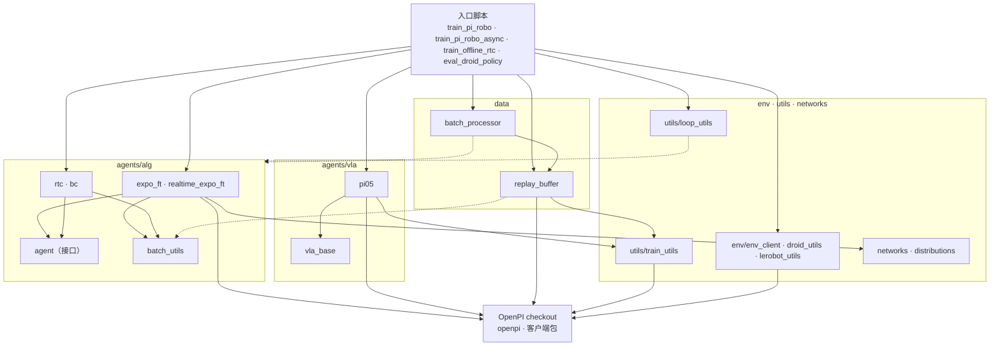
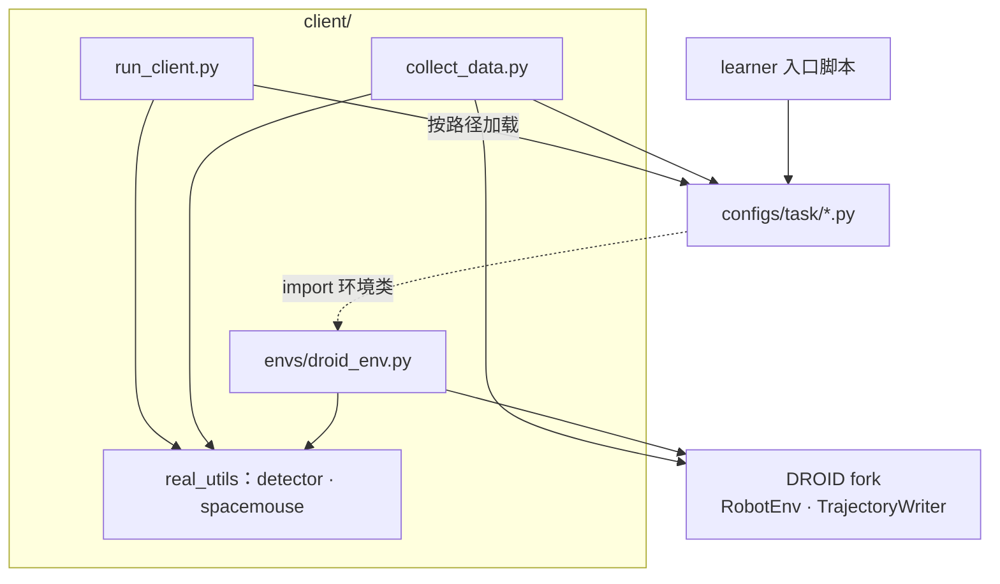

# EXPO-FT 代码组织

快照：`workspace` 分支的 `aaf1599`，即上游 `pd-perry/expo-ft` 导入后的单个提交；`robotwin-sim` 分支（`eed7996`）在其上合并了
上游 reward 对齐修复，learner 改用 xense-openpi，并加了 RoboTwin 的演示读取、环境端与任务配置（见 5 已知耦合）。运行还要
两个不在仓库里的 checkout：`expo_ft/agents/vla/openpi`（`workspace` 上是 pd-perry 的 OpenPI fork，`robotwin-sim`
上是 xense-openpi 的 `expo-ft` 分支）和 `client/droid`（DROID fork）。DROID fork 本工作区没有检出，它的接口来自
expo-ft 的 import 和 README。

## 1 总图



细线是产物的流向，粗线是运行时的连接；演示从机器人工作站拷到服务器。两个 Python 环境互不相通：learner 侧用根目录的 `.venv`（jax、OpenPI、lerobot），
机器人侧用 `client/.venv`（DROID 的旧版依赖）。

| 连接 | 谁监听，谁拨号 | 谁发起每一步 | 请求 → 回复 |
|---|---|---|---|
| 环境 RPC | learner 或评测脚本监听 `client_port`（示例 8102、8103），`run_client` 拨入 | learner，每个控制步一次 | 观测、7 维动作 → 观测、实际执行的动作、是否人工、done / success / reward |
| DROID 控制 | NUC 上的 DROID server | 机器人工作站上 DROID 的 `RobotEnv` | DROID fork 自己的协议，本仓库不涉及 |

## 2 启动入口

每一步都有 `scripts/<task>/` 下的 shell 包装，下表写包装和它实际调用的命令。

| 目的 | 机器 | 命令 | 输入 | 输出 |
|---|---|---|---|---|
| 采集演示 | 机器人 | `collect_data.sh`<br>`python -m client.collect_data --save_root <dir> --num_episodes N --task_config <task>` | 任务配置、SpaceMouse、NUC 上的 DROID | `<dir>/success/` 下每集一个 `traj.hdf5` |
| 转 LeRobot | 服务器 | `convert_data.sh`<br>`scripts/convert_droid_data_to_lerobot.py --data_dir --repo_name --task_config` | 成功演示 | LeRobot 数据集 `<repo_id>` |
| norm stats | 服务器 | `calculate_norm.sh`<br>OpenPI fork 的 `scripts/compute_norm_stats.py --config-name <openpi config> --repo-id <repo_id>` | LeRobot 数据集 | `assets/<openpi config>/<repo_id>/` |
| SFT（EXPO-FT） | 服务器 | `scripts/pick/finetune_droid.sh`<br>OpenPI fork 的 `scripts/train.py <openpi config> --exp-name <exp>` | LeRobot 数据集、norm stats | `checkpoints/<openpi config>/<exp>/<step>/params` |
| RTC-SFT（Real-Time） | 服务器 | `scripts/dynamic_pick/offline_train.sh`<br>`train_offline_rtc.py --config configs/model/rtc_pi_config.py --dataset_path <dir>` | 原始演示、norm stats | `<run>/checkpoints/<step>/params` |
| DROID server | NUC | DROID 安装目录下 `python scripts/server/run_server.py` | 机械臂 | 供工作站控制 |
| 机器人端 | 机器人 | `run_policy.sh`<br>`python -m client.run_client --host <learner> --port <port> --config_task_path <task>` | 任务配置 | 执行 learner 发来的动作 |
| 在线 RL | 服务器 | `run_server.sh`：`train_pi_robo.py`<br>`run_server_async.sh`：`train_pi_robo_async.py`（至少 2 张卡：卡 0 采样，其余更新）<br>参数：`--config_task <task> --config configs/model/<learner>.py --dataset_path <dir> --config.pi05_weight_loader_path <SFT params>` | SFT params、norm stats、演示、机器人连接 | `<run>/checkpoints/<step>/`（agent 与 params），同目录逐步存 replay；`<run>/train_videos/`；W&B |
| 评测 | 服务器 | `eval_policy.sh`<br>`eval_droid_policy.py --checkpoint_dir <run>/checkpoints --num_episodes N`，模型参数与训练相同 | RL checkpoint、机器人连接 | 终端里的成功率；`<run>/eval/step_<n>/` 下的视频 |

`<task>` 是 `configs/task/*.py`；`<openpi config>` 在示例里是 OpenPI fork 中的
`expo_pi05_droid_lora_finetune_sft_cartesian_state`；`<run>` 是 `<output_dir>/<run_name>`。

评测和训练都要连真机，没有仿真环境，也没有离线评测入口。

## 3 文件地图

### 3.1 入口、脚本与配置

```text
train_pi_robo.py             在线 RL，单线程：控制循环和梯度更新轮流
train_pi_robo_async.py       在线 RL，多线程：卡 0 采样驱动机器人，其余卡更新
train_offline_rtc.py         离线 RTC-SFT：带动作前缀条件的 pi0.5 BC，是 Real-Time 线路的基座
eval_droid_policy.py         冻结策略的真机评测
scripts/
  convert_droid_data_to_lerobot.py   DROID 的 traj.hdf5 → LeRobot 数据集
  convert_robotwin_to_lerobot.py     RoboTwin 每回合 HDF5 → LeRobot v3.0（动作列 actions，存图像）（robotwin-sim）
  robotwin/                  训练机上的 RoboTwin 运行脚本（robotwin-sim）
    night_run.sh             凌晨等空卡 → SFT（第 0 步参数护栏）→ 末个 checkpoint 分片评测 → 起联合更新
    eval_sft_ckpt.sh  rl_joint.sh    一张卡上配对 learner 与 RoboTwin 环境端：基座评测 / EXPO-FT 联合更新
  pick/                      EXPO-FT 的一整套启动脚本
  dynamic_pick/              Real-Time EXPO-FT 的一整套启动脚本
    collect_data.sh  convert_data.sh  calculate_norm.sh        数据三步（两套相同）
    run_policy.sh                                              机器人端
    run_server.sh  run_server_async.sh  eval_policy.sh         训练与评测（两套相同）
    offline_train.sh         RTC-SFT，只在 dynamic_pick/；pick/ 里对应 finetune_droid.sh
configs/
  model/                     算法超参（ml_collections），model_cls 决定用哪个 learner
    td_config.py  sac_config.py  expo_ft_pi_config.py          逐层继承，最后一个是 EXPOLearner
    realtime_expo_ft_pi_config.py  rtc_pi_config.py  dagger_pi_config.py    在 expo_ft_pi_config 上改
  task/                      任务：环境类、相机、工作空间边界、复位位姿、控制频率、语言指令
    real_base.py             DROID 公共默认
    pick.py  dynamic_pick.py  light2.py
    robotwin_base.py         RoboTwin 公共默认：14 维关节动作、三路 critic 相机（robotwin-sim）
    robotwin_beat_block_hammer.py    RoboTwin 任务：环境类、RoboTwin 根目录、种子起点、步数上限（robotwin-sim）
```

### 3.2 `expo_ft/`（learner 侧）

```text
expo_ft/
  agents/
    alg/
      agent.py               AgentLearner 接口：create、sample_actions、update、update_actor；建 checkpoint 目录
      expo_ft.py             EXPOLearner：pi0.5 采 N 个候选，edit actor 改一部分，critic 选 Q 最大的
      realtime_expo_ft.py    RealTimeEXPOFTLearner：再加延迟推理、前缀补全、过滤后的 backup
      rtc.py                 RTCLearner：带动作前缀条件的 pi0.5 BC
      bc.py                  BCLearner：只做 BC，不用 critic
      batch_utils.py         把 replay 批次拆成 critic 输入和 VLA 输入
    vla/
      vla_base.py            Model 接口：预处理、采样、反归一化、actor 训练批次
      pi05.py                Pi05Agent 与 build_pi05：包住 OpenPI fork 的 pi0.5
  data/
    replay_buffer.py         PiReplayBuffer：逐步存 transition，按 replan_steps 切块采样，带 OpenPI transform
    batch_processor.py       每次更新取 critic 批次和 actor 批次，可混合在线与离线数据
    dataset.py               Dataset 基类
  env/
    env_client.py            EnvClientWrapper：learner 侧的环境 RPC，监听端口等机器人拨入
    droid_utils.py           读演示目录里的 traj.hdf5
    lerobot_utils.py         读 LeRobot v3.0 数据集，每条演示成一个成功回合，图像保持 CHW（robotwin-sim）
  networks/
    encoders.py              critic 的图像编码器（ResNetV2）
    pixel_multiplexer.py     编码器 + 状态 + 动作的网络外壳，包括 critic 和 edit actor
    state_action_value.py  ensemble.py  mlp.py  mlp_resnet.py  temperature.py    Q 头、集成、MLP、熵温度
  distributions/             tanh 高斯分布
  utils/
    loop_utils.py            AsyncChunkSampler（后台推理）、EpisodeSink（攒数据、存盘、记日志）
    train_utils.py           解析 OpenPI 配置、加载权重、W&B、拼批次
    augmentation.py  log_utils.py  timer.py    图像增强、回合统计、计时
```

### 3.3 `client/`（机器人侧）与外部 fork

```text
client/
  run_client.py              环境 RPC 的机器人端：拨号到 learner，执行请求；SpaceMouse 接管在这里
  collect_data.py            SpaceMouse 遥操作采演示，成功的进 success/
  envs/
    droid_env.py             DroidEnv（继承 DROID 的 RobotEnv）和任务子类 PickBlocksEnv、Light2Env：观测、执行、成功判定、复位
    robotwin_env.py          RoboTwinEnv：按官方评测协议筛种子复位、执行 14 维关节目标、判成功与超时（robotwin-sim，跑在 RoboTwin 的环境里）
    zed_recorder.py          ZED 相机录像
    utils.py                 图像缩放
  real_utils/
    detector.py              成功判定：颜色阈值，或终端输入手动标记
    spacemouse.py            SpaceMouse 读数 → 7 维动作
    vis_utils.py             回合视频
  install_pyzed.sh           单独安装 ZED 的 Python 包

expo_ft/agents/vla/openpi/   OpenPI checkout，不在仓库里：pi0.5 模型与训练配置、SFT 和 norm stats 脚本、
                             客户端包（pd-perry fork 为 openpi_client，xense-openpi 为 xense_client；robotwin-sim 两侧都用 xense_client）
client/droid/                DROID fork，不在仓库里：RobotEnv、轨迹写入、NUC 端 server
```

## 4 模块交互

### 4.1 数据与基座训练



两条线路用同一份数据和 norm stats，从基座训练开始分开：

| | EXPO-FT | Real-Time EXPO-FT |
|---|---|---|
| OpenPI fork 分支 | `expo_ft` | `real-time-expo-ft` |
| DROID fork 分支 | 默认分支 | `real-time-expo-ft` |
| 基座训练 | OpenPI `train.py`，读 LeRobot 数据 | `train_offline_rtc.py` + `RTCLearner`，读原始演示，带动作前缀条件 |
| 在线 learner | `EXPOLearner` | `RealTimeEXPOFTLearner` |
| 推理时机 | 动作计划用完时阻塞推理 | 计划剩最后 `delay` 步时在后台推理 |
| 示例脚本 | `scripts/pick/` | `scripts/dynamic_pick/` |

### 4.2 在线 RL



图里是 `--update_type episode`（示例脚本的设置）；`step` 模式在控制步里更新。`train_pi_robo_async.py` 的控制循环
相同，更新放在另一个线程、另外几张卡上。评测脚本走同一个控制循环，不写 replay、不更新。

环境 RPC 的接口：

| `operation` | learner 给 | 机器人端回 |
|---|---|---|
| `create_env` | `env_usage`（train 或 eval）、`video_dir`、示例动作 | `env_id`、语言指令 |
| `reset` | `env_id` | 首帧观测 |
| `get_observation` | `env_id` | 观测，并附带 done、success、reward、mask |
| `step` | `env_id`、一个 7 维动作 | 实际执行的动作，`action_type` 为 `policy` 或 `human` |
| `get_info_for_step` | `env_id` | done、success、reward、mask；`get_observation` 已附带时不发 |
| `render` | `env_id` | 一帧 RGB，用于评测视频 |

### 4.3 EXPOLearner 的一次采样



一次 `update` 做四件事：

| 更新 | 用哪批数据 | 做什么 |
|---|---|---|
| critic | `utd_ratio` 个小批次，逐个更新 | chunk 级 TD；backup 的下一步动作也用上图的「采样 + 编辑 + 选最大 Q」 |
| pi0.5 | 最后一个小批次；`actor_success_only` 时改用成功回合的批次 | `Pi05Agent.train_step` 做 BC，并软更新目标参数 |
| edit actor | 最后一个小批次 | 最大化 Q 加熵项 |
| 温度 | edit actor 的熵 | 调节熵系数 |

### 4.4 模块依赖

箭头表示 import。实线是从上往下的正常依赖，虚线是反向依赖。



`BP -.-> ALG` 和 `LP -.-> ALG` 都是 `from expo_ft.agents import ...`，这个包的 `__init__` 会加载全部 learner。

机器人侧和任务配置：



任务配置两侧都读：learner 取控制频率、边界、相机名、语言指令；机器人端取环境类并实例化。配置文件 import
`client/envs/droid_env.py` 时包在 try 里，learner 侧没装 DROID 也能加载。

每个模块的输入输出：

| 模块 | 输入 | 输出 |
|---|---|---|
| `EnvClientWrapper` | 操作名和参数 | 回复；连接或操作出错时重建环境再试 |
| `run_client` | 环境 RPC 请求 | 观测、实际执行的动作、`action_type`、done / success / reward / mask |
| `DroidEnv` | 7 维动作：6 维笛卡尔速度 + 夹爪速度 | 观测：外部相机图像（两个键是同一路）、腕部图像、`cartesian_position`、`gripper_position`、prompt；成功时 reward 为 1 |
| `RoboTwinEnv` | 14 维关节目标（两臂各 6 关节 + 夹爪），每次 `step` 是 RoboTwin 的一次 `take_action` | 观测键与 LeRobot 数据集相同：三路相机（resize_with_pad 到 224，CHW uint8）、`observation.state`、prompt（每回合按 `seen` 生成）；成功或到 `step_lim` 时 done，成功时 reward 为 1 |
| `AsyncChunkSampler` | learner、观测、计划剩余步数 | 动作块；`delay > 0` 时提前在后台推理 |
| `Learner.sample_actions` | 原始观测 | `(H, 7)` 动作块、新的 agent、采样信息 |
| `Learner.update` | critic 批次、actor 批次、`utd_ratio` | 新的 agent、指标 |
| `Pi05Agent` | 原始观测、训练状态、采样数 | 归一化的动作块；反归一化后的动作；BC 训练步 |
| `PiReplayBuffer` | 每步 transition：观测、实际动作、reward、mask、done、`is_hil` | 按 `replan_steps` 切的块批次，OpenPI 格式和 critic 格式 |
| `BatchProcessor` | 在线与离线两个 replay、离线比例 | 每次更新的 critic 批次和 actor 批次 |

## 5 已知耦合

| 接口 | 现在的假设 | 位置 |
|---|---|---|
| 动作 | 7 维 DROID 笛卡尔速度 + 夹爪速度。人工接管、示例动作、`edit_action_xyzg`（把第 3–5 维当旋转屏蔽）都按这个布局写 | `configs/task/real_base.py`、`client/run_client.py`、`expo_ft/agents/alg/expo_ft.py` |
| 环境类型 | `workspace` 上四个入口只接受 `env_type == "droid"`，演示只读 DROID 的 `traj.hdf5`。`robotwin-sim` 上 `train_pi_robo.py` 与 `eval_droid_policy.py` 另接受 `robotwin`，演示从 LeRobot v3.0 读；`train_pi_robo_async.py`、`train_offline_rtc.py` 仍只认 DROID | 入口脚本、`expo_ft/env/droid_utils.py`、`expo_ft/env/lerobot_utils.py` |
| 控制循环的位置 | learner 每个控制步发 `get_observation` 和 `step` 两次 RPC，网络往返在控制环里 | `train_pi_robo.py`、`expo_ft/env/env_client.py` |
| 人工接管 | SpaceMouse 在机器人端逐步替换动作；transition 用 `is_hil` 标记 | `client/run_client.py` |
| 奖励 | 稀疏：成功给 1，其余为 0。DROID 用颜色阈值或手动标记判成功，RoboTwin 用任务的 `check_success` | `client/envs/droid_env.py`、`client/real_utils/detector.py`、`client/envs/robotwin_env.py` |
| VLA | `workspace` 上用 pd-perry fork 的 `get_config(name, weight_loader_path=...)`；`robotwin-sim` 上用 `get_config(name)` 后由 `dataclasses.replace` 换 `weight_loader`。采样依赖 openpi 的 `sample_actions` 支持 `num_samples`、`train`，`Policy.infer` 支持 `is_batch`、`for_training`。RTC 与 Real-Time 线路调 `model.sample_actions_with_prefix(prefix=...)`（前缀补全）；xense-openpi 的同名方法是 RLT 用的另一个接口，没有 `prefix` 参数，所以这两条线路在 `robotwin-sim` 上不能跑 | `expo_ft/utils/train_utils.py`、`expo_ft/agents/vla/pi05.py` |
| critic 相机 | 默认 `base_0_rgb`、`left_wrist_0_rgb`；任务配置可用 `critic_camera_keys` 覆盖，RoboTwin 用三路 | `expo_ft/agents/alg/batch_utils.py`、`configs/task/robotwin_base.py` |
| 首步动作 | 训练循环建好环境后先 `env.step(example_action)`。DROID 的 `example_action` 全零，速度动作下是静止；RoboTwin 的 `example_action` 设为复位姿态（两臂 0、夹爪 1），关节目标下同样不动 | `train_pi_robo.py`、`configs/task/robotwin_base.py` |
| 反向依赖 | `data/replay_buffer.py` import `agents/alg/batch_utils.py`；`data/batch_processor.py` 和 `utils/loop_utils.py` import `expo_ft.agents`；任务配置 import `client/envs/droid_env.py` | 见 4.4 |
