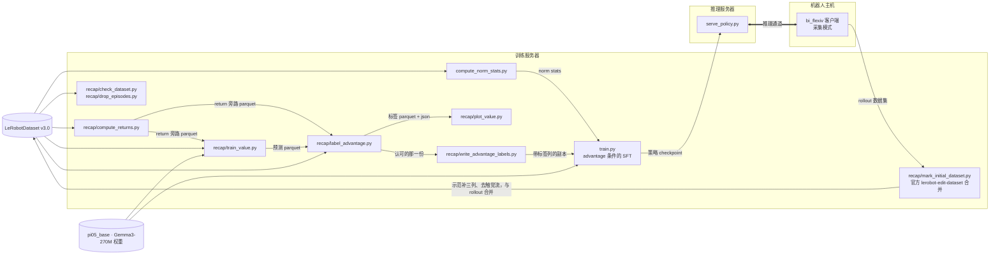
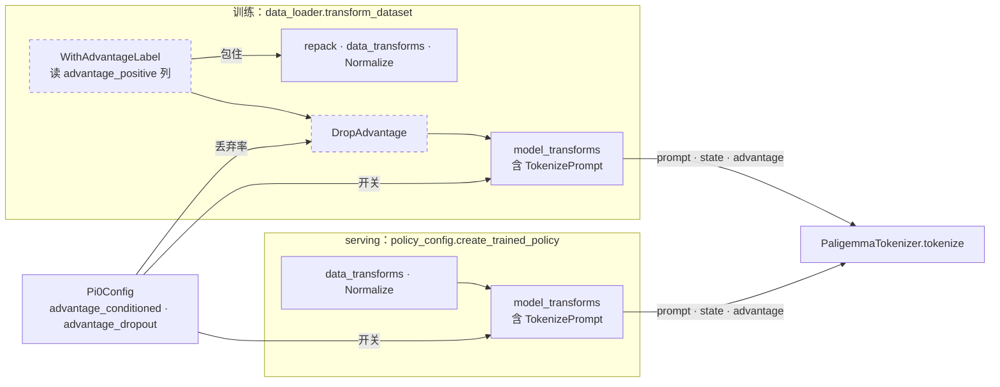
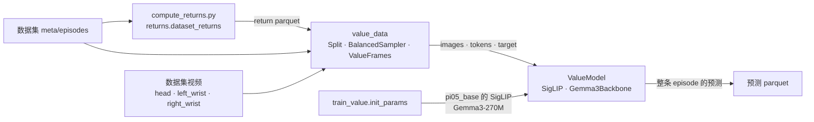
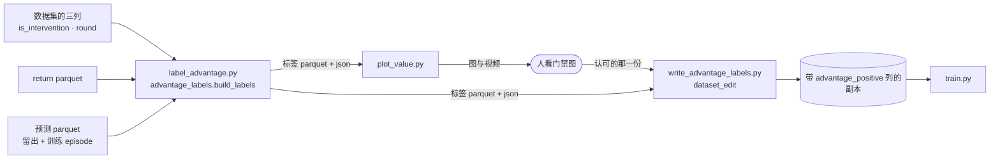
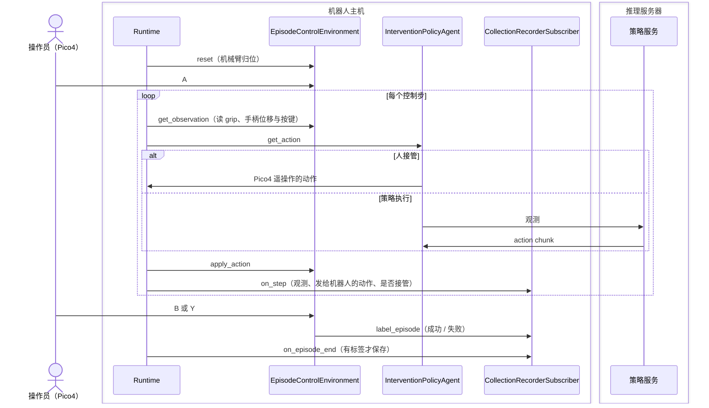
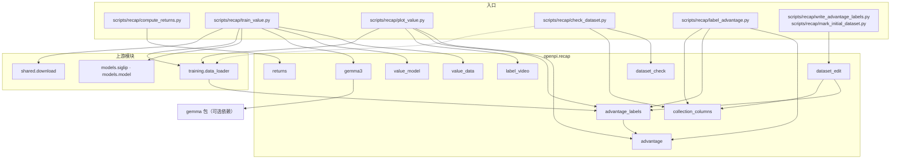

# xense-openpi 代码组织（`feature/pi-star-0.6`）

快照：`feature/pi-star-0.6`（`cad7e92`），起点是上游 main（`50c8196`）。这个分支没有 `src/openpi/rl/`；`rl-exp` 与 `feature/rlt-jax` 的 RL 模块见
[codebase-rl-exp.md](codebase-rl-exp.md)。本文只画 RECAP（π*0.6）新增与改动的部分，SFT 训练与 serving 沿用上游；机器人端只画 bi_flexiv 客户端里采集用到的文件。
方法定义见 [pi-star-06-spec.md](pi-star-06-spec.md)，可复制的命令见 [cmd.md](cmd.md)。

## 1 总图



细线是产物的流向，粗线是运行时的连接。一轮的顺序是：采集 rollout → 与补了三列的示范合并 → 算 return → 训练价值模型
并对每一帧预测 → 打标签 → 人看门禁图 → 认可的那一份写回 → 策略训练。第 0 轮没有标签列，所有帧按 positive 训练，
策略线不读价值线的输出。

| 连接 | 怎么启动 | 谁发起每一步 | 请求 → 回复 |
|---|---|---|---|
| 推理通道 | 机器人客户端默认模式，与上游相同 | 机器人端 | 观测 → action chunk；prompt 固定带 `Advantage: positive` |
| 推理通道（采集模式） | 客户端加 `--args.record --args.pico4-intervention --args.record-round <k>`，只能同步、不开 RTC | 机器人端；人接管的步不向服务端要动作 | 同上；Pico4 的按键留在机器人端，不随观测发给服务端 |

## 2 启动入口

| 目的 | 机器 | 命令 | 输入 | 输出 |
|---|---|---|---|---|
| 归一化统计 | 训练服务器 | `scripts/compute_norm_stats.py --config-name <config>` | 数据集 | `assets/<config>/<repo_id>/norm_stats.json` |
| 训练带 advantage 条件的策略 | 训练服务器 | `scripts/train.py <config> --exp-name <run>` | `configs` 下 `advantage_conditioned: true` 的 YAML、norm stats、`pi05_base`；数据集有 `advantage_positive` 列时按它给每帧标签 | `checkpoints/<config>/<run>/<step>/` |
| 起策略服务 | 推理服务器 | `scripts/serve_policy.py policy:checkpoint --policy.config <config> --policy.dir <ckpt>` | 策略 checkpoint | WebSocket 服务 |
| 采集带标记的 rollout | 机器人主机 | `python -m examples.bi_flexiv_rizon4_rt.main --args.record --args.record-repo-id <repo_id> --args.task <任务> --args.pico4-intervention --args.record-round <k>` | 策略服务、Pico4 | 多三列 `is_intervention`、`episode_success`、`round` 的 LeRobot 数据集 |
| 给初始示范补三列 | 任意（要复制视频） | `scripts/recap/mark_initial_dataset.py --src <dataset> --dst <新目录> [--remove-features <feature>…]` | 示范数据集 | 多三列（全部成功、无介入、`round = 0`）、少掉指定 feature 的新副本 |
| 合并示范与 rollout | 任意（要复制视频） | LeRobot 官方的 `lerobot-edit-dataset --operation.type merge` | 补过标记的示范、各轮 rollout | 累计数据集 |
| 算 return 标签 | 任意（不读视频） | `scripts/recap/compute_returns.py --dataset-root <dataset> --output <returns>` | 数据集的 `meta/episodes`、`data/` 里的 `episode_success` 列 | return 旁路 parquet |
| 训练价值模型 | 训练服务器 | `scripts/recap/train_value.py --repo-id <repo_id>… --returns <returns>… [--init-params <params>] --gemma-params <gemma> --gemma-tokenizer <tok> --output-dir <out> --exp-name <run>` | 数据集视频、return parquet、Gemma3-270M 与 `pi05_base` 权重 | `<out>/<run>/params`、`<out>/<run>/heldout_predictions.parquet`；加 `--final-train-episodes <n>` 时另有 `train_predictions.parquet` |
| 打优势标签 | 任意（不读视频） | `scripts/recap/label_advantage.py --dataset-root <dataset> --returns <returns> --predictions <预测>… --output <labels>` | 数据集的三列、return parquet、覆盖每一帧的预测 | 一次尝试：标签 parquet 与同名 json |
| 画优势标签的门禁图 | 训练服务器 | `scripts/recap/plot_value.py --labels <labels> --repo-id <repo_id> --output-dir <plots>` | 标签 parquet 与 json、数据集视频 | 每个 episode 一张 `value_episode_XXXX.png`；`--videos` 另出视频 |
| 把认可的标签写回 | 任意（要复制视频） | `scripts/recap/write_advantage_labels.py --src <dataset> --labels <labels> --dst <新目录>` | 数据集、标签 parquet 与 json | 多一列 `advantage_positive` 的新副本，`meta/advantage_labels.json` |
| 训练前检查数据集 | 任意（出图时要视频） | `scripts/recap/check_dataset.py --dataset-root <dataset> [--sheet-dir <plots>]` | 数据集的 `meta/`、`data/`、视频文件是否存在 | 不一致与可疑 episode 的清单；可选每条一张帧图 |
| 删 episode | 任意 | `scripts/recap/drop_episodes.py --src <dataset> --dst <新目录> --episodes <编号>…`，再 `scripts/recap/verify_drop.py` 同样参数 | 数据集 | 重新编号的新副本，视频硬链接 |

`<config>` 是 `configs` 下 YAML 的文件名；`<dataset>` 是数据集根目录（含 `meta/`、`data/`）；`<gemma>`、`<tok>` 是
Gemma3-270M checkpoint 目录与 sentencepiece 模型的本地副本；`<labels>` 是标签 parquet 的路径；`<out>`、`<plots>` 是输出目录。

现在没有的入口：CFG 推理、价值模型的独立推理脚本
（用 `train_value.py --init-params <params> --num-train-steps 0` 只做结尾的预测，训练 episode 加
`--final-train-episodes`）、RTC 运行方式下的采集。

## 3 文件地图

入口与配置：

```text
scripts/
├── train.py · compute_norm_stats.py · serve_policy.py   上游入口，未改；经 data_loader / policy_config 用到 advantage 条件
└── recap/
    ├── mark_initial_dataset.py  给初始示范补三列、去掉 rollout 没有的视频流，产出新副本
    ├── compute_returns.py   读 episode 元数据与 episode_success 列，写逐帧归一化 return 的旁路 parquet
    ├── train_value.py       价值模型训练：一个或多个数据集，载入预训练骨干或已有权重，按 episode 留出、存最优权重、早停、写留出集与可选的训练集预测
    ├── label_advantage.py   按规则给每一帧打优势标签，写成一次尝试的 parquet 与 json，不改数据集
    ├── plot_value.py        门禁图：读标签文件，整条 episode 的 return、预测与等间隔帧图按标签着色；`--videos` 另出视频
    ├── write_advantage_labels.py  把一次尝试写成数据集的 advantage_positive 列，产出新副本
    ├── check_dataset.py     训练前的数据检查：元数据一致性、帧的存储顺序、视频文件、三列是否自洽与每轮的统计、可疑 episode 清单与帧图，只读
    └── drop_episodes.py · verify_drop.py   删 episode 产出新副本并核对；从 feat/egg-carton-subtask 原样复制
configs/_examples/
├── pi05_base_bi_flexiv_cylinder_stack_recap_h100.yaml         打开 advantage 条件的 π0.5 bi_flexiv 配置（第 0 轮，示范）
└── pi05_base_bi_flexiv_cylinder_stack_recap_round_h100.yaml   同上，数据集换成带标签的副本（第 k 轮），repo_id 是占位
pyproject.toml               可选依赖组 recap（gemma）
```

策略侧（改动的上游文件）：

```text
src/openpi/
├── models/
│   ├── tokenizer.py     π0.5 prompt 里在 Action 之前插 advantage 文本；标签集合 ADVANTAGE_LABELS
│   └── pi0_config.py    开关 advantage_conditioned 与丢弃率 advantage_dropout，只被数据链读取
├── transforms.py        WithAdvantageLabel（把数据集的标签列变成样本的 advantage 字段）；DropAdvantage（按概率去掉条件）；TokenizePrompt 读样本的 advantage 字段
├── training/
│   ├── config.py        ModelTransformFactory 把开关传给 TokenizePrompt
│   └── data_loader.py   数据集有 advantage_positive 列时接上 WithAdvantageLabel 并在日志里报 positive 占比；model_transforms 之前插 DropAdvantage；RLDS 链不支持时报错
└── policies/
    └── policy_config.py 未改；serving 复用 model_transforms，所以不丢弃
```

价值侧（新增）：

```text
src/openpi/recap/
├── returns.py       逐帧归一化 return 的纯 numpy 计算，按任务取最长 episode
├── value_model.py   two-hot 目标、期望值、交叉熵；ValueModel（图像 token + 文本 token + CLS → 201 个 bin）
├── gemma3.py        Gemma3-270M 包一层，接受现成的 embedding；直接用 orbax 读官方 checkpoint
├── checkpoints.py   价值模型权重的保存与读回，载入前核对名称与形状
├── value_data.py    episode 留出划分、return 对齐、任务文本 token、补边缩放、ValueFrames 数据集；多数据集的 Split 与等概率采样
├── advantage.py     N 步优势估计、按比例取阈值、打标签的规则（示范与介入帧强制 positive，两种阈值做法）、标签分段，纯 numpy
├── advantage_labels.py  一次打标签尝试的表：由三列、return 与预测建表并核对覆盖，读写 parquet 与 json，按数据集的存储顺序对齐
├── collection_columns.py  三列的定义与读取；按 episode 汇总、自洽检查、每轮的统计
├── dataset_edit.py  用官方 modify_features 产出改了列的新副本：示范补三列并去掉指定 feature、写回 advantage_positive
├── label_video.py   视频的单帧画法：标签颜色的边框（强制 positive 是第三种颜色）、整条 episode 的标签时间轴与光标，numpy + PIL
└── dataset_check.py 帧的存储顺序；由机器人状态判静止帧、开头与结尾的静止长度、长度离群，纯 numpy
```

机器人端（bi_flexiv 客户端里与采集有关的文件；跑在 `lerobot-xense` 环境，不装 `openpi`）：

```text
examples/bi_flexiv_rizon4_rt/
├── main.py          入口；`--args.record-round` 进入采集模式并组装下面几个
├── intervention.py  Pico4 接管：握 grip 并移动才接管，另一只手保持，松开后让 broker 重新推理；与 `962f953` 逐字相同
├── button_edges.py  A/B/X/Y 的去抖边沿与手柄数据流的健康检查；与 `962f953` 逐字相同
├── collection.py    采集的 episode 控制：A 开始，B / Y 以成功 / 失败结束，X 作废；按键不发给策略服务
└── recorder.py      录制订阅者；采集模式的子类多录三列、按指定编码录视频，没有标签的 episode 不保存
```

## 4 模块交互

### 4.1 advantage 条件的数据链

训练与 serving 共用 `model_transforms`，丢弃只加在训练链上。虚线框是只在训练时存在的一步。



repack 与机器人的变换只保留自己认识的字段，所以 `WithAdvantageLabel` 先从原始样本读标签列，等这几步做完再把
`advantage` 字段加回去。数据集没有这一列时不接这一步，样本里没有 `advantage` 字段。

```text
开关打开：  Task: {task}, State: {state};\nAdvantage: positive;\nAction:   （标签列为 False 的帧是 negative）
条件被丢弃：Task: {task}, State: {state};\nAction:                        （与开关关闭时逐字相同）
```

| 模块 | 输入 | 输出 |
|---|---|---|
| `Pi0Config` | YAML 里的 `advantage_conditioned`、`advantage_dropout` | 两个字段；开关打开而 `discrete_state_input` 关闭时报错 |
| `WithAdvantageLabel` | 原始样本、标签列名、被包住的变换 | 被包住的变换的输出，加上 `advantage`：列为 True 是 `positive`，False 是 `negative` |
| `DropAdvantage` | 样本、丢弃率 | 以该概率把样本的 `advantage` 置为 `None` |
| `TokenizePrompt` | 样本的 `prompt`、`state`、`advantage`（缺省 `positive`） | `tokenized_prompt`、`tokenized_prompt_mask`；开关关闭时不读 `advantage` |
| `PaligemmaTokenizer.tokenize` | 任务文本、离散化前的 state、`positive` / `negative` / `None` | token 与 mask；其他标签或 π0 格式下传入会报错 |
| `transform_dataset` | 数据集、`DataConfig`、丢弃率、标签列名 | 套好变换链的数据集；RLDS 加载链在开关打开时报 `NotImplementedError` |
| `data_loader._advantage_column` | `DataConfig`、模型配置 | 开关打开且数据集有 `advantage_positive` 列时返回列名并在日志里报 positive 占比；否则返回 `None`，日志里写全部按 positive |

### 4.2 价值模型的训练



```text
ValueModel 的序列：[3 路相机的图像 token（经 image_proj 投到 640 维）, 任务文本 token, 可学习的 CLS]
Gemma3Backbone 是因果的，所以取最后的 CLS 位置 → value_head → 201 个 bin 的 logits
```

| 模块 | 输入 | 输出 |
|---|---|---|
| `returns.dataset_returns` | 每个 episode 的长度、是否成功、任务 | 每个 episode 的逐帧 return，值在 $[-1,0]$ |
| `compute_returns.py` | 数据集根目录；有 `episode_success` 列时读它 | parquet：`episode_index`、`frame_index`、`return` |
| `value_data.ValueFrames` | `LeRobotDataset`、全局帧号、对齐后的 return、任务 token | 样本：`images` uint8 (3, 224, 224, 3)、`tokens`、`token_mask`、`target`、`index` |
| `gemma3.Gemma3Backbone` | 文本 token；或 embedding 序列与 mask | 文本 embedding；或逐位置的隐状态 |
| `value_model.ValueModel` | 图像 (B, 3, 224, 224, 3)、文本 token 与 mask | logits (B, 201)；`expected_value` 取期望得 $V$ |
| `train_value.py` | 一个或多个数据集及各自的 return parquet；两份预训练权重，或 `--init-params` 指向的已有 `params` | 留出集指标（多数据集时取各数据集的平均）最优时的 `params`；最优权重的 `heldout_predictions.parquet`（`dataset`、`episode_index`、`frame_index`、`return`、`value`） |
| `dataset_check` | 逐帧 `observation.state`、各维量程、阈值 | 静止帧标记、开头与结尾的静止帧数、长度离群标记 |
| `check_dataset.py` | 数据集根目录 | `PROBLEM` 与 `SUSPECT` 清单；有三列时另有每轮的统计；可选 JSON 报告与每条可疑 episode 的帧图 |

价值模型的数据不走策略的 repack 与归一化链：它只要三路相机和任务文本，不用 state 与 action。

### 4.3 优势标签：从预测到训练用的列



```text
标签 parquet 每帧一行：episode_index · frame_index · return · value · advantage · positive · source
source：initial（round = 0）与 intervention（is_intervention）强制 positive；value 按 advantage 是否高于阈值
```

| 模块 | 输入 | 输出 |
|---|---|---|
| `collection_columns.load_frames` | 数据集根目录 | 每帧的 `episode_index`、`frame_index` 与三列，按存储顺序；缺任何一列就报错 |
| `advantage.n_step_advantages` | 一条 episode 的逐帧 return 与 $V$、步数 $N$ | 逐帧优势；`positive_threshold` 给出使指定比例为 positive 的阈值 |
| `advantage.label_frames` | 逐帧优势、是否初始示范、是否介入、positive 比例、阈值做法（`rollout` 或 `all`） | 逐帧标签、来源、阈值；没有按优势打标签的帧时阈值为 NaN |
| `advantage_labels.build_labels` | 三列、return、预测、$N$、比例、阈值做法 | 标签表与汇总（阈值、各来源的帧数与 positive 占比）；预测缺帧、多帧、重复或与 return 对不上时报错 |
| `label_advantage.py` | 数据集根目录、return parquet、一个或多个预测 parquet | 标签 parquet 与同名 json（另记输入文件的路径） |
| `plot_value.py` | 标签 parquet 与 json、数据集视频 | 每个 episode 一张图：上排帧图，中间 return 与 $V$ 两条曲线，背景按标签着色（绿 positive、红 negative、青强制 positive），下栏优势与阈值；日志里有优势标准差、标签每秒翻转次数、positive 片段中位时长。`--videos` 时每个 episode 另出一段视频，画面边框按标签着色 |
| `advantage_labels.aligned_positive` | 标签表、数据集每帧的键 | 按数据集存储顺序排好的逐帧标签；两边的帧不完全相同时报错 |
| `dataset_edit.write_advantage_labels` | 数据集、标签 parquet、新目录 | 用官方 `modify_features` 写出的新副本，多一列 `advantage_positive`；汇总 json 拷到 `meta/advantage_labels.json` |
| `dataset_edit.mark_initial_demonstrations` | 示范数据集、新目录、要去掉的 feature | 多三列、少掉这些 feature 的新副本；被去掉的视频流不复制 |

### 4.4 采集一条 episode



读到 B / Y 的那一步照常执行并录下，是这条 episode 的最后一帧；之后的归位不录。按 X、中途按 A、到步数上限或 Ctrl+C
时没有 `label_episode`，这条 episode 的缓冲被清掉。

| 模块 | 输入 | 输出 |
|---|---|---|
| `collection.CollectionController` | Pico4 的 grip、手柄位姿、按键 | 是否接管与遥操作动作（继承自 `intervention`）；按键只交给 `EpisodeControlEnvironment` |
| `collection.EpisodeControlEnvironment` | 被包住的环境、控制器、`on_label` 回调 | 归位后等 A 才给出第一帧观测；按键结束 episode，B / Y 时回调标签 |
| `recorder.CollectionRecorderSubscriber` | 每步的观测与动作、轮次、`label_episode` 的标签 | LeRobot 数据集：每帧多 `is_intervention`、`round`、`episode_success`（保存前整条填成同一个值）；作废的 episode 连同它的相机临时图片一起删掉 |
| `collection.stop_on_sigint` | 运行时、episode 控制、录制器 | SIGINT 的处理函数：第一次让运行时停下并归位，归位时的第二次先关数据集再立刻退出（各模式共用，后两个参数只有采集模式才有） |

### 4.5 分层

箭头表示 import。



虚线是只在出帧图时才发生的 import。`drop_episodes.py` 与 `verify_drop.py` 不 import `openpi`，图里没有画。
价值模型的五个模块互不 import，由 `train_value.py` 组装；`value_model` 的两个骨干是注入的，单测用小的替身。
只有 `gemma3` 依赖 `gemma` 包，没装时其余模块与策略侧都能用。`training.data_loader` 从 `advantage_labels` 只取列名。
机器人端的 `examples/bi_flexiv_rizon4_rt` 不 import `openpi`：`collection` → `intervention` → `button_edges`，
`main` 另 import `recorder`。

## 5 已知耦合

| 接口 | 现在的假设 | 位置 |
|---|---|---|
| 价值模型的相机 | 固定 bi_flexiv 的三路相机列名与顺序 | `value_data.BI_FLEXIV_CAMERA_KEYS` |
| 价值模型的数据集 | LeRobot v3.0；每个数据集的 episode 编号从 0 连续；多个数据集按相同概率采样，不按帧数 | `train_value.py`、`value_data.load_episode_table`、`value_data.BalancedSampler` |
| return 归一化 | 按任务文本分组取最长 episode；一个 episode 多条任务文本时按文本集合分组，整条 episode 一起算 | `compute_returns.load_episodes` |
| 成功标签 | 读逐帧列 `episode_success`；数据集没有这一列时全部按成功处理 | `compute_returns.load_success` |
| advantage 标签来源 | 只认数据集里名为 `advantage_positive` 的列；没有这一列时样本里没有 `advantage` 字段，一律 `positive` | `data_loader._advantage_column`、`transforms.TokenizePrompt` |
| 三列的定义 | 写了两份，必须相同，否则官方合并拒绝：机器人端不装 `openpi` | `recorder.COLLECTION_FEATURES`、`collection_columns.COLLECTION_FEATURES` |
| 没有三列的数据集 | 打标签与写回标签时报错，不猜成初始示范；检查脚本只做原来的检查，算 return 时全部按成功 | `collection_columns.load_frames`、`check_dataset.py`、`compute_returns.load_success` |
| 采集录下的视频 | 只录 head 与两个腕部相机，编码默认 h264（bi_flexiv 示范的编码）。官方合并要求两个数据集的 features（含视频编码）完全相同，所以示范要去掉触觉流，示范用别的编码时采集要跟着改 | `main.py` 的 `record_vcodec`、`mark_initial_dataset.py` 的 `--remove-features` |
| 采集的运行方式 | 只支持同步运行；录制器只能新建数据集，不能往已有的数据集里续录 | `main.py`、`recorder.make_collection_recorder_subscriber` |
| 写回标签的代价 | 官方 `modify_features` 整份复制视频，每个带标签的数据集都是一份完整副本 | `dataset_edit.add_columns` |
| Gemma3 权重读取 | 绕过 `gm.ckpts.load_params`，依赖官方 checkpoint 的扁平键名与 `gemma` 的私有模块 | `gemma3.py` |
| 价值模型的保存 | 只存留出集指标最优的一份 `params`，不存优化器状态，不能续训 | `train_value.py` |
