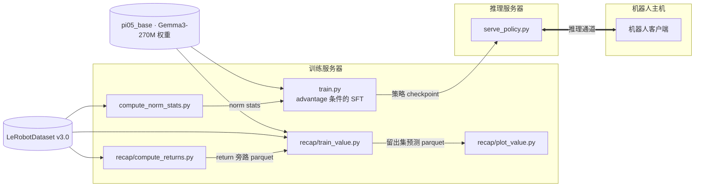
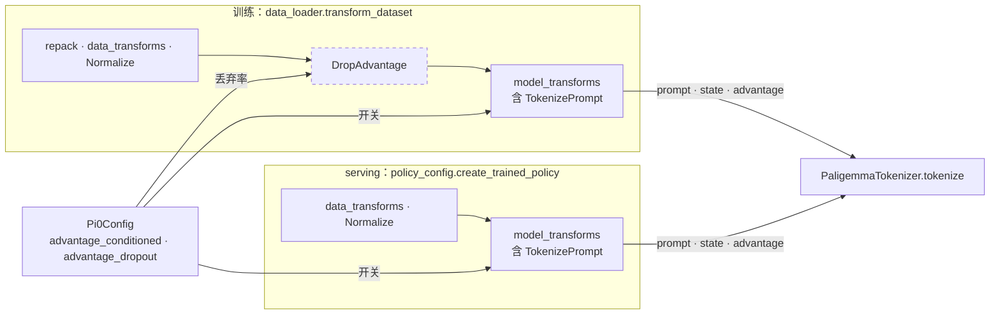
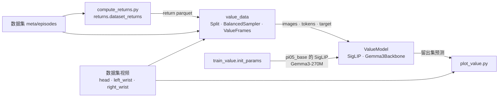
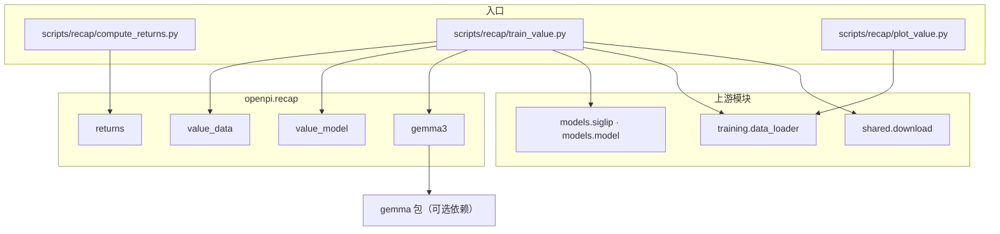

# xense-openpi 代码组织（`feature/pi-star-0.6`）

快照：`feature/pi-star-0.6`（`bb315b4`），起点是上游 main（`50c8196`）。这个分支没有 `src/openpi/rl/`；`rl-exp` 与 `feature/rlt-jax` 的 RL 模块见
[codebase-rl-exp.md](codebase-rl-exp.md)。本文只画 RECAP（π*0.6）新增与改动的部分，SFT 训练、serving 与机器人端沿用上游。
方法定义见 [pi-star-06-spec.md](pi-star-06-spec.md)，可复制的命令见 [cmd.md](cmd.md)。

## 1 总图



细线是产物的流向，粗线是运行时的连接。策略线（上）与价值线（下）现在互不依赖：第一轮所有帧都标 positive，策略训练不读
价值模型的输出；价值模型的权重与预测目前只供画图。

| 连接 | 怎么启动 | 谁发起每一步 | 请求 → 回复 |
|---|---|---|---|
| 推理通道 | 机器人客户端默认模式，与上游相同 | 机器人端 | 观测 → action chunk；prompt 固定带 `Advantage: positive` |

## 2 启动入口

| 目的 | 机器 | 命令 | 输入 | 输出 |
|---|---|---|---|---|
| 归一化统计 | 训练服务器 | `scripts/compute_norm_stats.py --config-name <config>` | 数据集 | `assets/<config>/<repo_id>/norm_stats.json` |
| 训练带 advantage 条件的策略 | 训练服务器 | `scripts/train.py <config> --exp-name <run>` | `configs` 下 `advantage_conditioned: true` 的 YAML、norm stats、`pi05_base` | `checkpoints/<config>/<run>/<step>/` |
| 起策略服务 | 推理服务器 | `scripts/serve_policy.py policy:checkpoint --policy.config <config> --policy.dir <ckpt>` | 策略 checkpoint | WebSocket 服务 |
| 算 return 标签 | 任意（只读元数据） | `scripts/recap/compute_returns.py --dataset-root <dataset> --output <returns>` | 数据集的 `meta/episodes` | return 旁路 parquet |
| 训练价值模型 | 训练服务器 | `scripts/recap/train_value.py --repo-id <repo_id>… --returns <returns>… [--init-params <params>] --gemma-params <gemma> --gemma-tokenizer <tok> --output-dir <out> --exp-name <run>` | 数据集视频、return parquet、Gemma3-270M 与 `pi05_base` 权重 | `<out>/<run>/params`、`<out>/<run>/heldout_predictions.parquet` |
| 画 $V$ 曲线 | 训练服务器 | `scripts/recap/plot_value.py --predictions <out>/<run>/heldout_predictions.parquet --repo-id <repo_id> --output-dir <plots>` | 留出集预测、数据集视频 | 每个 episode 一张 `value_episode_XXXX.png` |

`<config>` 是 `configs` 下 YAML 的文件名；`<dataset>` 是数据集根目录（含 `meta/`、`data/`）；`<gemma>`、`<tok>` 是
Gemma3-270M checkpoint 目录与 sentencepiece 模型的本地副本；`<out>`、`<plots>` 是输出目录。

现在没有的入口：读逐帧优势标签的训练（样本里没有 `advantage` 字段时一律当 positive）、用价值模型给数据打优势标签、
CFG 推理、价值模型的独立推理脚本（只有训练结尾对留出集的一次预测）。

## 3 文件地图

入口与配置：

```text
scripts/
├── train.py · compute_norm_stats.py · serve_policy.py   上游入口，未改；经 data_loader / policy_config 用到 advantage 条件
└── recap/
    ├── compute_returns.py   读 episode 元数据，写逐帧归一化 return 的旁路 parquet
    ├── train_value.py       价值模型训练：一个或多个数据集，载入预训练骨干或已有权重，按 episode 留出、存最优权重、早停、写留出集预测
    └── plot_value.py        留出集预测 + 等间隔帧图，每个 episode 一张图
configs/_examples/
└── pi05_base_bi_flexiv_cylinder_stack_recap_h100.yaml   打开 advantage 条件的 π0.5 bi_flexiv 配置
pyproject.toml               可选依赖组 recap（gemma）
```

策略侧（改动的上游文件）：

```text
src/openpi/
├── models/
│   ├── tokenizer.py     π0.5 prompt 里在 Action 之前插 advantage 文本；标签集合 ADVANTAGE_LABELS
│   └── pi0_config.py    开关 advantage_conditioned 与丢弃率 advantage_dropout，只被数据链读取
├── transforms.py        DropAdvantage（按概率去掉条件）；TokenizePrompt 读样本的 advantage 字段
├── training/
│   ├── config.py        ModelTransformFactory 把开关传给 TokenizePrompt
│   └── data_loader.py   transform_dataset 在 model_transforms 之前插 DropAdvantage；RLDS 链不支持时报错
└── policies/
    └── policy_config.py 未改；serving 复用 model_transforms，所以不丢弃
```

价值侧（新增）：

```text
src/openpi/recap/
├── returns.py       逐帧归一化 return 的纯 numpy 计算，按任务取最长 episode
├── value_model.py   two-hot 目标、期望值、交叉熵；ValueModel（图像 token + 文本 token + CLS → 201 个 bin）
├── gemma3.py        Gemma3-270M 包一层，接受现成的 embedding；直接用 orbax 读官方 checkpoint
├── checkpoints.py   价值模型权重的保存与读回，载入前核对名称与形状
└── value_data.py    episode 留出划分、return 对齐、任务文本 token、补边缩放、ValueFrames 数据集；多数据集的 Split 与等概率采样
```

## 4 模块交互

### 4.1 advantage 条件的数据链

训练与 serving 共用 `model_transforms`，丢弃只加在训练链上。虚线框是只在训练时存在的一步。



```text
开关打开：  Task: {task}, State: {state};\nAdvantage: positive;\nAction: 
条件被丢弃：Task: {task}, State: {state};\nAction:                        （与开关关闭时逐字相同）
```

| 模块 | 输入 | 输出 |
|---|---|---|
| `Pi0Config` | YAML 里的 `advantage_conditioned`、`advantage_dropout` | 两个字段；开关打开而 `discrete_state_input` 关闭时报错 |
| `DropAdvantage` | 样本、丢弃率 | 以该概率把样本的 `advantage` 置为 `None` |
| `TokenizePrompt` | 样本的 `prompt`、`state`、`advantage`（缺省 `positive`） | `tokenized_prompt`、`tokenized_prompt_mask`；开关关闭时不读 `advantage` |
| `PaligemmaTokenizer.tokenize` | 任务文本、离散化前的 state、`positive` / `negative` / `None` | token 与 mask；其他标签或 π0 格式下传入会报错 |
| `transform_dataset` | 数据集、`DataConfig`、丢弃率 | 套好变换链的数据集；RLDS 加载链在开关打开时报 `NotImplementedError` |

### 4.2 价值模型的训练与出图



```text
ValueModel 的序列：[3 路相机的图像 token（经 image_proj 投到 640 维）, 任务文本 token, 可学习的 CLS]
Gemma3Backbone 是因果的，所以取最后的 CLS 位置 → value_head → 201 个 bin 的 logits
```

| 模块 | 输入 | 输出 |
|---|---|---|
| `returns.dataset_returns` | 每个 episode 的长度、是否成功、任务 | 每个 episode 的逐帧 return，值在 $[-1,0]$ |
| `compute_returns.py` | 数据集根目录、可选的成功列名 | parquet：`episode_index`、`frame_index`、`return` |
| `value_data.ValueFrames` | `LeRobotDataset`、全局帧号、对齐后的 return、任务 token | 样本：`images` uint8 (3, 224, 224, 3)、`tokens`、`token_mask`、`target`、`index` |
| `gemma3.Gemma3Backbone` | 文本 token；或 embedding 序列与 mask | 文本 embedding；或逐位置的隐状态 |
| `value_model.ValueModel` | 图像 (B, 3, 224, 224, 3)、文本 token 与 mask | logits (B, 201)；`expected_value` 取期望得 $V$ |
| `train_value.py` | 一个或多个数据集及各自的 return parquet；两份预训练权重，或 `--init-params` 指向的已有 `params` | 留出集指标（多数据集时取各数据集的平均）最优时的 `params`；最优权重的 `heldout_predictions.parquet`（`dataset`、`episode_index`、`frame_index`、`return`、`value`） |
| `plot_value.py` | 留出集预测、数据集视频 | 每个 episode 一张图：上排帧图，下方 return 与 $V$ 两条曲线 |

价值模型的数据不走策略的 repack 与归一化链：它只要三路相机和任务文本，不用 state 与 action。

### 4.3 分层

箭头表示 import。



`openpi.recap` 内部五个模块互不 import，由 `train_value.py` 组装；`value_model` 的两个骨干是注入的，单测用小的替身。
只有 `gemma3` 依赖 `gemma` 包，没装时其余模块与策略侧都能用。

## 5 已知耦合

| 接口 | 现在的假设 | 位置 |
|---|---|---|
| 价值模型的相机 | 固定 bi_flexiv 的三路相机列名与顺序 | `value_data.BI_FLEXIV_CAMERA_KEYS` |
| 价值模型的数据集 | LeRobot v3.0；每个数据集的 episode 编号从 0 连续；多个数据集按相同概率采样，不按帧数 | `train_value.py`、`value_data.load_episode_table`、`value_data.BalancedSampler` |
| return 归一化 | 按任务文本分组取最长 episode；一个 episode 多条任务文本时按文本集合分组，整条 episode 一起算 | `compute_returns.load_episodes` |
| 成功标签 | 没有成功列时全部按成功处理 | `compute_returns.py` |
| advantage 标签来源 | 样本里没有 `advantage` 字段，一律 `positive`；`negative` 只在 tokenizer 层可用 | `transforms.TokenizePrompt` |
| Gemma3 权重读取 | 绕过 `gm.ckpts.load_params`，依赖官方 checkpoint 的扁平键名与 `gemma` 的私有模块 | `gemma3.py` |
| 价值模型的保存 | 只存留出集指标最优的一份 `params`，不存优化器状态，不能续训 | `train_value.py` |
