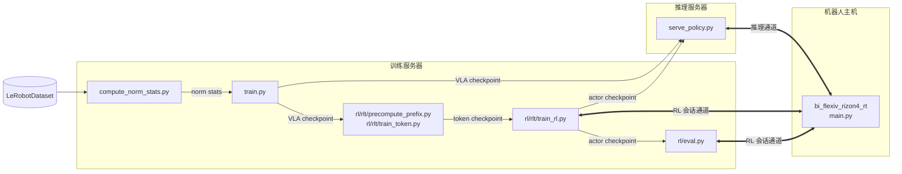
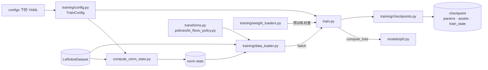
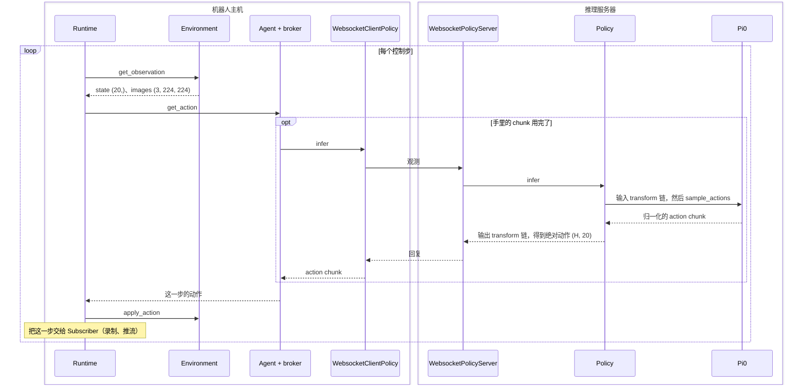
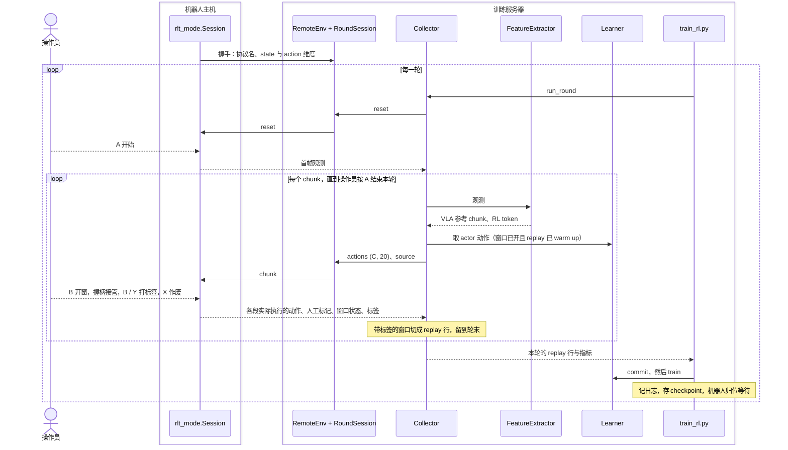
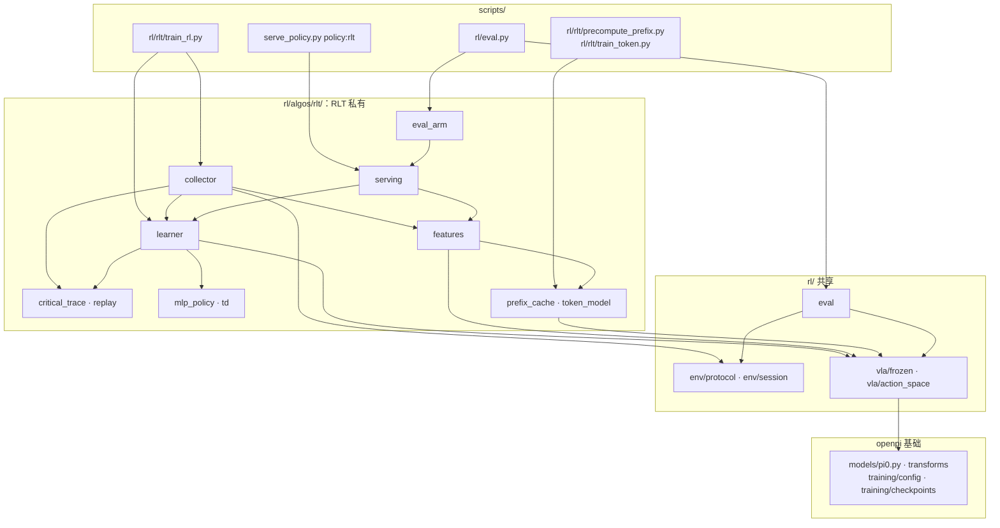

# xense-openpi 代码组织

快照：`rl-exp` 的 `bbd1c71`，已合入 `feature/rlt-jax` 的 `962f953`。两个分支的训练、推理、机器人端代码相同；RL 模块
相同、位置不同，带标签评测只在 `rl-exp` 上，对照见第 5 节。

## 1 总图



细线是产物的流向，粗线是运行时的连接。两条通道都由机器人主机拨出，都是 WebSocket 上的 msgpack，区别在谁掌握循环：

| 通道 | 机器人端怎么启动 | 谁发起每一步 | 请求 → 回复 |
|---|---|---|---|
| 推理通道 | 默认模式 | 机器人端 | 观测 → action chunk |
| RL 会话通道 | `--args.rlt` | 服务器 | `reset` / `chunk` 指令 → 实际执行的动作、人工标记、标签 |

## 2 启动入口

| 目的 | 机器 | 命令 | 输入 | 输出 |
|---|---|---|---|---|
| norm stats | 训练 | `scripts/compute_norm_stats.py --config-name <config>` | TrainConfig、数据集 | `assets/<config>/<repo_id>/` |
| SFT 训练 | 训练 | `scripts/train.py <config> --exp-name <run>` | TrainConfig、数据集、norm stats、预训练权重 | `checkpoints/<config>/<run>/<step>/`：`params`、`assets`、`train_state` |
| 推理部署 | 推理 | `scripts/serve_policy.py policy:checkpoint --policy.config <config> --policy.dir <step 目录>` | TrainConfig、checkpoint | 端口 8000 上的策略服务 |
| 机器人端 | 机器人 | `python -m examples.bi_flexiv_rizon4_rt.main --args.robot-recipe <工位> --args.host <服务器> --args.port <端口>` | recipe、可选 run YAML | 真机执行；`--args.record` 另存数据集 |
| RLT phase one | 训练 | `scripts/rl/rlt/precompute_prefix.py <rlt config>`<br>`scripts/rl/rlt/train_token.py <rlt config> --exp-name <run>` | RLT 配置、VLA checkpoint、数据集 | `<run>/token/<step>/` |
| RL 在线训练 | 训练 + 机器人 | 服务器：`scripts/rl/rlt/train_rl.py <rlt config> --exp-name <run>`<br>机器人端加 `--args.rlt --args.pico4-intervention` | RLT 配置、VLA 与 token checkpoint | `<run>/rl/<round>/learner.pkl`、`<run>/transitions/`、W&B |
| RL actor 部署 | 推理 | `scripts/serve_policy.py policy:rlt --policy.config <rlt config> --policy.exp-name <run>` | 同一个 run 的 VLA、token、actor | 策略服务，机器人端照常连 |
| 带标签评测 | 训练 + 机器人 | 服务器：`scripts/rl/eval.py <rlt config> --exp-name <run> --arm vla\|rlt --trials N --eval-name <名字>`<br>机器人端同 RL 训练 | RLT 配置、被评的策略 | `<run>/eval/<名字>/trials.jsonl` |

`<run>` 指 `<checkpoint_base_dir>/<rlt config>/<exp-name>/`。

基础策略没有离线评测脚本，也没有单独的带标签评测：`scripts/rl/eval.py` 只接受 RLT 配置，`--arm vla` 评纯 VLA 也要
这个 run 的 token checkpoint。

## 3 文件地图

### 3.1 入口与配置

```text
scripts/
  compute_norm_stats.py        算 state / action 的归一化统计
  train.py                     JAX SFT 训练
  train_pytorch.py             PyTorch SFT 训练
  serve_policy.py              策略服务：policy:checkpoint 或 policy:rlt
  rl/rlt/precompute_prefix.py  phase one 第 1 步：缓存冻结 VLA 的 prefix hidden states
  rl/rlt/train_token.py        phase one 第 2 步：训练 RL token 编解码器
  rl/rlt/train_rl.py           phase two：在线 RL 的训练服务器
  rl/eval.py                   带标签评测的服务器
  dump_config_to_yaml.py  inspect_checkpoint.py  repair_episodes.py  check_cuda_stack.py    工具

configs/
  <name>.yaml                  TrainConfig，本机私有，不进 git
  _examples/<name>.yaml        TrainConfig，共享
  rl/rlt/<name>.yaml           RLT 配置：引用一个 TrainConfig 和 VLA checkpoint
```

### 3.2 `src/openpi/` 基础部分

```text
src/openpi/
  training/
    config.py            TrainConfig、各机器人的 DataConfig、get_config(name)
    yaml_loader.py       YAML ↔ TrainConfig
    registry.py          YAML 里的 type 名 → Python 类
    data_loader.py       数据集 → 过 transform 链 → batch
    checkpoints.py       checkpoint 目录的保存、恢复，读 norm stats
    weight_loaders.py    加载预训练权重
    optimizer.py         学习率日程与优化器
    sharding.py          多卡与 FSDP
  models/
    model.py             Observation、BaseModel 接口、restore_params
    pi0_config.py        Pi0Config：π0 / π0.5、LoRA、训练时 RTC 的开关
    pi0.py               π0 / π0.5：compute_loss、sample_actions、sample_actions_with_prefix
    pi0_fast.py          π0-FAST
    gemma.py  siglip.py  vit.py  lora.py  tokenizer.py    骨干与分词
  models_pytorch/        PyTorch 版模型
  transforms.py          通用 transform：改列名、归一化、delta 动作、分词、缩放
  policies/
    policy.py            Policy：模型 + 输入输出 transform 链 → infer(obs)
    policy_config.py     create_trained_policy(TrainConfig, checkpoint) → Policy
    bi_flexiv_policy.py  双臂 Flexiv 的 Inputs / Outputs
    xtac_umi_policy.py  dobot_nova5_policy.py  droid_policy.py  aloha_policy.py    其他机器人
  serving/
    websocket_policy_server.py    把一个 BasePolicy 挂到 WebSocket 端口
  shared/                norm stats 读写、下载、图像工具、JAX 模块工具
  rl/                    见 3.4
```

### 3.3 机器人端

```text
packages/xense-client/src/xense_client/     轻量包，机器人端和服务器端都装
  base_policy.py              BasePolicy 接口：infer(obs) → dict
  websocket_client_policy.py  远程策略：一次 infer 就是一次 WebSocket 往返
  action_chunk_broker.py      同步 broker：一个 chunk 逐步发完再请求下一个
  rtc_action_chunk_broker.py  RTC broker：后台线程提前推理，新 chunk 接进动作队列
  action_queue.py  latency_tracker.py    RTC broker 用的队列与延迟统计
  paced_broker.py             给双线程循环用的定速包装
  msgpack_numpy.py            numpy 的 msgpack 编解码，两条通道都用
  image_tools.py              图像缩放补边
  runtime/
    environment.py  agent.py  subscriber.py    三个接口
    runtime.py                单线程控制循环
    decoupled_runtime.py      观测和动作各一个线程的循环
    agents/policy_agent.py    把 Policy 包成 Agent

examples/
  run_config.py          run YAML → 命令行参数的默认值
  flexiv_recipe.py       recipe YAML → lerobot 的机器人配置
  bi_flexiv_rizon4_rt/
    main.py              启动入口：按参数拼出 Environment、broker、Agent、Runtime
    env.py               Environment 实现：整理观测、缩放图像、下发动作
    real_env.py          包住 lerobot 的 BiFlexivRizon4RT 驱动
    recipe.py  recipes/  工位硬件：机械臂、相机、夹爪
    runs/                启动参数预设
    intervention.py      Pico4 接管：控制器，以及 Environment 和 Agent 的包装
    button_edges.py      按键去抖
    recorder.py          Subscriber：录成 LeRobot 数据集
    subscribe.py         Subscriber：把观测推给下游机器
    rlt_mode.py          --args.rlt：RL 会话的机器人端，按键状态机 + 执行 chunk
  flexiv_rizon4_rt/  tron2_rt/  xtac_umi_bi_flexiv_rizon4_rt/  bi_arx5_real/    其他机器人，结构类似
```

### 3.4 `src/openpi/rl/`（`rl-exp` 布局）

```text
src/openpi/rl/
  env/protocol.py        RemoteEnv：服务器端的机器人连接，协议 openpi-rlt/1
  env/session.py         RoundSession：一轮的 reset 与 chunk 往返，回报 → 窗口事件
  vla/frozen.py          FrozenVLA：加载冻结 VLA，给出 transform 和身份指纹
  vla/action_space.py    ActionSpace：归一化动作 ↔ 机器人绝对动作
  eval.py                Evaluation 与 Arm 接口：带标签评测
  run_logger.py          RunLogger：W&B 与 events.jsonl
  layering_test.py       检查依赖方向
  algos/rlt/                 RLT 私有
    config.py            RLTConfig 与 YAML 加载
    prefix_cache.py      phase one：prefix hidden states 的落盘缓存
    token_model.py       phase one：RL token 编解码器
    features.py          FeatureExtractor：观测 → 参考 chunk + RL token
    mlp_policy.py        actor 与 critic 网络
    td.py                critic loss 与 actor loss
    critical_trace.py    窗口内的逐步记录 → transition
    replay.py            replay buffer
    learner.py           Learner：出动作、训练、存取 checkpoint
    collector.py         Collector：一轮采集
    diagnostics.py       只做统计和落盘的诊断
    serving.py           RLTPolicy：接到 serve_policy.py policy:rlt
    eval_arm.py          评测用的 rlt、vla 两个 arm
```

## 4 模块交互

### 4.1 SFT 训练



机器人数据和模型之间只有一条 transform 链，训练和部署共用，由 TrainConfig 的 `data.type` 决定：

```text
进模型：机器人格式 → 改列名 → 机器人专属 Inputs → DeltaActions → Normalize → 模型专属（缩放、分词、补齐维度）
出模型：模型输出 → Unnormalize → AbsoluteActions → 机器人专属 Outputs → 机器人格式
```

双臂 Flexiv：state 和 action 都是 20 维 = 左臂 TCP 9（xyz + rot6d）+ 右臂 TCP 9 + 左右夹爪各 1。模型内部 18 个 TCP 维
是相对当前 state 的 delta，夹爪是绝对值；机器人端收发的都是绝对动作。

### 4.2 推理部署



- `Environment` 是机器人端唯一接触硬件的接口：`env.py` → `real_env.py` → lerobot 驱动。dry-run 和 Pico4 接管是包在
  它外面的一层。
- broker 决定 chunk 怎么用。同步 broker 推理时机器人等待；RTC broker 在后台提前推理，不等。
- 机器人端发的是整份观测，里面还有给录制用的原始分辨率 `images_raw`，服务端不读它。观测里没有 prompt，由服务端的
  default prompt 补上。

### 4.3 RL 在线训练



「窗口」是操作员用按键划出的一段关键阶段。只有带标签窗口里的数据进 replay，actor 只在窗口内驾驶。评测
（`rl/eval.py`）用同一张图：`Collector` 换成 `Evaluation`，`Learner` 换成一个冻结的 `Arm`，一个带标签的窗口算一次
trial，不训练。

RL 会话通道的接口（协议 `openpi-rlt/1`）：

| 请求 | 服务器给 | 机器人回 |
|---|---|---|
| `reset` | 接管的位移与转角阈值、窗口内采观测的步长 | 首帧观测 |
| `chunk` | `actions (C, 20)` 绝对动作；`source` 是 `actor` 或 `vla` | 若干 segment：执行后的观测、实际执行的动作、逐步人工标记、窗口状态、标签、轮结束、作废；另有窗口内采的观测 |
| `status` | 给操作员看的一行文本 | 不回复 |
| `close` | 无 | 空回复 |

`rlt_mode.Session` 只通过两个接口接触硬件：`env`（与推理用的同一个 `Environment`）和 `controller`（按键事件、是否在
接管、接管时的动作）。

### 4.4 RL 模块的依赖

箭头表示「依赖」。算法私有的模块依赖共享模块，共享模块不依赖算法；`rl/` 之外的 openpi 不依赖 `openpi.rl`。
`layering_test.py` 检查这两条。



图里省略了 `run_logger`（`collector` 和 `eval` 用它记日志）和 `diagnostics`。

每个模块的输入输出：

| 模块 | 输入 | 输出 |
|---|---|---|
| `RemoteEnv` | 请求 dict | 回复 dict；断线时报错 |
| `RoundSession` | `(actions, source)` | 各段执行结果，以及开窗、无标签关窗、标签、作废这些事件 |
| `FrozenVLA` | TrainConfig 名 + checkpoint | 模型、与部署一致的 transform、身份指纹 |
| `ActionSpace` | 绝对动作 + state，或归一化动作 + state | 另一种表示（`encode` / `decode`） |
| `Evaluation` | 一个 `Arm`、目标 trial 数 | `trials.jsonl`、成功率 |
| `Arm` | 观测、窗口是否开着 | `(chunk, source)` |
| `FeatureExtractor` | 观测 | RL token、state、归一化的参考 chunk、可直接执行的参考 chunk |
| `Learner` | 特征；replay 行 | actor 动作；梯度更新；checkpoint |
| `Collector` | 一轮会话 | replay 行与指标 |
| `RLTPolicy`（serving） | 观测，可选 `rlt_switch` | `{actions}`，actor 或 VLA 的 |

基础代码为 RL 改了四处：`Pi0.sample_actions_with_prefix`、`checkpoints.save_train_state`、`yaml_loader.construct`
改为公开、`serve_policy.py` 的 `policy:rlt` 分支。

## 5 两个分支的位置对照

| 内容 | `feature/rlt-jax` | `rl-exp` |
|---|---|---|
| 机器人连接 | `src/openpi/rlt/env_protocol.py` | `src/openpi/rl/env/protocol.py` |
| 一轮会话 | 写在 `collector.py` 里 | `src/openpi/rl/env/session.py` |
| 冻结 VLA、动作表示 | `src/openpi/rlt/vla.py`、`action_space.py` | `src/openpi/rl/vla/` |
| RLT 其余模块 | `src/openpi/rlt/` | `src/openpi/rl/algos/rlt/` |
| serving | `src/openpi/policies/rlt_policy.py` | `src/openpi/rl/algos/rlt/serving.py` |
| 入口脚本 | `scripts/rlt/` | `scripts/rl/rlt/` |
| 配置 | `configs/rlt/` | `configs/rl/rlt/` |
| 评测 | 没有 | `src/openpi/rl/eval.py`、`scripts/rl/eval.py` |
| 机器人端 | `examples/bi_flexiv_rizon4_rt/rlt_mode.py` | 同左 |

## 6 仍带 RLT 假设的接口

目前只有 RLT 一个算法。加第二个算法之前，下面每一处都要先决定是沿用、放宽还是另写。

| 接口 | 现在的假设 | 位置 |
|---|---|---|
| 窗口语义 | 机器人只在窗口内采观测，拒绝执行窗口外的 actor 指令 | `rlt_mode.py`、`env/session.py` |
| 机器人端 | 放在一个机器人的 `examples/` 下，state 和 action 维度写死 20，开关叫 `--args.rlt` | `rlt_mode.py`、`main.py` |
| 动作表示 | VLA 用 quantile 归一化，恰好一个 `DeltaActions` mask，delta 维度是整数个 xyz + rot6d 臂块 | `vla/action_space.py` |
| 训练入口与循环 | 每个算法一套脚本；「谁驾驶、何时算特征、何时训练」写在 RLT 的代码里 | `scripts/rl/rlt/`、`collector.py` |
| 评测入口 | 只接受 RLT 配置，直接构造 RLT 的 arm | `scripts/rl/eval.py` |
| 模型钩子 | 一次前向只采一个 chunk | `models/pi0.py` |
| 协议名 | `openpi-rlt/1`，服务器端和机器人端各存一份常量 | `env/protocol.py`、`rlt_mode.py` |
