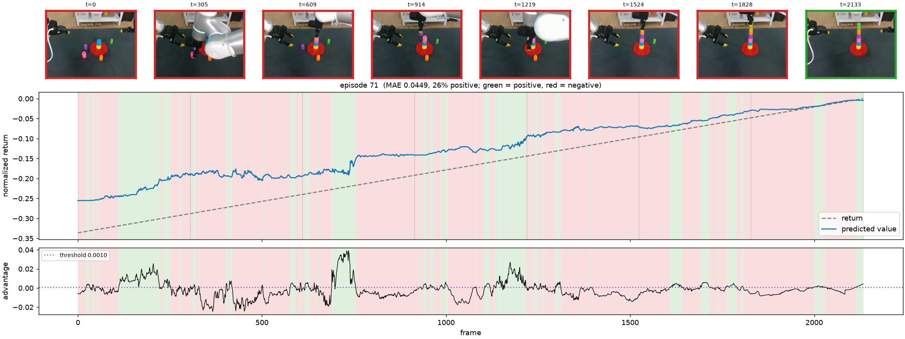
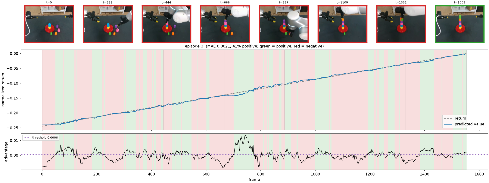
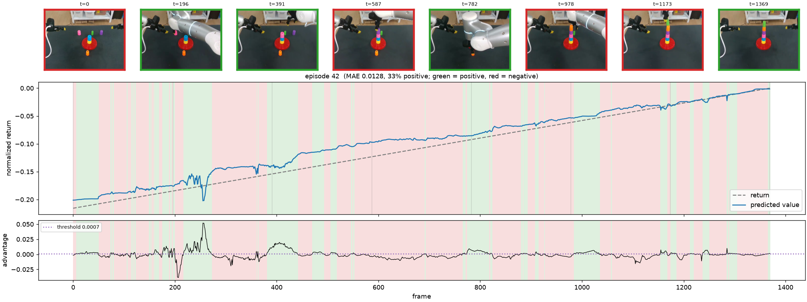
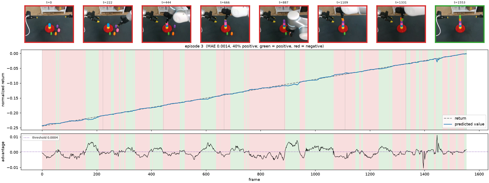
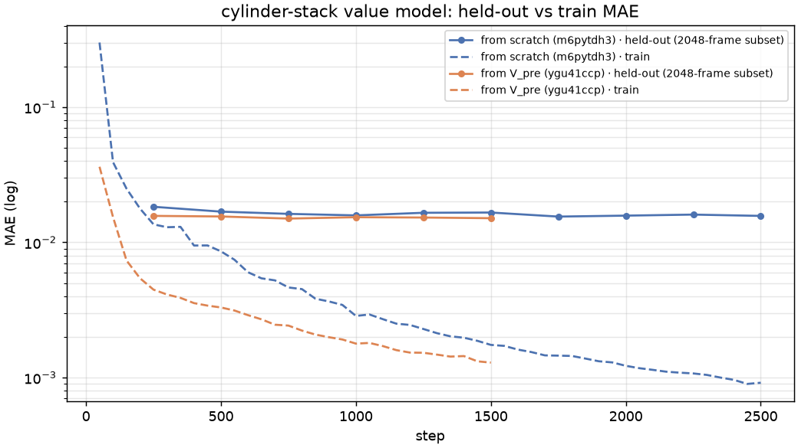

# xense-openpi 实验记录

按时间倒序记录外部启动的实验。每节依次保留原始记录、结果分析和下一步；观测、推断与未验证猜想分开。
训练契约见 [rlt-spec.md](rlt-spec.md)，已确认工作见 [plan.md](plan.md)。

## π*0.6 价值模型的图：各目录对应哪次实验

本文件按时间倒序，新的在上面；这一节是索引，固定放最前。图都在 `figures/pi-star-06/` 下。$V$ 曲线图每条 episode 一张：上排是 head 相机等间隔的 8 帧（标题 `t=` 是帧号），
下面蓝线是模型预测的 $\hat V$，灰虚线是 return（标签），标题里的 MAE 是这条 episode 的平均绝对误差。cylinder-stack 的
留出 episode 始终是同一批 15 条（42、53、54、68、71、72、88、93、97、100、114、117、119、143、149）。

| 目录 | 哪次实验（W&B run） | 模型与数据 | 正文 |
|---|---|---|---|
| `value-cylinder-1114-s750/` | 从头训练，固定 750 步（`cu25wtuk`） | cylinder-stack 留出 15 条的 $V$ 曲线 | [value-cylinder-1114](#2026-11-14--value-cylinder-1114--recap-价值模型在单任务示范上的训练耗时与过拟合) |
| `value-cylinder-scratch-ed0e224/` | 从头训练，早停，步 1750 最优（`m6pytdh3`），对照用的从头基线 | 同一批 15 条的 $V$ 曲线 | [cylinder-stack 上的对照结果](#cylinder-stack-上的对照结果2026-11-15) |
| `value-pretrain-10ds-ed0e224/<数据集>/` | 10 个数据集的预训练 $V_{\mathrm{pre}}$（`gty4r7z9`） | 每个预训练数据集 2 条留出 episode 的 $V$ 曲线 | [预训练运行](#预训练运行-value-pretrain-10ds-ed0e224) |
| `value-cylinder-zeroshot-vpre/` | $V_{\mathrm{pre}}$ 不微调，直接在 cylinder-stack 上预测（`bcmqljyw`） | 同一批 15 条的 $V$ 曲线 | [cylinder-stack 上的对照结果](#cylinder-stack-上的对照结果2026-11-15) |
| `value-cylinder-finetune-vpre/` | 从 $V_{\mathrm{pre}}$ 微调，步 750 最优（`ygu41ccp`） | 同一批 15 条的 $V$ 曲线 | 同上 |
| `value-cylinder-mae-curves.png` | `m6pytdh3` 与 `ygu41ccp` 两次训练 | 留出 MAE 与训练 MAE 随步数 | 同上 |
| `advantage-labels-cylinder-scratch-ed0e224/heldout/` | 从头基线 `m6pytdh3` 的权重，不再训练，只预测（没有 W&B run） | 同一批 15 条留出 episode，带优势标签 | [带优势标签的门禁图](#2026-11-15--带优势标签的门禁图留出与训练-episode) |
| `advantage-labels-cylinder-scratch-ed0e224/train/` | 同上，同一份权重 | 训练集前 15 条（episode 0–14），模型训练时见过，带优势标签 | 同上 |
| `advantage-labels-cylinder-finetune-vpre/{heldout,train}/` | 旧 $V_{\mathrm{pre}}$ 微调 `ygu41ccp` 的权重，不再训练（没有新的 W&B run） | `heldout/` 是同一批 15 条留出 episode，`train/` 是训练集前 15 条（episode 0–14，训练时见过）；带优势标签，另有同名视频 | [清理数据后重训](#2026-11-16--清理数据后重训预训练价值模型与-cylinder-stack-对照) |
| `advantage-labels-cylinder-finetune-vpre-clean/{heldout,train}/` | 从清理数据后的新 $V_{\mathrm{pre}}$ 微调，步 500 最优（`r3rdr7gj`） | 同上 | 同上 |
| `advantage-labels-cylinder-zeroshot-vpre-clean/heldout/` | 新 $V_{\mathrm{pre}}$ 不微调，直接预测（`y22dnkkh`） | 同上 | 同上 |
| `data-check/<数据集>/episode_XXXX.png` | 预训练数据检查（不是训练） | 被标为可疑的 episode，每条 6 帧 head 相机图，标题写原因与时长数字 | [可疑清单](#可疑清单) |

带优势标签的图在 $V$ 曲线图上多三样：曲线背景绿色的帧是 positive、红色是 negative；上排每帧图的边框是该帧标签的
颜色；最下一栏黑线是优势估计 $\hat A_t$，紫色虚线是阈值，黑线在阈值之上的帧为 positive。$\hat A_t$ 在第 $t$ 帧看的是
之后 50 帧里 $\hat V$ 涨得比 return 的固定斜率快还是慢，所以绿色段比 $\hat V$ 的上升段早开始，最多早 50 帧（1.7 秒）。

## 2026-11-16 · 清理数据后重训预训练价值模型与 cylinder-stack 对照

**当前结论**

- 用户决定（2026-11-16）：本事务到此收尾。现在只有成功数据，目标任务初始化时全部帧标 positive，优势标签用不上，
  继续探究意义不大。$N$ 与 positive 比例怎么选、训练时见过的数据上标签怎么打（见本节末）、训练与部署的细节，
  等有失败数据混在一起训练时再讨论。下面的图与数字留作那时的起点。
- 清理数据后，预训练自己的验证指标变好：各数据集平均 val MAE 从 0.0209 降到 0.0163，相关系数从 0.897 升到 0.968。
  pick_up_cube 的相关系数从 0.41 回到 0.97，原因是 4914 帧的 episode 168 不在留出集里了。
- 在 cylinder-stack 上没有变好。新微调留出 MAE 0.0164，旧微调 0.0150，从头 0.0156；三者相差约 0.001，只有一个
  seed，分不出高下。新零样本 MAE 0.0507（旧 0.0526），相关系数 0.580（旧 0.748）。
- 新微调的优势标签仍集中在夹爪开合之前，幅度比旧微调小：之后 50 帧内有开合的帧里 positive 占 48.5%，其余帧
  35.5%（旧微调 56.1% 与 31.4%，从头 50.4% 与 34.4%）。
- 在训练时见过的 episode 上（下游实际要标的就是这种），三个模型的标签都比留出组差：$\hat A_t$ 的幅度是留出组的
  1/4 到 1/2，两个模型之间的标签一致率只有 55–61%（随机 52%，留出组 64–70%）。训练步数少的模型保留的结构多一些：
  开合前 50 帧 positive 的比例，旧微调 48.2%（其余帧 35.7%），新微调 44.1%（37.8%），从头 41.4%（39.3%）。
- 前后两版预训练不只差清理：earbud 从 776 条的 `_left_right` 仓库换成 888 条的仓库；清理过的数据集按 seed 现算
  的留出划分也变了。上面第一条里"变好"有多少来自清理、多少来自换了留出 episode，分不开（pick_up_cube 那一条除外）。

### 预训练运行 `value-pretrain-10ds-clean-2b7bb10`

W&B [dhkgxqz9](https://wandb.ai/XenseRobotics/pi06-recap-value/runs/dhkgxqz9)，方法仓库 `2b7bb10`，超参与上一版
`gty4r7z9` 相同（`--num-train-steps 20000 --eval-interval 1000 --patience 5 --final-episodes 2 --num-workers 64`）。
2026-11-16 00:04 启动、03:16 结束，共 3 小时 10 分，退出码 0，日志无 NaN 与 Traceback。步 12000 最优，步 17000 早停
（上一版也是这两个步数）。稳态 0.37 s/步（上一版 0.48 s）。最优步时 train MAE 0.0020（上一版 0.0019）。权重在
`xense-train-01:/root/localstorage/pi06/runs/value-pretrain-10ds-clean-2b7bb10/params`，2026-11-16 另传了一份到 COS：
`cos://data-1460349206/xense_checkpoints/pi06_recap_value_checkpoints/value-pretrain-10ds-clean-2b7bb10/12000/`（`params/` 与 `heldout_predictions.parquet`，15 个文件、2.1 GB，
与训练机上逐个文件大小相同）。其余运行的权重只在训练机上。

数据：egg、whiteboard、cube-color、stack-cubes、earbud（888 条的仓库）用清理后的副本，pick_up_cube 用删掉 168 的
副本，shoe、assemble_box、unscrew、fold 没变；清理前后的数字见[清理结果](#清理结果)。

步 12000 的周期验证，新旧两版并列（MAE / 相关系数）：

| 数据集 | 训练 / 留出 episode（新） | 新 `dhkgxqz9` | 旧 `gty4r7z9` | 数据有没有变 |
|---|---|---|---|---|
| newbalance_shoe | 318 / 35 | 0.0133 / 0.978 | 0.0143 / 0.971 | 没变 |
| whiteboard_inspect | 265 / 30 | 0.0112 / 0.986 | 0.0177 / 0.927 | 删 6 条 |
| egg_carton_to_tray（bi_elite） | 109 / 12 | 0.0178 / 0.966 | 0.0172 / 0.966 | 删 1 条 |
| assemble_box | 186 / 21 | 0.0114 / 0.986 | 0.0125 / 0.983 | 没变 |
| earbud_case | 797 / 89 | 0.0122 / 0.987 | 0.0153 / 0.974 | 换仓库，删 2 条 |
| stack-cubes-flexiv | 149 / 17 | 0.0167 / 0.968 | 0.0182 / 0.968 | 删 4 条 |
| pick_up_cube | 179 / 20 | 0.0181 / 0.972 | 0.0381 / 0.413 | 删 1 条（168） |
| cube-color-sorting | 89 / 10 | 0.0159 / 0.972 | 0.0285 / 0.936 | 删 2 条 |
| unscrew-the-bottle-cap | 90 / 10 | 0.0266 / 0.922 | 0.0290 / 0.887 | 没变 |
| fold-the-towel | 90 / 10 | 0.0194 / 0.937 | 0.0185 / 0.945 | 没变 |
| 平均 | | 0.0163 / 0.968 | 0.0209 / 0.897 | |

- pick_up_cube 的相关系数从步 1000 起就在 0.962–0.975，上一版全程 0.41。
- 降得多的是 pick_up_cube、cube-color、whiteboard 三个，都是删掉了超长或结尾静止的 episode 的数据集。这三个的
  留出划分也变了，被删的 episode 原先在不在留出集里没有逐个查（pick_up_cube 168 在）。
- 数据没变的四个里，shoe、assemble_box、unscrew 略好，fold 略差，幅度 0.001–0.003。

结尾在每个数据集前 2 个留出 episode 上整段预测（最优步权重）。清理过的数据集这 2 条与上一版不是同一批，只能看量级：

| 数据集 | MAE | 相关系数 | 交叉熵 |
|---|---|---|---|
| newbalance_shoe | 0.0248 | 0.957 | 7.20 |
| whiteboard_inspect | 0.0222 | 0.995 | 8.76 |
| egg_carton_to_tray（bi_elite） | 0.0103 | 0.992 | 5.93 |
| assemble_box | 0.0129 | 0.997 | 4.88 |
| earbud_case | 0.0247 | 0.994 | 7.47 |
| stack-cubes-flexiv | 0.0134 | 0.985 | 6.09 |
| pick_up_cube | 0.0152 | 0.997 | 8.99 |
| cube-color-sorting | 0.0192 | 0.985 | 9.14 |
| unscrew-the-bottle-cap | 0.0342 | 0.967 | 10.15 |
| fold-the-towel | 0.0287 | 0.973 | 11.59 |
| 平均 | 0.0206 | 0.984 | 8.02 |

上一版的平均是 0.0237 / 0.974 / 7.25。这次没有给预训练数据集出 $V$ 曲线图。

### cylinder-stack 上的对照

新权重的零样本与微调，设置与上一版相同（seed 0、5000 步、每 250 步验证、patience 3），只差 `--init-params`。留出
episode 列表与上一版逐个相同（15 条，23,415 帧）。

| 初始化 | 最优步数 | 留出 MAE | 相关系数 | 留出交叉熵 | 最优步时 train MAE |
|---|---|---|---|---|---|
| 从头（`m6pytdh3`） | 1750 | 0.0156 | 0.959 | 4.90 | 0.0015 |
| 旧 $V_{\mathrm{pre}}$ 零样本（`bcmqljyw`） | — | 0.0526 | 0.748 | 6.12 | — |
| 从旧 $V_{\mathrm{pre}}$ 微调（`ygu41ccp`） | 750 | 0.0150 | 0.958 | 4.47 | 0.0024 |
| 新 $V_{\mathrm{pre}}$ 零样本（`y22dnkkh`） | — | 0.0507 | 0.580 | 6.78 | — |
| 从新 $V_{\mathrm{pre}}$ 微调（`r3rdr7gj`） | 500 | 0.0164 | 0.953 | 4.19 | 0.0032 |

- **微调**：步 250 的留出 MAE 是 0.0167，步 500 最优（0.0164），步 1250 早停。比旧微调高 0.0014，比从头高 0.0008。
  逐 episode 与旧微调比：54、97、100、117、143 上好，42、53、68、71、72、88、93、114、119、149 上差，单条差距多在
  0.001–0.005。最差的仍是 71（0.045）与 119（0.031）。episode 71 的样子与之前一样：起点预测 −0.255（真值 −0.335），
  中段整体偏高。
- **零样本**：首帧预测的均值是 −0.226（真值 −0.246，旧零样本 −0.151），起点的整体偏高小了。相关系数反而更低。
  逐 episode 看，15 条里 10 条的 MAE 比旧零样本低，但 119（0.019 → 0.055）与 149（0.012 → 0.059）差了很多，
  71、93、114 也略差。episode 71 上预测在第 210–300 帧从 −0.20 跳到 −0.06，之后 1700 帧基本不动。
- 微调后这些差别都被抹平，零样本的好坏没有传到微调结果上。

逐 episode 的留出 MAE：

| episode | 从头 | 旧微调 | 新微调 | 旧零样本 | 新零样本 |
|---|---|---|---|---|---|
| 42 | 0.0128 | 0.0094 | 0.0121 | 0.0495 | 0.0377 |
| 53 | 0.0118 | 0.0145 | 0.0171 | 0.0923 | 0.0834 |
| 54 | 0.0186 | 0.0213 | 0.0203 | 0.0451 | 0.0277 |
| 68 | 0.0214 | 0.0206 | 0.0219 | 0.0678 | 0.0664 |
| 71 | 0.0384 | 0.0400 | 0.0449 | 0.0876 | 0.0976 |
| 72 | 0.0076 | 0.0077 | 0.0088 | 0.0927 | 0.0767 |
| 88 | 0.0064 | 0.0052 | 0.0062 | 0.0519 | 0.0387 |
| 93 | 0.0115 | 0.0061 | 0.0074 | 0.0395 | 0.0404 |
| 97 | 0.0056 | 0.0055 | 0.0045 | 0.0413 | 0.0319 |
| 100 | 0.0098 | 0.0132 | 0.0118 | 0.0374 | 0.0253 |
| 114 | 0.0134 | 0.0095 | 0.0142 | 0.0182 | 0.0239 |
| 117 | 0.0083 | 0.0067 | 0.0043 | 0.0416 | 0.0384 |
| 119 | 0.0276 | 0.0277 | 0.0305 | 0.0187 | 0.0545 |
| 143 | 0.0205 | 0.0169 | 0.0163 | 0.0372 | 0.0218 |
| 149 | 0.0124 | 0.0120 | 0.0167 | 0.0115 | 0.0594 |

Agent 推断（2026-11-16）：与上一轮的结论一致，cylinder-stack 上的留出误差卡在 0.015 上下，由标签本身决定（首帧
看不出这条 episode 会有多长），换一个更干净的预训练权重改不了它。清理数据的收益在预训练数据集自己的指标上，
没有在这个下游对照里体现；这只是一个任务、一个 seed 的结果。

### 三个模型的带标签图与视频

同一批 15 条留出 episode，$N=50$、40% positive，每个模型各自取阈值。图与视频（视频与图同名，扩展名 `.mp4`，不进仓库）：
[从头](figures/pi-star-06/advantage-labels-cylinder-scratch-ed0e224/heldout/)、
[旧微调](figures/pi-star-06/advantage-labels-cylinder-finetune-vpre/heldout/)、
[新微调](figures/pi-star-06/advantage-labels-cylinder-finetune-vpre-clean/heldout/)；另出了一组
[新零样本](figures/pi-star-06/advantage-labels-cylinder-zeroshot-vpre-clean/heldout/)（计划外，顺手出的）。
新微调的 episode 71：

| | 从头 | 旧微调 | 新微调 | 新零样本 |
|---|---|---|---|---|
| 阈值 | 0.00074 | 0.00081 | 0.00101 | −0.00010 |
| $\hat A_t$ 标准差 | 0.0100 | 0.0094 | 0.0077 | 0.0325 |
| 标签每秒翻转次数 | 1.59 | 1.66 | 1.96 | 1.58 |
| 之后 50 帧内有开合的帧里 positive 的比例 | 50.4% | 56.1% | 48.5% | 没算 |
| 其余帧里 positive 的比例 | 34.4% | 31.4% | 35.5% | 没算 |

两两之间的标签一致率（两边各 40% positive 时随机一致是 52%）：

| | 标签一致的帧 | $\hat A_t$ 的相关系数 |
|---|---|---|
| 从头 与 旧微调 | 65.5% | 0.154 |
| 从头 与 新微调 | 63.8% | 0.178 |
| 旧微调 与 新微调 | 70.4% | 0.366 |

新微调按夹爪开合时刻展开（算法与[用夹爪开合时刻核对](#用夹爪开合时刻核对)相同，72 次合爪、62 次开爪，全体 40%）：

| 相对起点的帧 | −150 | −125 | −100 | −75 | −50 | −25 | 0 | +25 | +50 | +75 | +100 |
|---|---|---|---|---|---|---|---|---|---|---|---|
| 新微调，留出，合爪 | 43% | 47% | 54% | 46% | 47% | 54% | 52% | 44% | 40% | 30% | 29% |
| 新微调，留出，开爪 | 36% | 32% | 31% | 27% | 35% | 47% | 52% | 46% | 42% | 46% | 47% |

- 合爪前 100 帧到合爪开始后的 25 帧，positive 是 46–54%；另外两个模型也集中在合爪之前。
- 开爪前的集中比旧微调弱、也晚：旧微调在 −50 到 0 是 50%、67%、53%，新微调是 35%、47%、52%，开爪之后仍在
  42–47%。
- 两个微调模型之间的一致率（70.4%）高于它们各自与从头模型的一致率（约 64–66%）。
- 新微调的 $\hat A_t$ 幅度更小、翻转更密。Agent 推断：它在步 500 就停了，$\hat V$ 更平滑地贴着直线，优势更多地
  落在阈值附近。没有单独验证。

### 训练 episode 上的标签（用户要求，2026-11-16 追加）

下游 SFT 要标的是价值模型训练时见过的数据，所以给旧微调与新微调补了训练 episode 上的图。做法与从头模型那组相同：
权重不再训练，`--num-train-steps 0 --final-train-episodes 15`，对训练集前 15 条（episode 0–14，共 24,116 帧）整段
预测。三个模型的训练划分相同（seed 0），这 15 条它们训练时都见过。同时重算的留出预测与原运行一致（旧微调
0.0150 / 0.957，新微调 0.0164 / 0.953）。图与视频：
[从头](figures/pi-star-06/advantage-labels-cylinder-scratch-ed0e224/train/)、
[旧微调](figures/pi-star-06/advantage-labels-cylinder-finetune-vpre/train/)、
[新微调](figures/pi-star-06/advantage-labels-cylinder-finetune-vpre-clean/train/)。旧微调的训练 episode 3：

| 训练 15 条 | 从头（步 1750） | 旧微调（步 750） | 新微调（步 500） |
|---|---|---|---|
| MAE / 相关系数 | 0.0014 / 0.9996 | 0.0023 / 0.9991 | 0.0030 / 0.9985 |
| 阈值 | 0.00039 | 0.00056 | 0.00060 |
| $\hat A_t$ 标准差（留出组的值） | 0.0025（0.0100） | 0.0034（0.0094） | 0.0039（0.0077） |
| 标签每秒翻转次数 | 1.81 | 1.84 | 2.27 |
| positive 片段时长：中位 / 平均 / 90 分位 | 0.17 / 0.44 / 1.40 s | 0.13 / 0.43 / 1.50 s | 0.10 / 0.35 / 1.10 s |
| $\hat A_t$ 离阈值不到 0.001 的帧 | 35% | 26% | 24% |
| 之后 50 帧内有开合的帧里 positive 的比例 | 41.4% | 48.2% | 44.1% |
| 其余帧里 positive 的比例 | 39.3% | 35.7% | 37.8% |
| 1 秒以上的 positive 片段里，碰到开合前帧的 | 110 段中 63 段（57%） | 117 段中 68 段（58%） | 113 段中 60 段（53%） |

从头那一列与 2026-11-15 的数字逐项相同，说明这次的算法没有变。

两两之间，训练组与留出组并列：

| | 标签一致的帧：训练 / 留出 | $\hat A_t$ 相关系数：训练 / 留出 | $\hat V-R$ 相关系数：训练 / 留出 |
|---|---|---|---|
| 从头 与 旧微调 | 56.5% / 65.5% | 0.161 / 0.154 | 0.049 / 0.828 |
| 从头 与 新微调 | 55.1% / 63.8% | 0.149 / 0.178 | 0.029 / 0.845 |
| 旧微调 与 新微调 | 61.0% / 70.4% | 0.260 / 0.366 | 0.095 / 0.913 |

按夹爪开合时刻展开（训练 15 条，80 次合爪、67 次开爪，全体 40%）：

| 相对起点的帧 | −150 | −125 | −100 | −75 | −50 | −25 | 0 | +25 | +50 | +75 | +100 |
|---|---|---|---|---|---|---|---|---|---|---|---|
| 从头，训练，合爪 | 35% | 37% | 39% | 35% | 37% | 34% | 45% | 50% | 43% | 44% | 44% |
| 从头，训练，开爪 | 44% | 38% | 40% | 40% | 42% | 47% | 36% | 29% | 37% | 35% | 38% |
| 旧微调，训练，合爪 | 43% | 46% | 43% | 38% | 44% | 48% | 36% | 38% | 38% | 35% | 31% |
| 旧微调，训练，开爪 | 42% | 34% | 30% | 37% | 52% | 50% | 39% | 31% | 39% | 51% | 48% |
| 新微调，训练，合爪 | 39% | 49% | 51% | 45% | 43% | 40% | 31% | 38% | 39% | 37% | 34% |
| 新微调，训练，开爪 | 37% | 28% | 25% | 29% | 30% | 51% | 53% | 40% | 29% | 41% | 50% |

- **见过的 episode 上，标签更多取决于是哪个模型。** 留出组里两个模型的残差高度相关（0.83–0.91，对同一条 episode
  偏高偏低的看法一致），训练组里几乎不相关（0.03–0.10）；标签一致率从 64–70% 降到 55–61%，离随机的 52% 不远。
- **训练得少的模型，训练组上的标签更像留出组。** 旧微调（步 750）在合爪前 25 帧与开爪前 50 帧是 48–52%，位置与
  留出组一致；从头模型（步 1750）的集中出现在合爪之后，开合前后几乎分不出（41% 对 39%）。训练 MAE 越低，
  $\hat A_t$ 幅度越小，离阈值不到 0.001 的帧越多。
- 新微调翻转最密（每秒 2.27 次），positive 片段最短。

Agent 推断（2026-11-16）：价值模型把训练 episode 的 return 背得越准，$\hat V$ 越贴直线，优势里与任务有关的部分
越小，剩下的是拟合残差。直接用同一个模型给自己的训练数据打标签，标签质量低于留出图上看到的；留出图是上限。
可选的做法有两个，都没有做，需要用户决定：把数据分成几份，每份用没见过它的模型来标（交叉标注）；或者故意用
训练步数少的权重来标。只有 15 条 episode、每个设置一个 seed。

## 2026-11-15 · 预训练数据检查与清理

重训 $V_{\mathrm{pre}}$ 之前对 10 个预训练数据集加 cylinder-stack 做的检查，以及按用户决定删掉可疑 episode 后的
干净副本。先是清理后的现状，后面是检查脚本报出的清单。

### 清理结果

用 `scripts/recap/drop_episodes.py` 产出新副本，只改元数据，视频是硬链接；源数据与 Hub 都没有改。干净副本在
`xense-train-01:/root/localstorage/pi06/lerobot-clean/Xense/<数据集>`，重算的 return 在
`/root/localstorage/pi06/data/clean/returns-<数据集>.parquet`。pick_up_cube 用另一个 agent 已做好的副本
`/root/localstorage/pick-up-cube-drop168/drop168`。

2026-11-16 把下表六个干净副本与六个 return 文件传了一份到 COS：`cos://data-1460349206/xense_data/pi06_recap_clean/`，
每个数据集一个目录，return 在 `returns/` 下，根下的 `README.md` 写了来源与删掉的编号。共 1792 个文件、16.06 GiB，
文件数与总字节数同训练机一致。预训练里没有改动的四个数据集（shoe、assemble_box、unscrew、fold）没有传。
训练机上 776 条的 `_left_right` 副本已删（用户决定，2026-11-16）。

| 数据集 | 删掉的 episode | episode 前 → 后 | 帧 前 → 后 | $L_{\max}$ 前 → 后 | 中位长度 前 → 后 |
|---|---|---|---|---|---|
| bi_elite_cs66_rt_egg_carton_to_tray_1016_fixed | 108 | 122 → 121 | 338,599 → 337,238 | 5053 → 5053 | 2716 → 2717 |
| whiteboard_inspect_1023 | 0、11、28、70、73、94 | 301 → 295 | 709,453 → 692,240 | 3614 → 3437 | 2276 → 2273 |
| cube-color-sorting-0821 | 0、100 | 101 → 99 | 143,517 → 139,580 | 2287 → 2097 | 1382 → 1379 |
| stack-cubes-flexiv-0801 | 12、15、27、58 | 170 → 166 | 891,288 → 868,182 | 9933 → 9933 | 4866.5 → 4866.5 |
| pick_up_cube_0713 | 168（已有副本） | 200 → 199 | 208,762 → 203,848 | 4914 → 1577 | 997 → 997 |
| earbud_case_insertion_teleop_0515（888 条的仓库） | 51、165 | 888 → 886 | 1,290,091 → 1,285,833 | 2342 → 2205 | 1419 → 1418.5 |

核对：

- `verify_drop.py` 对五个新副本都报 OK（earbud 是 2026-11-16 补的）。
- 检查脚本在六个干净副本上都没有元数据与视频问题。egg、cube-color、stack-cubes、pick_up_cube、earbud 没有可疑
  episode。
- whiteboard 的干净副本里新报出一条"超长"：新编号 1（原 1 号），114.6 秒，是中位的 1.51 倍。删掉 0 号（120.5 秒）
  之后其余 episode 的长度分布变窄，它越过了 $Q_3+3\,\mathrm{IQR}$。whiteboard 的 $L_{\max}$ 因此只从 3614 降到 3437。
  这一条先保留：它只比阈值（113.8 秒）长 0.8 秒，后面紧跟着 112.1、111.0、108.8、107.2 秒的 episode，是长度分布
  的上沿，不是孤立的一条；再删它 $L_{\max}$ 只降 2%，删后不再有新的超长。按用户"轻微的长度离群不处理"的决定
  归为轻微，保留（Agent 判断，用户确认，2026-11-16）。
- 每个新副本取 3 条编号变了的 episode（变号的第一条、中间一条、最后一条），三路相机各解码首、中、末帧，与源数据里
  同一条 episode 比较：每个数据集 27 帧，像素差最大为 0，`observation.state` 相同。earbud 取的是新编号
  51、468、885（原 52、470、887）。

`drop_episodes.py` 原来从 `lerobot.datasets.utils` 导入 `write_info` 与 `write_stats`，lerobot 0.5.1 把这两个函数
放在 `lerobot.datasets.io_utils`，在 `pi06-recap` 环境里导入失败。egg、whiteboard、cube-color、stack-cubes 四个副本是运行时把这两个函数挂回原位置后
产出的，产物由上面的核对验证。之后按用户决定（2026-11-15）在上游分支改了导入（`feat/egg-carton-subtask` 的
`a423c67`，旧位置作回退）并重新复制（方法仓库 `aaee714`）；earbud 的副本是用改过的脚本直接产出的。

### 可疑清单

`scripts/recap/check_dataset.py`（方法仓库 `8470c52`）在 10 个预训练数据集与 cylinder-stack 上各跑一遍，只读。
元数据与视频文件两项都没有问题；把 cube-color-sorting 那个残留的 episode 元数据文件放回一份副本后，报出 3 条不一致
（行数、重复编号、帧数合计）。

判据（脚本默认值，在这批数据上定的）：一帧算静止，是 20 维 `observation.state` 的每一维相对上一帧的变化都小于该维
量程（全数据集 1%–99% 分位之差）的 0.05%。可疑的条件是下面任一条：结尾或开头连续静止超过 5 秒；静止帧超过一半；
长度超过 $Q_3 + 3\,\mathrm{IQR}$。没有被标出的 episode 里，结尾静止最长 4.7 秒，开头最长 4.8 秒，静止帧占比最高 0.28。

`unscrew-the-bottle-cap-0821`、`assemble_box_with_phone_stand0430_merged`、`newbalance_shoe_insole_retrieval_and_packing_0611`
没有可疑 episode。其余 24 条（含 2026-11-16 在 888 条的 earbud 仓库上报出的 2 条），每条 6 帧 head 相机图在 [figures/pi-star-06/data-check/](figures/pi-star-06/data-check/)：

| 数据集 | episode | 原因 | 时长（÷中位） | 静止帧 | 开头静止 | 结尾静止 | 处理 |
|---|---|---|---|---|---|---|---|
| bi_elite_cs66_rt_egg_carton_to_tray_1016_fixed | 108 | 整条静止 | 45.4 s（0.50） | 100% | 45.4 s | 45.4 s | 删（用户决定） |
| pick_up_cube_0713 | 168 | 超长、多数静止、结尾静止 | 163.8 s（4.93） | 82% | 1.2 s | 45.5 s | 已删（用干净副本） |
| whiteboard_inspect_1023 | 70 | 结尾静止 | 97.1 s（1.28） | 27% | 3.6 s | 19.7 s | 删（用户决定） |
| whiteboard_inspect_1023 | 0 | 超长 | 120.5 s（1.59） | 7% | 1.9 s | 1.1 s | 删（用户决定） |
| cube-color-sorting-0821 | 100 | 结尾静止 | 55.0 s（1.19） | 24% | 1.7 s | 11.4 s | 删（用户决定） |
| earbud_case_insertion_teleop_0515_left_right | 71 | 结尾静止 | 76.9 s（1.60） | 29% | 1.6 s | 18.3 s | 不处理，这个仓库不再用（见下） |
| earbud_case_insertion_teleop_0515_left_right | 188 | 结尾静止 | 66.6 s（1.39） | 30% | 1.4 s | 17.1 s | 不处理，这个仓库不再用（见下） |
| earbud_case_insertion_teleop_0515_left_right | 210 | 结尾静止 | 63.9 s（1.33） | 13% | 1.0 s | 6.2 s | 不处理，这个仓库不再用（见下） |
| earbud_case_insertion_teleop_0515 | 165 | 结尾静止 | 63.9 s（1.35） | 13% | 1.0 s | 6.2 s | 删（用户决定，见下） |
| earbud_case_insertion_teleop_0515 | 51 | 超长 | 78.1 s（1.65） | 12% | 2.7 s | 4.2 s | 删（用户决定，见下） |
| stack-cubes-flexiv-0801 | 58 | 结尾静止 | 158.8 s（0.98） | 13% | 3.3 s | 9.5 s | 删（用户决定） |
| whiteboard_inspect_1023 | 94 | 结尾静止 | 80.9 s（1.07） | 16% | 2.2 s | 8.3 s | 删（用户决定） |
| whiteboard_inspect_1023 | 28 | 结尾静止 | 108.2 s（1.43） | 14% | 2.4 s | 6.4 s | 删（用户决定） |
| stack-cubes-flexiv-0801 | 27 | 开头静止 | 158.5 s（0.98） | 10% | 8.4 s | 1.2 s | 删（用户决定） |
| stack-cubes-flexiv-0801 | 15 | 开头静止 | 236.9 s（1.46） | 10% | 5.6 s | 0.0 s | 删（用户决定） |
| stack-cubes-flexiv-0801 | 12 | 开头静止 | 216.0 s（1.33） | 7% | 5.3 s | 0.7 s | 删（用户决定） |
| whiteboard_inspect_1023 | 11 | 开头静止 | 95.4 s（1.26） | 12% | 5.3 s | 0.4 s | 删（用户决定） |
| whiteboard_inspect_1023 | 73 | 开头静止 | 71.7 s（0.95） | 14% | 5.2 s | 1.0 s | 删（用户决定） |
| cube-color-sorting-0821 | 0 | 超长 | 76.2 s（1.65） | 6% | 1.7 s | 2.2 s | 删（用户决定） |
| fold-the-towel-0821 | 0 | 超长 | 60.6 s（2.42） | 5% | 0.8 s | 0.5 s | 保留（用户决定） |
| fold-the-towel-0821 | 1 | 超长 | 48.0 s（1.91） | 5% | 0.6 s | 1.5 s | 保留（用户决定） |
| fold-the-towel-0821 | 10 | 超长 | 41.6 s（1.66） | 9% | 1.3 s | 0.5 s | 保留（用户决定） |
| fold-the-towel-0821 | 9 | 超长 | 41.1 s（1.64） | 6% | 0.5 s | 0.4 s | 保留（用户决定） |
| cylinder-stack-0909 | 86 | 超长 | 105.8 s（2.16） | 2% | 0.9 s | 0.0 s | 保留（用户决定） |

"用户决定"都是 2026-11-15 的。

earbud 换仓库（用户决定，2026-11-15）。清单里的三条来自上一版预训练用的
[Xense/earbud_case_insertion_teleop_0515_left_right](https://huggingface.co/datasets/Xense/earbud_case_insertion_teleop_0515_left_right)
（776 个 episode、1,145,613 帧，Hub 上 2026-08-25 更新）。用户看视频核对时看的是
[Xense/earbud_case_insertion_teleop_0515](https://huggingface.co/datasets/Xense/earbud_case_insertion_teleop_0515)
（888 个 episode、1,290,091 帧，2026-10-14 更新），同一个编号不是同一条 episode，所以看到的"结尾只静止几秒"与
清单里的数字不矛盾。用户决定：这个任务以 888 条的仓库为准，重训用它；脚本在它上面报出的 episode 直接删，不再
逐条核实。`_left_right` 不再用于预训练，上表它的三条不用处理。

888 条的仓库上的结果（2026-11-16，方法仓库 `2b7bb10`）：元数据、视频文件、帧的存储顺序都没有问题，报出 2 条
可疑，都已删。165 号的四个数字（63.9 秒、静止 13%、开头 1.0 秒、结尾 6.2 秒）与 `_left_right` 的 210 号相同，
应是同一条录制（Agent 推断，没有逐帧比对）。`_left_right` 里结尾静止 18.3 秒与 17.1 秒的 71、188 两条在 888 条
的仓库里没有对应的报出：没被标出的 episode 结尾静止最长 4.0 秒。两个仓库的 episode 怎么对应没有查。
51 号只是超长（中位的 1.65 倍，没被标出的最长 1.55 倍），按用户对这个数据集"脚本报出的就删"处理，
没有套用"轻微的长度离群不处理"。

## 2026-11-15 · 带优势标签的门禁图：留出与训练 episode

**当前结论**

- 用户判断（2026-11-15，对着图回看视频）：positive 集中的片段几乎都是关键阶段，即快要对准并抓住的时候，以及快要
  插入、放置的时候；有小部分抓取阶段没有被标成 positive。留出组与训练组都能看到这个现象。标签碎是正常的，论文里
  的 $V$ 曲线也很波动。
- 标签与模型抖动的关系不大。上一版"标签主要反映模型自己的抖动"的 Agent 推断不准确，已撤回。
- 夹爪开合时刻的核对与用户判断方向一致：留出组在合爪前、开爪前的 50 帧里 positive 是 45–53%（全体 40%），训练组
  也有集中，幅度小一些、位置晚约 50 帧。数字在本节末尾。
- $N=50$ 与 40% positive 是超参数，论文取值只作起点，看标出来的效果再选（用户决定，2026-11-15）。
- 门禁的看法定为现在的图加一段视频（用户决定，2026-11-15）：视频里每帧画面的边框是该帧标签的颜色，左上角写帧号
  与 $\hat A_t$，底部是整条 episode 的标签时间轴和当前位置的白色光标。这样不用在图与视频之间对时间，对任何任务都
  通用。视频由 `plot_value.py --videos` 生成（方法仓库 `7145e7d`），与图同名、扩展名 `.mp4`；`*.mp4` 不进仓库。

### 图与基本数字

用从头训练的权重（`value-cylinder-scratch-ed0e224`，`m6pytdh3`）不再训练，只做整段预测（代码 `e7d0692`，
`--num-train-steps 0 --final-train-episodes 15`）：同一批 15 个留出 episode，加训练集的前 15 个 episode（0–14）。
留出的预测与原运行逐帧相同（最大差 $9\times10^{-8}$）。优势按规格公式往后看 $N=50$ 帧，阈值在每组全部帧上取 60% 分位，
使 40% 的帧为 positive。图：[留出](figures/pi-star-06/advantage-labels-cylinder-scratch-ed0e224/heldout/)、
[训练](figures/pi-star-06/advantage-labels-cylinder-scratch-ed0e224/train/)；背景绿色是 positive，红色是 negative，
下栏是 $\hat A_t$ 与阈值线。读图方法见本文件开头的[图的索引](#π06-价值模型的图各目录对应哪次实验)。两张例图，留出 episode 42 与训练 episode 3：

分留出与训练两组，是因为下游要标的正是训练数据：模型在见过的 episode 上把 return 几乎背了下来（MAE 0.0014），
要看它在这些 episode 上给出的标签和在没见过的 episode 上是否一样可信。

| | 留出 15 条 | 训练 15 条 |
|---|---|---|
| 帧数 | 23,415 | 24,116 |
| MAE / 相关系数 | 0.0156 / 0.9595 | 0.0014 / 0.9996 |
| 阈值 | 0.00074 | 0.00039 |
| $\hat A_t$ 标准差 | 0.0100 | 0.0025 |
| 标准差 ÷ 名义的 50 帧进度（0.0079） | 1.27 | 0.31 |
| 标签每秒翻转次数 | 1.59 | 1.81 |
| positive 片段时长：中位 / 平均 / 90 分位 | 0.17 s / 0.49 s / 1.67 s | 0.17 s / 0.44 s / 1.40 s |
| 落在 1 s 以上片段里的帧 | 73% | 65% |
| $\hat A_t$ 离阈值不到 0.001 的帧 | 15% | 35% |
| 先对 $\hat A_t$ 做 1 s 滑动平均再打标签，每秒翻转 | 0.42 | 0.49 |

前 7 行来自 `plot_value.py` 与训练日志，后 3 行是用同一份预测另算的。

- **标签很碎，两组都一样。** 平均 0.6 秒翻一次，一半的 positive 片段不到 0.17 秒（5 帧）。碎的部分来自 $\hat V$ 的逐帧
  抖动：$\hat A_t$ 里有 $\hat V_{t+N}-\hat V_t$，单帧抖动原样进来，而 $\hat A_t$ 大部分时间贴着阈值。
- **留出 episode 上能看出结构。** $\hat V$ 走平的一段标成 negative，之后追上来的一段标成 positive，例如 episode 42 的
  280–380 帧与 380–440 帧。也有明显由模型造成的：episode 100 开头 80 帧 $\hat V$ 上下抖 0.03，$\hat A_t$ 摆到 −0.06。
- **训练 episode 上优势的幅度只有留出的 1/4。** $\hat V$ 贴着 return，35% 的帧离阈值不到 0.001，与训练集 MAE（0.0014）
  同一量级，这些帧的正负由拟合残差决定。片段的时长分布与留出组相近。

每条 episode 最后 50 帧没有可 bootstrap 的价值，按 $\hat A_t=R_t-\hat V_t$ 算，带着 $\hat V$ 的绝对误差，与前面的帧共用
一个阈值（审查指出）。实测影响小：这部分帧占 3%，positive 比例是留出 25.5%、训练 32.4%（其余帧 40%）。

### 换一个模型，标签变不变

计划外加算，只用已有的预测文件。要回答的问题：标签反映的是这条示范本身，还是这个模型
自己的误差。如果是前者，两个同样准的模型应当把同一帧标成同一个标签。同一批留出 episode，从头训练的模型与从
$V_{\mathrm{pre}}$ 微调的模型（`ygu41ccp`）都没见过，留出 MAE 相近（0.0156 与 0.0150）。两个模型各自打标签：

| | 数值 |
|---|---|
| 标签一致的帧 | 65.5%（两边各 40% positive 时，随机一致是 52.0%；Cohen κ 0.28） |
| 从头模型标 positive 的帧里，微调模型也标 positive | 56.8% |
| 两个模型 $\hat A_t$ 的相关系数 | 0.154 |
| 两个模型 $\hat V-R$ 的相关系数 | 0.828 |
| 按 episode 的一致率 | 0.54–0.72 |

两个模型对"这条 episode 整体偏高还是偏低"看法一致（残差相关 0.83），逐帧的优势只有弱相关（0.15）。

### 用夹爪开合时刻核对

Agent 加算（2026-11-15）。cylinder-stack 只有右夹爪在动；右夹爪位置在 5 帧内变化超过
量程的 15% 记为一次开或合。$\hat A_t$ 往后看 50 帧，所以按"之后 50 帧内有没有开合"把帧分成两类，各看 positive 的比例
（全体是 40%）：

| | 从头模型，留出 | 微调模型，留出 | 从头模型，训练 |
|---|---|---|---|
| 之后 50 帧内有开合的帧占全部帧 | 34.8% | 34.8% | 34.4% |
| 这类帧里 positive 的比例 | 50.4% | 56.1% | 41.4% |
| 其余帧里 positive 的比例 | 34.4% | 31.4% | 39.3% |
| 1 秒以上的 positive 片段里，碰到这类帧的 | 114 段中 75 段（66%） | 113 段中 83 段（73%） | 110 段中 63 段（57%） |

- 留出组：开合前的帧更容易标成 positive（50% 对 34%，微调模型 56% 对 31%）。合爪（抓）与开爪（放）两边差不多：
  从头模型 51.6% 与 48.2%。
- 训练组：这样分看不出差别（41% 对 39%），要按时间展开看，见下表。
- 两个模型的一致率在开合前后没有更高：之后 50 帧内有开合的帧上一致 63.1%，其余帧 66.7%；从头模型标 positive 时
  微调模型也标 positive 的比例，开合前后是 69.0%，其余帧 47.3%。

按时间展开：以每次合爪、开爪的起点为 0，看前后各 25 帧一格里 positive 的比例（全体 40%）。留出 15 条里有 72 次
合爪、62 次开爪，训练 15 条里有 80 次与 67 次。

| 相对起点的帧 | −150 | −125 | −100 | −75 | −50 | −25 | 0 | +25 | +50 | +75 | +100 |
|---|---|---|---|---|---|---|---|---|---|---|---|
| 从头模型，留出，合爪 | 41% | 40% | 43% | 40% | 49% | 53% | 46% | 48% | 43% | 34% | 35% |
| 从头模型，留出，开爪 | 42% | 44% | 28% | 33% | 45% | 51% | 47% | 43% | 41% | 43% | 48% |
| 微调模型，留出，合爪 | 47% | 51% | 52% | 45% | 50% | 58% | 46% | 36% | 42% | 35% | 35% |
| 微调模型，留出，开爪 | 31% | 37% | 29% | 25% | 50% | 67% | 53% | 45% | 39% | 36% | 36% |
| 从头模型，训练，合爪 | 35% | 37% | 39% | 35% | 37% | 34% | 45% | 50% | 43% | 44% | 44% |
| 从头模型，训练，开爪 | 44% | 38% | 40% | 40% | 42% | 47% | 36% | 29% | 37% | 35% | 38% |

- 留出组的 positive 集中在合爪前 50 帧与开爪前 50 帧，即快要抓住和快要放下的时候，两个模型都是。
- 训练组也有集中，位置不同：合爪开始后的 50 帧（45–50%）和开爪前 25 帧（47%），幅度比留出组小；开爪之后降到
  29–37%。为什么比留出组晚约 50 帧没有查。

Agent 推断（2026-11-15，替换撤回的那条）：留出 episode 上标签有两个成分。一个与任务有关：快要抓住、快要放好时
$\hat V$ 涨得快，标成 positive，两个模型都这样。另一个是各模型自己的，贴着阈值的那部分帧（15% 的帧离阈值不到
0.001）由它决定，逐帧一致率因此只有 65%。训练 episode 上第一个成分也在，幅度更小、位置更晚。

## 2026-11-15 · 多任务预训练 $V_{\mathrm{pre}}$ 与 cylinder-stack 上的初始化对照

### 能验证什么

本节在预训练跑完之前写下判据，结果出来后在这里补数字。

**能验证的（都在 cylinder-stack 的同一批 15 个留出 episode 上）：**

- 预训练后是否更不容易过拟合（用户假设，2026-11-14，未验证）。从头训练时，留出集 MAE 在 750 步走平于 0.015–0.017，而
  train MAE 继续降到 0.003。判据：从 $V_{\mathrm{pre}}$ 微调时，最优留出 MAE 是否更低，以及留出 MAE 与 train MAE 的差距
  随步数拉开得是否更慢。
- $V_{\mathrm{pre}}$ 不微调时在没见过的任务上有多准（零样本）。它给出"从图像读进度"有多少能跨任务迁移。
- 到最优所需的步数是否变少。

**不能验证的：**

- 失败识别。预训练数据全是成功示范，$V$ 曲线仍然接近直线；这要等带失败的 rollout 数据。
- 对策略的影响。价值模型只通过 advantage 标签影响策略，第一轮标签全是 positive，与 $V$ 无关。

**后续的直接对照（用户设想，2026-11-14）：** 预训练只是多产出一个初始化权重。经验改进循环的每一轮，都可以从
$V_{\mathrm{pre}}$ 与从头各训一个价值模型并列比较，这就是预训练的消融。

| 初始化 | 最优步数 | 留出 MAE | 相关系数 | 留出交叉熵 | 最优步时 train MAE |
|---|---|---|---|---|---|
| 从头（`cu25wtuk`，固定 750 步） | 750 | 0.0149 | 0.962 | 5.82 | 0.0024 |
| 从头（`m6pytdh3`，`ed0e224`，早停） | 1750 | 0.0156 | 0.959 | 4.90 | 0.0015 |
| $V_{\mathrm{pre}}$ 零样本（`bcmqljyw`） | — | 0.0526 | 0.748 | 6.12 | — |
| 从 $V_{\mathrm{pre}}$ 微调（`ygu41ccp`，`ed0e224`，早停） | 750 | 0.0150 | 0.958 | 4.47 | 0.0024 |
| 新 $V_{\mathrm{pre}}$ 零样本（`y22dnkkh`，`2b7bb10`，2026-11-16 补） | — | 0.0507 | 0.580 | 6.78 | — |
| 从新 $V_{\mathrm{pre}}$ 微调（`r3rdr7gj`，`2b7bb10`，2026-11-16 补） | 500 | 0.0164 | 0.953 | 4.19 | 0.0032 |

后两行用清理数据后重训的 $V_{\mathrm{pre}}$（`dhkgxqz9`），细节见[清理数据后重训](#2026-11-16--清理数据后重训预训练价值模型与-cylinder-stack-对照)。

`cu25wtuk` 那一行的 train MAE 是第 701–750 步的均值，那次没有早停，学习率按 750 步衰减。对照用的从头基线是
`m6pytdh3`：与之后的微调同一份代码、同一超参（5000 步余弦衰减、每 250 步验证、patience 3），步 1750 最优、步 2500
早停，W&B [m6pytdh3](https://wandb.ai/XenseRobotics/pi06-recap-value/runs/m6pytdh3)。它的周期验证（每次 2048 帧子集）
MAE 从 250 步的 0.0183 缓慢降到 0.0155，交叉熵却从 3.25 升到 5.36：分布越来越尖，均值没变好。留出 15 个 episode
与 `cu25wtuk` 相同，最差仍是 71（0.038）与 119（0.028）。图在
[figures/pi-star-06/value-cylinder-scratch-ed0e224/](figures/pi-star-06/value-cylinder-scratch-ed0e224/)。

episode 71 这次起点预测准确（约 −0.32，真值 −0.335），误差来自中段整体偏高：前 300 帧里预测从 −0.33 升到 −0.19，
之后按画面上已叠好的环推进。Agent 推断：模型按"画面里完成了多少"估计进度，这条 episode 动作慢、帧数多，按时间
定义的 return 落后于画面进度，所以中段系统性偏高。

### 预训练运行 `value-pretrain-10ds-ed0e224`

W&B [gty4r7z9](https://wandb.ai/XenseRobotics/pi06-recap-value/runs/gty4r7z9)，方法仓库 `ed0e224`，10 个数据集，
`--num-train-steps 20000 --eval-interval 1000 --patience 5 --final-episodes 2 --num-workers 64`，其余为默认值。
2026-11-15 03:58 启动、07:11 结束，共 3 小时 13 分。

数据集都在 `Xense/` 下，LeRobot v3.0、30 fps，全部按成功示范处理，各留出 10% episode（seed 0）：

| 数据集 | episode | 帧 | $L_{\max}$ | 中位长度 |
|---|---|---|---|---|
| newbalance_shoe_insole_retrieval_and_packing_0611（训练机共享缓存里的旧版本，Hub 现为 368 个 episode） | 353 | 5,844,491 | 24,884 | 16,298 |
| assemble_box_with_phone_stand0430_merged | 207 | 1,848,306 | 13,903 | 9,012 |
| earbud_case_insertion_teleop_0515_left_right | 776 | 1,145,613 | 2,342 | 1,439 |
| stack-cubes-flexiv-0801 | 170 | 891,288 | 9,933 | 4,866 |
| whiteboard_inspect_1023 | 301 | 709,453 | 3,614 | 2,276 |
| bi_elite_cs66_rt_egg_carton_to_tray_1016_fixed（bi_elite） | 122 | 338,599 | 5,053 | 2,716 |
| pick_up_cube_0713 | 200 | 208,762 | 4,914 | 997 |
| cube-color-sorting-0821 | 101 | 143,517 | 2,287 | 1,382 |
| unscrew-the-bottle-cap-0821 | 100 | 84,419 | 1,388 | 832 |
| fold-the-towel-0821 | 100 | 80,569 | 1,819 | 753 |

合计 11,295,017 帧。**这批数据没有经过数据检查（用户判断，2026-11-15）：** pick_up_cube 的 episode 168 是 4914 帧
（次长 1577），fold-the-towel 的 episode 0 是 1819 帧（次长 1441），都没有剔除；cube-color-sorting 的 Hub 仓库多一个
残留的 episode 元数据文件，训练用的副本里移开了。下面的数字属于这版数据；清理后已重训（2026-11-16，见最上面一节）。每 1000 步验证、patience 5：步 12000 最优
（各数据集平均 val MAE 0.0209、corr 0.897），步 17000 早停。$V_{\mathrm{pre}}$ 权重在
`xense-train-01:/root/localstorage/pi06/runs/value-pretrain-10ds-ed0e224/params`。

- 平均 val MAE：步 1000 0.0234，步 2000 0.0217，之后在 0.0209–0.0220 之间小幅波动，1 万多步基本走平；交叉熵从
  3.14 一路升到 8.45，与单任务一样分布越来越尖。最优步时 train MAE 0.0019。
- 每步 0.48 s（单任务 0.37 s），波动在 0.37–0.69 s，数据读取跟不上；GPU 显示 100%。
- 内存：64 个 worker 的解码器缓存只增不减，步 1000 时 631G，步 2000 时 815G，之后增速降到每千步 13–53G，
  步 8000 后约 950G 持平。一个 worker 在步 2000 时已打开 1214 个相机视频文件中的 1091 个，缓存上限由文件数决定。
- pick_up_cube 的周期验证相关系数一直只有 0.41：4914 帧的超长 episode 168 正好在留出集里，占留出帧的五分之一。

结尾在每个数据集前 2 个留出 episode 上整段预测（最优步权重）：

| 数据集 | MAE | 相关系数 | 交叉熵 |
|---|---|---|---|
| newbalance_shoe | 0.0268 | 0.951 | 7.55 |
| whiteboard_inspect | 0.0437 | 0.915 | 6.81 |
| egg_carton_to_tray（bi_elite） | 0.0097 | 0.993 | 5.49 |
| assemble_box | 0.0112 | 0.997 | 3.84 |
| earbud_case | 0.0217 | 0.978 | 6.22 |
| stack-cubes-flexiv | 0.0154 | 0.986 | 7.01 |
| pick_up_cube | 0.0031 | 0.994 | 1.90 |
| cube-color-sorting | 0.0455 | 0.975 | 13.46 |
| unscrew-the-bottle-cap | 0.0335 | 0.970 | 9.35 |
| fold-the-towel | 0.0267 | 0.977 | 10.87 |
| 平均 | 0.0237 | 0.974 | 7.25 |

每个数据集只有 2 条 episode，数字只能看量级。图在
[figures/pi-star-06/value-pretrain-10ds-ed0e224/](figures/pi-star-06/value-pretrain-10ds-ed0e224/)。曲线与 cylinder 单任务
同一个样子：随画面进度上升、末帧到 0，误差主要是起点偏差。whiteboard episode 0 是该任务最长的一条（3613 帧，起点真值
−0.5），预测起点约 −0.34；shoe episode 5 起点真值 −0.335，预测约 −0.24。Agent 推断：按时间定义的 return 在起点等于
"这条 episode 总共要多长"，首帧画面里看不出来，模型只能给出该任务的平均起点；这部分误差换初始化也去不掉。

### cylinder-stack 上的对照结果（2026-11-15）

三次运行（上表后三行）用同一份代码 `ed0e224`、同一划分（seed 0，留出 episode 列表在日志里逐个相同：42、53、54、68、
71、72、88、93、97、100、114、117、119、143、149）。微调与从头的超参相同，只差 `--init-params`。三者的留出数字都是
15 个 episode 全部 23,415 帧上的整段预测。图：
[零样本](figures/pi-star-06/value-cylinder-zeroshot-vpre/)、[微调](figures/pi-star-06/value-cylinder-finetune-vpre/)、
[从头](figures/pi-star-06/value-cylinder-scratch-ed0e224/)，以及两次训练的 MAE 曲线：

- **零样本**：MAE 0.0526、相关系数 0.748，比未训练的模型（0.39、−0.05）好得多，但比在 cylinder 上训练过的差 3 倍多。
  曲线有上升趋势但很平，整体偏高：首帧预测在 −0.11 到 −0.20，真值 −0.17 到 −0.34。episode 71 的预测在前 1500 帧
  几乎不动，叠环的进度基本没读出来。
- **到最优的步数**：微调第 250 步的留出 MAE 已是 0.0157，从头要到第 1750 步才到 0.0155。微调最优在第 750 步。
- **最优留出 MAE**：微调 0.0150，从头 0.0156，差 0.0006。逐 episode 看各有胜负（微调在 42、88、93、114、117、143
  上好，在 53、54、100 上差，其余相近），最差的 71 与 119 两边都一样差。只有一个 seed，这个差距不足以说微调更准。
- **过拟合**：微调的 train MAE 降得更快，同一步数下更低；两边的留出 MAE 都在几百步内走平，之后只有 train MAE 在降。
  最优步时的差距：从头 0.0156 对 0.0015，微调 0.0150 对 0.0024。"预训练后不容易过拟合"这个用户假设在这组数据上
  看不出来：留出误差的下限两边一样，被同一类误差（起点偏差、慢 episode 的中段偏高）卡住。
- **交叉熵**：微调 4.47 比从头 4.90 低，分布没那么尖。

Agent 推断：在只有成功示范、return 按时间定义的条件下，预训练带来的是更快收敛，没有带来更低的误差下限；误差下限
来自标签本身——首帧看不出 episode 会有多长。要看出预训练的价值，可能得等有失败数据、需要分辨"做对了没有"的时候。

用户判断与决定（2026-11-15）：以上结论的前提是只在纯成功数据上比较；之后每轮两种初始化并列，真正的检验等有失败
数据。$V$ 曲线图本身还不够当下游 SFT 的门禁，需要在曲线上标出优势标签的正负，做出来的图见下一节。

## 2026-11-14 · value-cylinder-1114 — RECAP 价值模型在单任务示范上的训练耗时与过拟合

### 1 原始记录

- **目的：** 目标任务初始化事务（已收尾，见 [log.md](log.md)）里价值模型的耗时与过拟合数字，作为是否做多任务预训练 $V_{\mathrm{pre}}$ 的依据。
- **数据：** `Xense/cylinder-stack-0909`（151 个 episode、226,975 帧，全部按成功处理）。按 episode 留出 10%：训练 136 个
  episode / 203,560 帧，留出 15 个 / 23,415 帧。return 按 [pi-star-06-spec.md](pi-star-06-spec.md) 的定义，$L_{\max}=3174$。
- **模型与超参：** SigLIP So400m + Gemma3-270M，681.4M 参数全部训练；batch 128，AdamW，峰值学习率 5e-5，warmup 500 步后
  余弦衰减，梯度裁剪 1.0，seed 0。
- **机器与代码：** `xense-train-01`，8×H100。代码是 `feature/pi-star-0.6` 上未提交的工作区，属于 smoke 性质的运行。
- **运行：** 两次，W&B project `XenseRobotics/pi06-recap-value`。`sti4p1c6` 计划 5,000 步，在约 2,750 步手动停掉，没有留下
  权重（当时脚本只在结尾存）。`cu25wtuk` 750 步跑完，权重与留出集预测在服务器
  `/root/localstorage/pi06/runs/value-cylinder-1114-s750/`。两次的学习率衰减长度不同，前 750 步不可直接等同。

周期验证用留出集里均匀抽的 2,048 帧。

| 步数 | `sti4p1c6` train MAE | `sti4p1c6` 留出 MAE | `sti4p1c6` 留出交叉熵 | `cu25wtuk` 留出 MAE | `cu25wtuk` 留出交叉熵 |
|---|---|---|---|---|---|
| 0 | — | 0.3906 | 19.97 | 0.3906 | 19.97 |
| 250 | 0.0152 | 0.0210 | 2.995 | 0.0201 | 2.972 |
| 500 | 0.0083 | 0.0170 | 3.615 | 0.0161 | 3.178 |
| 750 | 0.0046 | 0.0160 | 4.137 | 0.0148 | 5.813 |
| 1000 | 0.0030 | 0.0161 | 4.621 | | |
| 1500 | — | 0.0169 | 4.973 | | |
| 2000 | — | 0.0169 | 5.359 | | |
| 2750 | — | 0.0170 | 5.820 | | |

`cu25wtuk` 结束时在全部留出帧上：MAE 0.0149，相关系数 0.962，交叉熵 5.82。

耗时（`cu25wtuk`，共 31 分钟）：稳态 0.37 s/步，8 张 GPU 利用率 100%；起 64 个训练 worker 712.5 s；750 步训练约 5 分钟；
4 次周期验证约 10 分钟；全量留出集预测与存权重约 4 分钟。

### 2 结果分析

- 留出集 MAE 在约 750 步（约 0.47 个 epoch）后不再下降，train MAE 继续降，之后的训练只是在记训练集。
- 留出集交叉熵在 250 步最低，之后上升，而 MAE 持平：分布变尖，期望值没有变差。选权重用 MAE，因为下游用的是期望 $V$
  （Agent 推断）。
- 留出 episode 的 $V$ 曲线都上升并在末帧到 0；误差主要来自整条曲线的平移——首帧预测集中在 $-0.20$ 到 $-0.30$，不随
  episode 长度变化，长 episode 被高估，短 episode 被低估。图在
  [figures/pi-star-06/value-cylinder-1114-s750/](figures/pi-star-06/value-cylinder-1114-s750/)。
- 用户判断（2026-11-14）：只有成功示范时曲线接近直线，从图上看不出更多信息。

### 3 下一步

- 单任务训练到最优只要约 5 分钟的 GPU 时间，瓶颈是 worker 启动与验证的固定开销。
- 做多任务预训练 $V_{\mathrm{pre}}$（用户决定，2026-11-14），已完成，摘要见 [log.md](log.md)，判据与结果见下一节。

## 2026-10-10 · pi05_base_bi_flexiv_insert_ethernet_0928_h100/test1010-2 — 用成功示教学局部对准，再交给 VLA 插入

### 1 原始记录

#### 用户的实验思路：先把对准与插入分开

**以下是用户的设计理由与分析判断，不是从训练指标倒推出来的解释。**

首先限定小 AC 网络的职责：**actor 从离插入口稍有距离的位置，调整到正确的插入位置；VLA 负责后续完整插入。** 本次想考察的是局部对准能力。

按这个分工设计示教：起点与插入口保持稍许距离，给 actor 学习“如何调整到位”的空间；对准并稍微插入就结束示教，不继续教完整插入。用户担心**完整插入数据可能影响小 AC 网络的对准能力**，因此主动缩小示教范围。这个担心是设计假设，本次没有加入插入数据的对照。

同时，用户暂时假设 **Q 的作用可能不大，先看成功人工示教能否让 actor 学会对准**，所以只采成功示教，没有刻意加入失败或错误示教。这里的“纯成功示教”描述数据选择，不表示实际训练已经关闭 Q。

第二次采用 **corrected 默认条件输入模式**。评测遵循同一个阶段边界：actor 对准或浅插后，由用户**手动关闭窗口**，让 VLA 接管；不要求 actor 一直驾驶到完全插入。

因此，本次想验证的是：**用专门针对对准阶段的成功示教训练小 actor，再在对准后切回 VLA，这种分工是否可行，对准能力是否改善。**

#### 用户的现场观察：对准能力看起来有明显改善

用户在示教中后期开始分批手动评测，估计对准成功率从初期 **低于 10%** 提升到后期 **70–80%**。这支持用户对上述分工的初步判断，但还没有登记准确的成功数/试次总数、checkpoint 和起始距离分布，不能给出置信区间或显著性检验。

用户随后澄清：“约 60–100 次示教”是把 W&B 的 100 多个 round 误当成示教次数。应区分 **round、已入库示教段数、手动评测试次**；本次日志不能还原手动评测的准确分母。

[成功参考视频：Feishu20261010-170700.mp4](/home/atticuszz/Downloads/Feishu20261010-170700.mp4) 为用户提供的行为个例，时长 5.667 秒。已查看代表帧；画面没有策略来源标记，交接方式依据用户确认的“手动关闭窗口”，不由视频推断切换时刻。

#### 云端数据：只保留与上述判断直接相关的证据

以下沿用 **2026-10-10 约 17:08 的取证快照**，不是本次重写时重新拉取的实时状态。

| 要回答的问题 | 已核对的事实 |
|---|---|
| 用了多少成功示教？ | 入库 **39 段**，全部含人工介入；failure 为 0；形成 2,608 条重叠 transition，人工动作位置占比 96.206% |
| 训练是否实际发生？ | Critic 更新 13,040 次，actor 更新 6,520 次；第 32 轮开始训练，最后一次更新在第 110 轮；与 UTD=5、critic/actor 更新比 2 一致 |
| 是否在拟合示教目标？ | BC loss 首次 `0.11734` → 最后 `2.243e-5`；末 500 actor 更新中位数 `2.152e-5`，非单调下降 |
| 是否有数值异常？ | Critic loss 首次 `0.04851` → 最后 `1.325e-5`；已检查的 replay 特征/动作与 actor 输出未发现非有限值，完整轮 rot6d fallback 为 0 |
| Q 是否实际上关闭？ | 没有；`q_weight=0.1`。末 500 actor 更新的加权 BC/Q 梯度范数中位数为 `0.03307 / 0.02367`；逐次范数比中位数 1.398 |
| 能否复算 70–80%？ | 不能。已入库的 39 个 success 是含人工介入的采集标签，不是 39 次自主评测；139 个 round 也不是评测分母 |

取证身份与训练配置

- **W&B：** <https://wandb.ai/XenseRobotics/xense-openpi-hubo/runs/o8ifks0z>；project `XenseRobotics/xense-openpi-hubo`，run `o8ifks0z`，group 未设置。
- **代码版本：** W&B metadata 与远端 HEAD 均为 `84113a489240e8b221f7f9617c756ea7c1d25fe6`，标题 `chore(rlt): set ethernet 0928 token checkpoint and 20-step chunks`；远端分支 `feature/rlt-jax`。启动时分支未单独记录。与第一次 `68dbe8f` 比较，代码增加 `input_reference` 选择，并设置 `corrected`；另有配置/测试及机器人端 main 的变化，不将所有行为差异归到单一代码行。
  本机 method 仍为 `rl-exp / 7464fec`，根仓 `4c517089312c9fafe88b1cbf25c14dbe70c4df0f` 有既有未提交工作；本 run 在远端裸脚本启动，不是根仓 `lab` 实验。
- **硬件与权重：** `xense-inference`，RTX 5090；VLA `/home/li/hubo/xense-openpi/checkpoints/ehernet_insertion`，VLA 权重 step 未确认；token `/home/li/hubo/xense-openpi/checkpoints/ehernet_insertion/token_encoder/60000`。没有重跑 phase one。
- **归一化身份：** 与第一次相同，`checkpoints/ehernet_insertion/assets/Xense/insert-ethernet-above-desk-0916/norm_stats.json`，SHA256 `00789e9879f3cb6f66d6c2c02ec7352f99f03897b0aed448c4da7b4323a8d2ea`。
- **精度与 seed：** token 配置 `bfloat16`，参数/残差/loss 为 `float32`；phase-two MLP 未显式指定低精度 dtype，未实测权重 dtype；`seed=42`。
- **状态与截止：** 2026-10-10 约 17:08（北京时间）拉取，W&B 为 `running`；14:35:53 启动，最后完整轮为第 139 轮（16:02:42），16:02:49 机器人断连后等待重连。取证时服务进程仍在；W&B 最后日志 runtime 约 `5208 s`，不等于取证时进程墙钟时长。未确认是否已结束机器人侧操作，不将这次写成已完成的 300 轮运行。
- **统计子集：** history 17,957 行，含 139 个 round、13,040 个 update、4,778 个 chunk；完整轮累计 4,702 个 chunk。第 62 轮号下有 76 个未提交尝试的额外 chunk，不能混入完整轮任务统计。
- **证据位置：** 远端 `checkpoints_rlt/pi05_base_bi_flexiv_insert_ethernet_0928_h100/test1010-2/`；取证时最后保存 checkpoint 为 `rl/130`，已检查全部 39 个非空 `transitions/round_*.npz`。本机分析缓存 `/tmp/o8ifks0z-analysis/` 为临时缓存；既定数据挂载当前不可写，未在仓库保存大文件。

权威来源：本 run 的 W&B config 与 `84113a4` 的 YAML/源码。对比第一次，除实验名外，W&B 中已有数值配置均相同；明确新增且不同的条件输入模式加粗。

| 组 | 参数 | 值 |
|---|---|---|
| 条件输入 | `input_reference` | **`corrected`，第一次源码固定为 proposal** |
| Actor 目标 | `q_weight / bc_weight / reference_dropout_prob` | `0.1 / 5 / 0.5`；Q 未关闭 |
| 优化 | `actor_lr / critic_lr / max_grad_norm` | `3e-4 / 3e-4 / 10` |
| 动作与 TD | `num_action_chunks / ref_num_action_chunks / replay_stride` | `20 / 50 / 2` |
| Critic / 探索 | `gamma / tau / fixed_std` | `0.99 / 0.005 / 0.002` |
| 数据 | `warm_up / batch_size / buffer_size` | `600 / 256 / 6000`，容量单位为 transition |
| 预算 | `utd / critic_actor_ratio / total_rounds` | `5 / 2 / 300` |

结构沿用第一次：actor/critic `(256,256)`，两个 Q head，actor LayerNorm 关闭、critic LayerNorm 开启；token 结构、接管阈值、VLA 去噪步数和保存周期见运行 config，没有把这些遗漏当成关闭。

### 2 结果分析

#### 当前最有依据的判断：这套分工有可行性，对准改善主要由现场观察支持

**（用户判断）** corrected 模式下，针对局部对准采成功示教，actor 对准后手动切回 VLA，这套分工看起来可行，且对准能力明显改善。

**数据支撑：** 39 段示教确实进入训练，BC loss 明显下降，未发现数值发散。这说明训练路径有效、actor 在拟合所给目标。用户观察到的 `<10% → 70–80%` 才是行为改善的主要证据；训练 loss 不能替代对准评测。

**任务解释：** 对准后退出符合本次职责。不能因为 actor 没独立插到底就判定本次失败；也不能把人工切换后的系统行为等同于自主判断何时切换。此处依据用户定义和 `84113a4` 的 `collector.py:73–89,135–152`。

#### 本次还不能把改善归因到 corrected、Q 或示教范围中的某一项

三条判断应分别保留，不能混成一个“已证明的原因”：

- [ ] **未验证：corrected 本身带来改善。** 本次还改变了示教起始条件、阶段边界与交接流程。`84113a4` 的 `td.py:81–100` 确认 corrected 将人工替换后的 reference 同时作为条件输入和 BC 目标；这也使训练拟合更容易。应固定 replay 和更新预算再比较 corrected/proposal，观察部署时的自主对准结果。
- [ ] **未验证：Q 对对准没什么贡献。** 当前 Q 仍有非零加权梯度，说明参与更新；参与不等于有益。应在相同数据/预算下比较 `q_weight=0` 与 `0.1`，看对准行为是否变化，而不是只比较 loss。分项梯度依据 `learner.py` 的 actor 更新实现。
- [ ] **未验证：完整插入数据会影响对准能力。** 本次仅验证了用户选择的局部示教方案，没有完整插入数据对照。若以后检验，应固定对准数据，比较是否加入插入数据，并单独考核对准阶段。

### 3 下一步

当前最需要补的是**把用户已经观察到的对准改善记录成可复核的评测结果**。以下为候选验证，不进入 `plan.md`。

- [ ] 固定 checkpoint 与起始距离/误差分组，记录每次 actor 自主对准是否成功、有无人工纠正、何时手动关窗，以及 VLA 后续是否插入完成。**判据：** 分别报告局部对准和交接后完成的成功数/总次数；人工纠正试次单列。**风险：** 操作员改变切换标准会混入系统表现，应先固定标准。
- [ ] 若需要解释改善来源，再分别做 corrected/proposal、Q 开/关、加入插入数据的对照，每次只改变一个因素。**判据：** 在相同评测条件下，对准表现的差异能重复；取得实际计数后再做区间和显著性检验。**风险：** 同时改变数据、模式与任务终点将无法归因。

#### 暂不处理

- 保持用户定义的“actor 对准、VLA 插入”边界，不自动扩大 actor 职责或加入完整插入示教。
- 不把人工估计变成精确成功率，不把成功采集标签当成自主评测。
- 不因“Q 作用可能不大”的假设自动关闭 Q；不因复制捷径的可能性否定用户看到的行为改善。
- 本次只重写记录；不刷新运行数据、不改技能、代码、配置或计划，也不启动对照实验。

## 2026-10-10 · pi05_base_bi_flexiv_insert_ethernet_0928_h100/test1010 — 人工对准示教下的 proposal actor 训练

### 1 原始记录

#### 身份、权重与结束状态

- **W&B：** <https://wandb.ai/XenseRobotics/xense-openpi-hubo/runs/x7dxhn3g>；project `XenseRobotics/xense-openpi-hubo`，run `x7dxhn3g`，group 未设置。
- **方法与任务：** RLToken 第二阶段在线 actor/critic；插网线。服务器 `xense-inference`，RTX 5090；运行目录 `/home/li/hubo/xense-openpi`。
- **启动代码：** W&B metadata 记录 `68dbe8fb6768ebf52d20cb83d40a0383ce4bb1d9`，标题 `chore(rlt): set ethernet 0928 token checkpoint and 20-step chunks`；该提交位于远端 `feature/rlt-jax`。启动时分支名称未被 metadata 记录。
  取证时远端工作树已切到 `main / 6b9a30f`，因此所有运行语义均用 `git show 68dbe8f:<path>` 核对。
  本机 method 为 `rl-exp / 7464fec`；根仓为 `4c517089312c9fafe88b1cbf25c14dbe70c4df0f`，已有未提交工作，与这次外部启动运行不构成同一代码快照。
- **VLA：** `/home/li/hubo/xense-openpi/checkpoints/ehernet_insertion`；VLA 权重训练 step 未从本次证据确认。
- **Token：** `/home/li/hubo/xense-openpi/checkpoints/ehernet_insertion/token_encoder/60000`，step `60000`。本 run 的 token-training 配置写 `20000`，但本次加载已有 `60000` 权重，没有重新执行第一阶段训练。
- **归一化：** `checkpoints/ehernet_insertion/assets/Xense/insert-ethernet-above-desk-0916/norm_stats.json`；SHA256 `00789e9879f3cb6f66d6c2c02ec7352f99f03897b0aed448c4da7b4323a8d2ea`。state/actions 均没有 `q99-q01 <= 1e-6` 的维度。
- **精度与 seed：** token 矩阵计算配置为 `bfloat16`，token 参数、残差和 loss 保持 `float32`；phase-two MLP 未显式配置低精度 dtype，不应把 token dtype 当成 actor/critic dtype 的实测值。`seed=42`。
- **状态与截止：** 2026-10-10 约 14:18（北京时间）拉取 W&B；API 状态 `finished`，runtime `11570 s`（3 小时 12 分 50 秒）。运行 10:30 启动，86 个完整 round 的末尾为 11:36:42，11:37 机器人断连并等待重连，13:43:24 保存最终 `rl/86`；用户确认主动结束，未跑满配置的 300 轮。
- **统计子集：** 缓存 history 为 13,394 行，包含 86 个 round 记录、10,615 个 update 记录和 2,693 个 chunk 记录。完整轮累计 chunk 为 2,657；额外 36 个来自第 4 轮号下未提交尝试（该轮号共记录 67 个 chunk，完成尝试计 31 个），不能混入已完成轮的任务统计。末尾 chunk 轮号仍为 86，不能把这 36 个误归到最后断连的一轮。
- **产物与取证：** 远端 `checkpoints_rlt/pi05_base_bi_flexiv_insert_ethernet_0928_h100/test1010/` 下保留 `rl/86` 与 `transitions/round_*.npz`。已检查全部 43 个非空 transition dump。
  本机规定的 `/mnt/data/atticux/agent-workspace/` 挂载不可写，分析缓存临时放在 `/tmp/x7dxhn3g-analysis/`，该缓存不是长期证据存档；未将完整日志、pickle 或 checkpoint 写入仓库。

#### 影响训练的配置

没有选定且核验上一轮对照配置，因此不标注“相对上一轮改动”。权威来源为本 run `config.json` 和启动提交的 `configs/rlt/pi05_base_bi_flexiv_insert_ethernet_0928_h100.yaml`。

| 组 | 参数 | 值 |
|---|---|---|
| Actor 语义 | 条件输入 / 输出 | `proposal`：原始 VLA reference / `direct`，由源码确认，并非 config 中的模式字段 |
| 动作与 TD | `num_action_chunks / ref_num_action_chunks / replay_stride` | `20 / 50 / 2` |
| 优化 | `actor_lr / critic_lr / max_grad_norm` | `3e-4 / 3e-4 / 10` |
| Actor 目标 | `q_weight / bc_weight / reference_dropout_prob` | `0.1 / 5 / 0.5` |
| 探索 | `fixed_std` | `0.002`，归一化动作空间 Gaussian 标准差 |
| Critic | `gamma / tau` | `0.99 / 0.005`；gamma 按执行步计 |
| 数据与预算 | `warm_up / batch_size / buffer_size` | `600 / 256 / 6000`，warm-up 和容量单位为 replay transition |
| 更新 | `utd / critic_actor_ratio` | `5 / 2` |
| 采集 | `total_rounds / num_steps` | `300 / 10`；后者为 VLA 去噪步数 |

结构设置未作为本轮调参项：actor/critic 均为 `(256,256)`，critic 两个 Q head，actor LayerNorm 关闭、critic LayerNorm 开启；token 的层数、维度、head 与 prefix 长度，以及接管阈值、保存周期，见上述运行 config。

#### 标签、数据与训练观测

**用户说明：** 本次没有独立评测；未考虑 failure 和错误示教。人工示教主要到对准或浅插，即使没有完成插入也按 success 结束窗口。
用户观察到 actor 接管时停留在对准位置、不继续插入；计划再测试 `corrected`。这是机器人定性观察，不是量化评测结果。

| 观测 | 数值及边界 |
|---|---|
| 已入库阶段 | 43 个，全为 success；failure 0 个 |
| 已入库 transition | 2,123；43 个 terminal，各自最后一步 reward 为 `1`；其余 reward 为 `0` |
| 人工占比 | replay 的重叠窗口中 41,428 / 42,460 个动作位置，即 **97.569%**；VLA 219，actor 813。这不是去重后的真实执行步占比 |
| 真实采集长度 | 已提交阶段累计 5,018 步；阶段长度 40–304 步。完整轮总执行 64,219 步，人工 14,476 步，含未入库时段 |
| Warm-up / 更新 | 第 23 轮达到 684 行并开始训练；最终 critic 10,615、actor 5,307 次；最后一次训练在第 84 轮；85、86 轮没有新行，也没有更新 |
| 更新预算核对 | `2123 × 5 = 10615`，`floor(10615 / 2) = 5307`；没有欠账。2,123 行来自 stride 2 的重叠窗口，不代表 2,123 段独立示教 |
| Critic loss | 首次 `0.07150` → 最后 `6.70e-6`；末 500 critic 更新中位数 `7.37e-6`；非单调下降 |
| BC loss | 首次 actor 更新 `0.11750` → 最后 `1.878e-4`；末 500 actor 更新中位数 `1.743e-4`；非单调下降 |
| Q | `q_data` 首次 `−0.03983` → 最后 `0.30997`；`q_pi` 首次 `−0.32090` → 最后 `0.32023`；末段 `q_target` 约 `0.319`，非单调 |
| Q 分歧 / 目标离散度 | 双 Q 平均差首次 `0.3020` → 最后 `0.002856`；末 500 critic 更新的 `q_target_std` 中位数 `0.17014` |
| 两项梯度 | 末 500 actor 更新加权 BC/Q 梯度范数中位数分别 `0.02604 / 0.01416`；逐次范数比中位数 **1.845**；cosine 中位数 **−0.549**，96.4% 为负 |
| Actor 与 VLA 的动作差异 | 281 个 actor 路由 chunk 的双臂位置差均值之中位数 `4.665 mm`，末 50 个中位数 `5.350 mm`；此值无方向，不能据此判断沿插入轴后拉 |
| 工程健康 | dump 的 actions/proprio/reference/z_rl 无非有限数；actor 281、shadow 2412 个 chunk 的 nonfinite 都为 0；完整轮累计 rot6d fallback 为 0 |
| 裁剪与投影 | 完整轮累计 out-of-range 元素 26,501、物理 gripper clip 元素 39,582；末 500 actor 更新 projection absolute mean 中位数 `0.17109`。这是元素/幅度统计，不是失败次数或动作饱和率 |

W&B summary 会保留以前非空字段：第 86 轮没有更新，summary 中的 `round/train_*` 实际来自第 84 轮，不能称为“第 86 轮训练结果”。history 的缺失值对应分开的日志流和隔次 actor 更新，不当成训练产生 NaN。

**任务指标：** 没有完整插入判据、失败标签或冻结策略评测，不能计算任务成功率，也不进行成功/失败 Fisher 检验。43 个正标签只能描述采集方式，不能作为 100% 插入成功率。pre-warmup 也是人工对准示教，不是自主 VLA 评测基线。

### 2 结果分析

以下源码位置均指启动提交 `68dbe8f` 的旧路径，而非本机 `rl-exp` 的新布局。

#### 训练确实在学习，但学习目标止于对准或浅插

**观测：** 用户确认对准/浅插即 success；dump 43 个 terminal reward 全为 1；97.569% 的 replay 动作位置来自人工；BC loss 降到约 `1.7e-4`。

**推断：** actor 在人工 mask 位置被要求模仿这些动作，critic 被要求给它们结束的状态正价值。系统没有获得“继续插到位才成功”的区别信号。
这两条监督与“停在对准附近”相容；将其归因于网络学死或数值炸掉，当前没有证据。
依据：`td.py:29–38,82–96` 的 BC target，以及 `collector.py:195–225` 的 terminal reward。

**（用户提出）** 示教不完成插入，actor 学会纠正 VLA 后，可能反而把 VLA 限制在对准位置。

- [ ] **未验证**：actor 在同一状态下是否削弱了 VLA 沿插入轴的推进。需对同一观测、同一 VLA reference 比较 actor/VLA 的轴向位移及末端推进轨迹；当前 4.665 mm 的无方向差值不能证明“后拉”。也需排除 VLA 自身不能插入、接触阻力或控制器接管规则。

#### proposal 更直接学习人工修正，corrected 仍使用相同的目标和奖励

**源码事实：** 本 run 的 actor 输入一直是原始 VLA reference；BC target 在人工位置换成人工动作。
它学习的是“VLA 建议 → 人工纠正”，不是只复制已纠正的输入。reference dropout 为 0.5。
依据：`td.py:82–96`；本机 spec 的研究性选项与此一致。

**推断：** 若人工常把 VLA 的推进改成对准/浅插，proposal 能直接把这种修正迁移到部署输入，因而可能更容易表现为抑制推进。
`corrected` 的训练条件输入则是人工替换后的 reference，但 BC target 和 terminal reward 不变；部署时仍没有未来人工 reference。
所以 corrected 的复制捷径或训练/部署输入差异可能改变行为，却不能补上完整插入的成功定义。

- [ ] **未验证**：停滞主要来自 proposal 条件方式还是来自示教/奖励终点。只改变条件输入、固定数据与其余超参的对照才能区分；若换模式同时换示教与标签，无法归因。

#### Critic 拟合自己的 TD 目标良好，不等于在评价完整插入

本次 TD 目标为：

$$
y=\sum_{i=0}^{19}\gamma^i r_i+(1-d)\gamma^{20}\min_j Q'_j(s',a'),\qquad \gamma=0.99.
$$

单个 terminal 窗口的目标应为 `0.99^19 = 0.82617`；非 terminal 的 bootstrap 系数是 `0.99^20 = 0.81791`。
依据：`td.py:51–58`；奖励位于最后一执行步，不能把每个窗口的目标都当成 1。

**观测：** 按 43 段实际长度、stride 2 和 terminal anchor，给每个保存窗口计算跟随已记录示教直至其终点的折扣回报；均值 `0.48403`、标准差 `0.20537`、范围 `0.04758–0.82617`。
末 500 critic 更新的 Q/target 均值约 `0.319`；`sqrt(median TD loss) / median target std ≈ 1.60%`，表明当前 TD 目标拟合误差小。

**推断：** critic 没有停止更新，也不是目标完全没变化。它已较好拟合当前 bootstrap 目标，但其正价值指向人工定义的对准/浅插终点。
示教折扣回报 `0.484` 只是行为轨迹参照；bootstrap 用下一状态的 actor，而不是下一段人工示教，因此与 Q `0.319` 的差值不能直接当成 critic 校准误差或算法失败。

#### BC 与 Q 梯度在拉扯，不能只按 loss 数值决定减小 BC 权重

**观测：** 末 500 actor 更新的加权 BC loss 中位数 `0.0008715`，加权 Q 值 `0.03238`，后者绝对值较大；但 BC/Q 梯度范数比中位数为 `1.845`，cosine 中位数 `−0.549`，96.4% 为负。

**推断：** BC 对参数更新的约束仍较强，两项经常冲突。Q 值大小与其动作梯度大小不同，不能因为 BC loss 小就认定 BC 不影响 actor。
依据：`learner.py:172–190` 分别对加权 BC 与负加权 Q 求梯度。当前还不知道冲突是否集中在插入轴，也没有证据证明降低 BC 权重就能插入。
缺少任务完成监督时，加强 Q 可能只是更积极地优化错误终点或外推 Q。

#### 数据覆盖窄，actor 自主停滞没有形成新的纠错监督

**观测：** replay 只有 43 段已标正例，且人工占比 97.569%。完整轮一半没有入库数据；warm-up 后 32 轮没有新行。第 85、86 轮有执行但没有更新。

**推断：** 没有标签的窗口会丢弃，失败标签没有自动补上（`collector.py:102–149`）。actor 停住后若该窗口未标注或未提交，它不会仅凭“停住了”获得负信号。
没有 failure 并不意味着所有示教动作都正确，也不意味着必须惩罚所有人工接管；应将对准纠正、插入完成和真实失败按任务标准区分。

### 3 下一步

以下为候选验证，不修改 `plan.md`，不启动训练或评测。

- [ ] **先区分训练终点与完整任务终点。** 若最终目标是完整插入，补充到位的正确示教，并使任务 success 对应完整插入；对准/浅插可以是明确的阶段目标，但不能当作完整任务已结束。
  支持证据：43 个 terminal 全部正奖励，用户确认标准止于对准/浅插。观测判据：在固定起始状态下，完整示教覆盖插入轴推进和终点；actor 推进深度与到位判据改善而非只停在对准。风险：同时换数据与标签会混淆两者作用，需分别记录。
- [ ] **按用户意向测试 corrected，作为条件输入的对照。** 保持示教、标签标准、VLA/token、C、seed、训练预算和其他超参一致；优先用已保存 replay 离线训练两种条件输入模式后做同观测动作比较，再决定真机对照。
  支持证据：本次明确为 proposal，人工 target 占比极高。观测判据：corrected 是否减弱同状态下对 VLA 轴向推进的抑制；同时报告 BC、梯度比、动作幅度和任务终点。风险：corrected 在人工位置存在复制捷径，部署条件输入不同；模式改变有效不代表标签标准正确。
- [ ] **单独验证“actor 拽住 VLA”。** 在安全、可重复的对准状态，冻结当前 actor，比较窗口内 VLA 与 actor 的有符号插入轴位移、实际推进深度及人工接管位置。
  支持证据：用户定性观察及 actor/VLA 有毫米级动作差异。观测判据：同一 reference 下 VLA 给正向推进而 actor 给接近零或反向动作，且真实轨迹重复出现；若两者都不推进，应转查 VLA 或控制器。风险：不同起始状态、接触条件和人工操作会混入差异。
- [ ] **审查示教与裁剪的任务影响后再调权重。** 查看正确对准、停止、浅插、完整插入等片段，以及插入轴与 gripper 上的 clip/projection；不要把所有人工动作天然当成正确修正。
  支持证据：高人工占比、投影幅度 `0.171` 和累计裁剪元素。观测判据：能定位被截断或错误停止的具体动作，并在保持数据/标签不变的对照中验证影响；不能用累计裁剪次数替代这个检查。风险：直接减 BC 会削弱安全约束，Q 当前也不代表完整插入质量。

#### 暂不处理

- 本轮没有独立评测，不补造成功率、不把 43 个正标签当成策略改善证据。
- 不把本次 proposal 运行当成 `rl-exp` 真机试跑计划的验收证据；代码快照不同。
- 不调整网络容量、学习率或 Q/BC 权重；当前优先问题是目标语义和数据覆盖，尚无容量不足或数值发散证据。
- 不将本次归一化问题与 H100 圆柱堆叠训练混同：这里没有退化分位区间，RL 动作空间有 clip。
- 不改源码、配置、计划或既有日志；不提交、不推送、不启动 corrected 实验。
