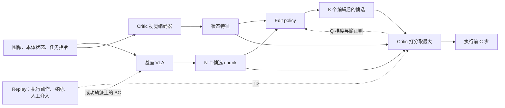
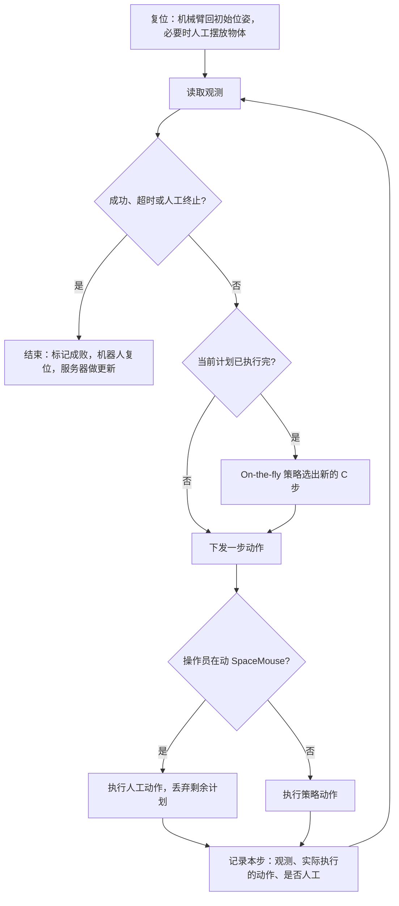

# EXPO-FT 论文复现规格

本文说明 EXPO-FT 的方法定义与官方参考实现：整体思路、模型定义与实现选型、数据与训练 workflow，以及论文给出的实验依据。平台与取值都是论文和参考实现的：单臂 DROID、π₀.₅、10 Hz 末端速度控制。范围为同步执行的 EXPO-FT，Real-Time EXPO-FT 只在 4.3 说明它改了什么。

论文依据为 [EXPO-FT，arXiv v2](https://arxiv.org/html/2605.25477v2)；底层算法见 [EXPO，arXiv v3](https://arxiv.org/html/2507.07986v3)，实时版见 [Real-Time EXPO-FT，arXiv v1](https://arxiv.org/html/2609.18207v1)（下称 RT 论文）。参考实现固定对照工作区 `methods/expo-ft` 所基于的 [expo-ft `803381f`](https://github.com/AtticusZeller/expo-ft/tree/803381fc3b4c91a0c47904f1b688fc5e35904f50)，以及它依赖的 [OpenPI fork `expo_ft` 分支 `46407a4`](https://github.com/pd-perry/openpi/tree/46407a41183b037313a383ff679683f2773b766d)。

参考实现的行为均读自上述固定版本的源码，本工作区没有运行过它。论文未写明或与实现不一致的地方，第二、三部分按参考实现写，并在 4.2 逐条列出；唯一的例外是奖励对齐，按论文和上游修正后的写法。

## 一、方法整体 Overview

EXPO-FT 以示教微调好的 VLA 为基座，在线阶段再训练三样东西：给“观测 + 动作块”打分的 critic，在 VLA 动作块上加小幅修正的 edit policy，以及 VLA 本身。每次决策时 VLA 采出 N 个候选动作块，edit policy 给其中 K 个各加一份有界修正，critic 在全部 N+K 个候选里选分数最高的执行。

执行数据连同人工介入的动作进入 replay。Critic 用 TD 学习稀疏的成败奖励；edit policy 沿 critic 的梯度更新并带熵正则；VLA 继续用自己的 flow-matching 模仿目标训练，样本取自示教和成功的在线 episode，被选中并成功的动作由此回流进基座。Q 的梯度不穿过 VLA。



图示一次决策与三条训练信号。基座为 π₀.₅；原论文的系统图见 [Fig. 2](https://arxiv.org/html/2605.25477v2#S4.F2)。

## 二、模型定义与实现选型

### 2.1 符号与共用表示

时间索引统一使用真实执行 step。一个动作块包含多个 step；动作块的 next state 是执行 C 步之后的状态。

| 符号 | 含义 |
|---|---|
| \(o_t,\ell\) | 第 t 个执行 step 的观测（各路图像与本体状态）、任务指令 |
| \(\tilde s_t\) | 归一化后的本体状态 |
| \(e_t\in\mathbb R^{512}\) | Critic 视觉编码器对图像的嵌入 |
| \(x_t=(e_t,\tilde s_t)\) | Critic 与 edit policy 的状态输入 |
| \(H,C,d\) | VLA 一次生成的 chunk 长度、每次执行并重规划的步数、动作维度；\(C\le H\) |
| \(a\in\mathbb R^{C\times d}\) | VLA 归一化动作空间里的 C 步动作块；送入 MLP 前按时间顺序展平为 \(\operatorname{vec}(a)\in\mathbb R^{Cd}\) |
| \(a_t^{(i)}\) | 基座 VLA 在 \(o_t\) 采出的第 i 个候选的前 C 步，\(i=1,\ldots,N\) |
| \(\hat a,\ \tilde a=a+\hat a\) | Edit 与编辑后的动作块；\(\hat a\in[-\beta,\beta]^{C\times d}\) |
| \(a_t^{*}\) | On-the-fly 策略在 \(o_t\) 选中的动作块 |
| \(a_t^{\rm exec},\ a_t^{{\rm exec},H}\) | 真实轨迹上从 t 起实际执行的 C 步、H 步动作，已归一化 |
| \(r_t,m_t\) | 执行第 t 步动作后得到的奖励、continuation mask（终止为 0） |
| \(Q_j,Q'_j\) | 第 j 个 critic 与它的 target，\(j=1,\ldots,M\) |
| \(N,K\) | 基座候选数、带 edit 的候选数，\(K\le N\) |
| \(\beta,\alpha\) | Edit 幅度上限（归一化动作单位）、熵温度 |
| \(\gamma,\tau_Q\) | 每执行 step 的折扣、target critic 软更新系数 |
| \(\mathcal B,\mathcal B^{+}\) | Replay、其中由示教与成功 episode 构成的子集 |
| \(B,U\) | Minibatch 大小、一次 update call 里 critic 的更新次数 |

### 2.2 基座 VLA

基座是 π₀.₅，先在任务示教上做 LoRA 监督微调（3.1），在线阶段继续更新。

**候选采样。** VLA 以 flow matching 生成 H 步动作块。一次决策从 N 个独立噪声出发各做 10 步 Euler 去噪，得到 N 个候选。图像与任务输入构成的 prefix 只前向一次，它的 KV cache 复制给 N 条去噪序列，所以多采候选只增加 action expert 的计算。候选取前 C 步参与编辑与选择。

**模仿目标。** 沿用 OpenPI 的 flow-matching loss，约定 \(\tau=1\) 为纯噪声、\(\tau=0\) 为数据：

$$
a^{\tau}=\tau\epsilon+(1-\tau)\,a_t^{{\rm exec},H},\qquad
L_{\rm BC}(\theta)=\mathbb E\left[\frac{1}{HD}\big\|v_\theta(a^{\tau},o_t,\ell,\tau)-(\epsilon-a_t^{{\rm exec},H})\big\|_2^2\right].
$$

其中 \(\epsilon\sim\mathcal N(0,I)\)，\(\tau=0.001+0.999\,\mathrm{Beta}(1.5,1)\)，D=32 是模型内部补零后的动作维度，样本取自 \(\mathcal B^{+}\)。目标动作是真实轨迹上实际执行的 H 步，其中可以包含被 edit 修改过的动作和人工动作。

论文只写“基座 VLA 用原有训练目标更新，不作修改”。只在示教与成功 episode 上更新，来自参考实现与 [RT 论文附录 VII-E](https://arxiv.org/html/2609.18207v1#Sx1.SS5.SSS2)。

**参与训练的参数。** VLM 与 action expert 的 Gemma 主干权重冻结，各自挂 LoRA；LoRA、SigLIP 图像编码器、动作输入输出投影与时间 MLP 参与训练。优化器为 AdamW（β₁=0.9，β₂=0.95，weight decay 1e-10），全局梯度范数上限 1.0，学习率恒定 2.5e-5，不用 EMA。

实现还维护一份基座参数的 Polyak 副本（系数 \(\tau_\pi=10^{-3}\)）。TD backup 不使用它，采样下一动作用的是当前参数。

| 项目 | 取值 |
|---|---|
| 基座 | π₀.₅，`gemma_2b_lora` + `gemma_300m_lora` |
| H / 模型内部动作维度 D | 16 / 32，真实动作 7 维，其余补零 |
| 去噪步数 | 10 |
| 图像输入 | 224×224 |

### 2.3 观测与动作的表示

**动作。** 论文平台的动作是 7 维：末端 6 维笛卡尔速度加 1 维夹爪速度，10 Hz 下发。VLA 用示教数据的 quantile 统计量逐维归一化：

$$
N_q(y)=2\,\frac{y-q_{01}}{q_{99}-q_{01}+10^{-6}}-1 .
$$

归一化后不 clip，也没有相对当前状态的 delta 变换。Edit、critic 与 replay 都工作在这个归一化空间，执行前做逆变换回到机器人接口的单位。统计量在在线阶段固定。

**本体状态。** 末端位置 3 维、欧拉角 3 维与夹爪 1 维，同样做 quantile 归一化。VLA 按自己的数据配置读取状态；critic 与 edit policy 读取归一化后的向量（实现里是补零到 32 维的那一份）。

**图像。** 侧视与腕部两路相机，缩放到 224×224。Critic 把两路图像按通道拼成一个 6 通道输入；VLA 仍按自己的相机槽位读取。

**增广。** 更新时对当前观测与下一观测各自独立增广，每路相机独立抽样：95% 随机裁剪后缩回 224×224、±5° 旋转、亮度 / 对比度 / 饱和度各 ±0.1。同一份增广后的图像同时供 critic 编码器和 TD backup 里的 VLA 采样使用。Rollout 不做增广。

VLA 的 BC 样本先做同一组增广，随后 OpenPI 的训练前处理再做一次自带增广：侧视相机的 95% 裁剪与 ±5° 旋转，全部相机亮度 0.3、对比度 0.4、饱和度 0.5 的颜色抖动。

### 2.4 Critic 视觉编码器

Critic 不复用 VLA 的视觉编码器，另设一个轻量卷积编码器。论文的理由是 VLA 编码器太大，放进紧凑的采集-更新循环里算不起。[论文 §4.3](https://arxiv.org/html/2605.25477v2#S4.SS3)

| 项目 | 取值 |
|---|---|
| 主干 | Pre-activation ResNetV2，basic block，各 stage 深度 (3, 4, 6, 3)，宽度 64 → 128 → 256 → 512 |
| 归一化 / 激活 | GroupNorm，4 组，epsilon 1e-5 / ReLU |
| Stem | 224 输入时为 7×7、stride 2 的卷积加 3×3、stride 2 的 max pooling |
| 输出 | 7×7×512 特征图直接展平，不做全局池化；再经 Linear(512) → LayerNorm → tanh 得到 \(e_t\) |

编码器只由 critic loss 更新（Adam，3e-4）。Edit policy 读取 \(e_t\) 时停止梯度。计算 TD target 与给候选打分时用当前编码器参数，没有 target 编码器。

本体状态经 Linear(64) → LayerNorm → tanh 嵌入后与 \(e_t\) 拼接。Critic 与 edit policy 各有自己的状态嵌入层。

### 2.5 Edit policy

**输入输出。** 输入状态 \(x_t\) 与一个待修正的动作块 \(a\)，输出同形状的有界修正：

$$
(\mu,\log\sigma)=f_\phi\big(\operatorname{sg}(e_t),\tilde s_t,\operatorname{vec}(a)\big),\qquad
u\sim\mathcal N(\mu,\operatorname{diag}\sigma^2),\qquad
\hat a=\beta\,(w\odot\tanh u),\qquad \tilde a=a+\hat a .
$$

\(\log\sigma\) 裁到 [−20, 2]。w 是逐维开关，默认全 1；参考实现提供一个把旋转维置 0、只保留平移与夹爪的选项（`edit_action_xyzg`，Cube Pick 的任务配置打开了它）。

**训练目标。**

$$
L_{\rm edit}(\phi)=\mathbb E_{(o_t,a_t^{\rm exec})\sim\mathcal B,\ \hat a\sim\pi_\phi}
\left[\alpha\log\pi_\phi(\hat a\mid x_t,a_t^{\rm exec})-\frac1M\sum_{j=1}^{M}Q_j(x_t,a_t^{\rm exec}+\hat a)\right],
$$

$$
\log\pi_\phi(\hat a\mid\cdot)=\log\mathcal N(u;\mu,\sigma^2)-\sum_k\log\big(1-\tanh^2u_k\big)-Cd\log\beta .
$$

训练时被修正的是 replay 里实际执行的动作块，不是 VLA 重新采的样本。Q 项对全部 M 个在线 critic 取平均。\(\log\pi\) 的最后一项是按 β 缩放带来的密度修正；被 w 屏蔽的维度仍计入 \(\log\pi\)。

**结构。**

```text
[图像嵌入 512（停止梯度）, 状态嵌入 64, 展平的动作块 C×d]
→ Linear(256) → ReLU → Linear(256) → ReLU → Linear(256) → ReLU
→ 均值头 Linear(C×d)，log 标准差头 Linear(C×d)
→ 采样 → tanh → 乘 β → 加到输入动作块上
```

无 LayerNorm、无 dropout，权重为 Xavier uniform 初始化，Adam 学习率 3e-4。

> **推断（由初始化得出，未实测）：** 未训练时 σ 的量级为 1，经过 tanh 后 edit 大致铺满 ±β。首次更新之前的 rollout 已经带着这样的 edit 参与候选选择（3.5）。

### 2.6 On-the-fly 策略

候选集由 N 个基座候选和其中前 K 个的编辑版组成，critic 选最大：

$$
\mathcal C(o_t)=\{a_t^{(i)}\}_{i=1}^{N}\cup\{a_t^{(i)}+\hat a^{(i)}\}_{i=1}^{K},\qquad
a_t^{*}=\arg\max_{a\in\mathcal C(o_t)}\ \min_{j\in S}Q'_j(x_t,a).
$$

每次决策从 M 个 target critic 里随机抽 2 个组成 S，全部候选共用同一个 S。选择是确定性的 argmax，不做 softmax。

同一个策略用在两处：rollout 时在当前观测上选出要执行的 C 步；TD backup 时在下一观测上选出 bootstrap 动作。两处的基座候选都来自当前 VLA 参数，edit 来自当前 edit policy。默认 N=K=8，共 16 个候选。

### 2.7 Critic 与 target critic

**输入输出。** 每个 critic 接收状态 \(x_t\) 与一个 C 步动作块，输出标量 \(Q_j(x_t,a)\)。训练当前 Q 时，a 是真实轨迹上的 \(a_t^{\rm exec}\)。

**TD target。** 先累计动作块内的奖励，再以 C 步折扣 bootstrap：

$$
R_t^{(C)}=\sum_{i=0}^{C-1}\gamma^i r_{t+i},\qquad
\bar m_t=\prod_{i=0}^{C-1}m_{t+i},\qquad
\hat Q_t=\operatorname{sg}\Big[R_t^{(C)}+\gamma^{C}\,\bar m_t\min_{j\in S'}Q'_j\big(x_{t+C},a_{t+C}^{*}\big)\Big].
$$

\(S'\) 是为取值另抽的一个 2 元子集，与选出 \(a_{t+C}^{*}\) 时用的 S 相互独立。Backup 里没有熵项。论文正文的公式 (5) 把折扣简写成 γ；[附录 D.1](https://arxiv.org/html/2605.25477v2#A4.SS1) 说明多步动作块的折扣与执行步数一致，实现用的是 \(\gamma^{C}\)。

$$
L_Q=\frac{1}{MB}\sum_{j=1}^{M}\sum_{b=1}^{B}v_b\big(Q_j(x_b,a_b^{\rm exec})-\hat Q_b\big)^2 .
$$

\(v_b\in\{0,1\}\) 是 3.3 定义的窗口有效标志。

**结构。**

```text
[图像嵌入 512, 状态嵌入 64, 展平的动作块 C×d]
→ Linear(256) → LayerNorm → ReLU    （共 3 层）
→ Linear(1)
```

M=10 个成员结构相同、各自独立初始化，共用同一份图像嵌入与状态嵌入。Critic 与编码器用 Adam，学习率 3e-4。每次 critic 更新后软更新 target：

$$
\psi'_j\leftarrow(1-\tau_Q)\psi'_j+\tau_Q\psi_j,\qquad\tau_Q=0.005 .
$$

### 2.8 温度

$$
\alpha=e^{\lambda},\qquad L(\lambda)=\alpha\,\big(\hat{\mathcal H}-\bar{\mathcal H}\big),\qquad
\hat{\mathcal H}=-\frac1B\sum_b\log\pi_\phi(\hat a_b\mid\cdot),\qquad \bar{\mathcal H}=-\tfrac12Cd .
$$

\(\hat{\mathcal H}\) 取自同一次 edit 更新，按常数处理。α 初值 1.0，Adam 学习率 3e-4。熵只进入 edit policy 的目标。

> **配置理解：** 目标熵 \(-Cd/2\) 没有按 β 修正，而 \(\log\pi\) 带有 \(-Cd\log\beta\) 一项。Edit 的取值范围是 \([-\beta,\beta]^{Cd}\)，熵不超过 \(Cd\log(2\beta)\)；\(\beta<e^{-1/2}/2\approx0.30\) 时这个上界低于目标熵。论文的 β 取 0.05–0.2，全部落在这个范围。参考实现有按 β 修正目标熵的开关 `adjust_target_entropy`（目标变为 \(-Cd/2+Cd\log\beta\)），示例配置关闭。
>
> **推断（未经实验确认）：** 在这些 β 下 \(\hat{\mathcal H}\) 低于目标熵，α 只升不降。每次 update call 只走一步、学习率 3e-4，600 次调用后 α 至多约为初值的 1.2 倍，可近似看作常数。\(\alpha_0=1\) 时熵项的量级远大于 Q 项：C=8、d=7、β=0.2 时 \(\log\pi\) 的均值不低于 51，Q 在 0–1 之间。Edit 的分布可能长期接近 ±β 内的均匀噪声，策略改进主要来自 critic 在候选中的选择和成功动作回流进 VLA。RT 论文把 \(\alpha_0\) 改为 0.01（4.3）。

## 三、数据构建与训练 Workflow

### 3.1 准备：示教、监督微调与 replay 预填

1. 定义任务：相机布置、复位方式、成功判据。论文的 8 个任务全部使用规则式二值判据（像素颜色、末端高度、夹爪开度等），自报准确率高于 95%。[附录 C.1](https://arxiv.org/html/2605.25477v2#A3.SS1)
2. 采集示教：SpaceMouse 遥操作，每个任务 10–40 条，控制频率与在线阶段相同。
3. 计算归一化统计量，监督微调 VLA（LoRA）。论文的门槛是成功率约 40% 以上。示例脚本训练约 4,000 步（batch 64，学习率 2.5e-5），在线阶段加载的是第 2,000 步的 checkpoint。
4. 把示教预填进 replay：每条示教作为一个成功 episode，最后一步 r=1 并终止。论文说明也可以把示教留作独立的离线数据集、按比例混入 batch；它的实验因示教很少而直接预填。

### 3.2 一个在线 episode

参考实现的同步模式下，learner 进程逐步驱动环境：每个控制周期取一次观测、下发一步动作，到重规划边界时推理会阻塞控制循环。



**人工介入。** SpaceMouse 的 6 维速度输入范数超过 1e-4 的那一步，人工动作整体替换策略动作，剩余计划丢弃；接管期间不做推理，松手后从当前观测重新采样。介入可以落在一个动作块中间，也可以跨多个动作块。论文的做法是训练早期介入较多，随策略变好降到零；它对介入后剩余动作的描述与实现不同，见 4.2。[论文 §4.2](https://arxiv.org/html/2605.25477v2#S4.SS2)

**奖励与终止。**

- 每一步的奖励与终止属于执行该步动作之后观测到的结果：判据成立的那一步 r=1，其余为 0。
- 判据成立、超时、操作员用键盘判成功或直接终止，都结束 episode，并且都不再 bootstrap（\(m_t=0\)）。判据成立与手动判成功给 r=1，其余结束方式为 0。超时按任务设定，Cube Pick 为 80 步，即 8 s。
- Episode 结束后，成功的整条 episode 标入 \(\mathcal B^{+}\)，其中的人工动作与被编辑过的动作一并成为 VLA 的 BC 目标。
- 人工动作在 EXPO-FT 里没有单独的 loss：它们作为实际执行的动作进入 critic 的数据，所在 episode 成功时进入 BC。

### 3.3 Replay transition 与采样

Replay 按执行 step 存储，每步一行：该步的观测（缩放后的各路图像、归一化状态、任务输入）、实际执行的动作、奖励、continuation mask、是否人工动作，以及所在 episode 是否成功。

采样时在所有已存 step 上均匀抽取起点 t，从真实轨迹切出一条 C 步 transition：

$$
T_t=\big(o_t,\ a_t^{\rm exec},\ R_t^{(C)},\ o_{t+C},\ \bar m_t,\ v_t\big).
$$

- 起点不限于策略的重规划边界，相当于 stride 为 1 的滑窗。一个窗口里可以同时有策略动作、人工动作和重规划前后的动作。
- 终止只允许落在窗口最后一步：\(v_t=1\) 当且仅当窗口的前 C−1 步都没有终止。每个 episode 因此恰有一条含终止奖励的有效窗口，成功时目标值为 \(\gamma^{C-1}\)。起点更晚的窗口越过了终止，动作尾部是补出来的，不参与 loss。
- 参考实现另有开关 `valids_keep_terminal_windows`，让越过终止的窗口也参与训练，目标只剩已观测到的奖励。EXPO-FT 的示例配置关闭；RT 论文在两个任务上打开。
- Replay 还能表示截断，即结束但 \(m_t=1\) 的 step，触及它的窗口整体无效。参考环境不产生截断，超时按终止处理。
- VLA 的 BC 样本从 \(\mathcal B^{+}\) 均匀抽起点，目标是从该步起实际执行的 H 步动作；episode 末尾不足 H 步时重复最后一个动作补齐。

### 3.4 一次 update call

```text
采样 B×U = 1,280 条 C 步 transition，当前观测与下一观测各自独立增广
└─ 重复 U = 20 次，每次一个 64 条的 minibatch
     下一观测：VLA 采 N 个候选 → 前 K 个加 edit → target critic 选最大
     计算 TD target → 更新 critic 与视觉编码器 → 软更新 target critic
从成功池另采 64 条 → 基座 VLA 做 1 步 flow-matching BC
最后一个 minibatch → edit policy 更新 1 步 → 温度更新 1 步
```

一次调用里 critic 走 U 步，VLA、edit policy、温度各走 1 步。论文所说的 UTD=20 指的是这个 U，不是每个环境 step 对应 20 次更新。

计算量集中在 TD backup：一次调用要对 1,280 个下一观测各采 8 个候选，即 1,280 次 prefix 前向，加上 10,240 条 H=16 的动作序列各做 10 步去噪。VLA 自身的训练只有 1 次 64 条样本的前向与反向。

### 3.5 更新节奏与数据预算

**何时开始。** 完成 10 个在线 episode 之后才开始更新。在此之前 rollout 已经使用 on-the-fly 策略，critic 与 edit policy 都还是随机初始化（参考实现）。

**更新时机。** 论文给出三种：每步、每个 episode 结束、每攒够一批 episode。主实验用同步模式，在 episode 结束后、机器人复位期间更新，每个 episode 固定做若干次 update call；次数按“大约每 40 个环境 step 一次”设定，参考实现的 README 建议每 20–30 步一次。[附录 D.2](https://arxiv.org/html/2605.25477v2#A4.SS2)

**论文各任务的取值。**

| 任务 | 示教数 | β | C | 每 episode 的 update call | 环境 step | 在线数据（分钟） |
|---|---:|---:|---:|---:|---:|---:|
| Egg Flip | 25 | 0.2 | 8 | 4 | 10,000 | 18 |
| String Light – Route I | 40 | 0.05 | 8 | 4 | 10,000 | 18 |
| String Light – Route II | 30 | 0.05 | 8 | 4 | 20,000 | 35 |
| String Light – Insert | 25 | 0.05 | 4 | 3 | 9,000 | 16 |
| Candy Scoop | 20 | 0.2 | 8 | 6 | 12,000 | 20 |
| Cube Pick | 10 | 0.2 | 8 | 3 | 8,000 | 14 |
| Flower Insert | 25 | 0.05 | 4 | 1 | 8,000 | 14 |
| Pool Shot | 30 | 0.05 | 8 | 1 | 10,000 | 18 |

对精度要求高的任务用更小的 β；两个插入类任务同时把 C 降到 4。

**量级。** 以 Cube Pick 为例：8,000 个环境 step，episode 上限 80 步、成功即提前结束，按每个 episode 40–80 步估算约合 100–200 个 episode。每个 episode 做 3 次 update call，全程约 300–600 次调用，即 6,000–12,000 次 critic 更新，而 VLA 与 edit policy 各只有 300–600 次梯度更新。

**训练周期参数与配置来源。** 第一列来自论文附录 D，第二列来自参考实现固定版本的默认配置，第三列来自它的 Cube Pick 示例脚本。

| 参数 | 论文 | 参考实现默认 | Cube Pick 示例脚本 |
|---|---:|---:|---:|
| 候选数 N / K | 8 / 8 | 8 / 8 | 8 / 8 |
| Edit 幅度 β | 0.05、0.1 或 0.2 | 0.2 | 0.2 |
| H / C | 未写 / 4 或 8 | 16 / 8 | 16 / 8 |
| Critic 数 M / 每次抽取 | 10 / 2 | 10 / 2 | 同左 |
| Minibatch B / 每次调用的 critic 步数 U | 64 / 20 | 64 / 20 | 同左 |
| Critic、编码器、edit、温度的优化器 | Adam，3e-4 | Adam，3e-4 | 同左 |
| 基座 VLA 的优化器 | 未写 | AdamW，恒定 2.5e-5，裁剪 1.0 | 同左 |
| 每 step 的 γ / \(\tau_Q\) | 0.99 / 0.005 | 0.99 / 0.005 | 同左 |
| α 初值 / 目标熵 | 1.0 / 未写 | 1.0 / \(-Cd/2\) | 同左 |
| 首次更新前的在线 episode 数 | 未写 | 10 | 10 |
| 每个 episode 的 update call 数 | 1–6 | 每条 transition 折算 1 次，在 episode 结束时执行 | 3 |
| 预填示教数 | 10–40 | 启动参数 | 10 |

**算力。** 论文在 2 张 H200 上跑同步模式。参考实现另有采样与更新分在不同 GPU 上的异步模式，论文认为 GPU 不多于 2 张时同步更快。

### 3.6 评测与 checkpoint

评测时冻结全部参数，用与训练相同的 on-the-fly 策略执行。论文每个任务做 30 次试验，初始状态随机，由人观察判定成功，并报告达到该性能所用的在线数据时长。参考实现的评测脚本默认跑 10 个 episode，另有只执行基座单个样本的开关，用来评测 SFT 基线。训练过程另记录最近 10 个 episode 的成功率与每个 episode 的人工介入比例。

Checkpoint 保存 critic、target critic、编码器、edit policy、温度与 VLA 的训练状态。打开对应开关后 replay 逐步落盘，恢复时按时间顺序重放，并按终止奖励重建成功标记。

## 四、实验细节、讨论与选择依据

本工作区没有 EXPO-FT 的实验记录。本节的实验依据来自两篇论文，4.4 另引用一次工作区 RLT 真机试跑的现场观察；论文与参考实现的出入来自对固定版本源码的阅读。

### 4.1 论文报告的结果与消融

8 个真机任务全部达到 30/30，平均在线数据 19.1 分钟。同样的评测下 SFT 平均 20.5/30，HG-DAgger 22.1/30；在其中 4 个任务上，DSRL 平均 19/30，HIL-SERL 5.5/30。[Table 1、2](https://arxiv.org/html/2605.25477v2#S5.T1)

消融在 Cube Pick 与 Egg Flip 上做，每个设置 30 次试验：[附录 B.2](https://arxiv.org/html/2605.25477v2#A2.SS2)

- **人工介入。** 去掉或减半都能到 30/30，但需要更多在线 step。
- **执行长度 C。** 4 与 8 的最终表现相近，16 更差；不做在线训练时基座在三种长度下为 19/30、18/30、17/30。
- **冻结基座 VLA。** 相同数据预算内到不了 30/30。附录的 Fig. 6 中，冻结时两个任务的训练成功率（含介入）停在约 0.65–0.85，联合更新约 13 分钟数据到 1.0。论文认为在算力不够时它仍是可用的替代。
- **Edit policy 的视觉特征。** 复用 critic 编码器、使用 VLA 特征、另设编码器三种都能到 30/30，复用 critic 编码器收敛最快最稳。
- **不从预训练 VLA 初始化。** 更慢，仍能到 30/30。
- **n-step return。** 长度对学习速度有影响，主实验没有调。

论文没有报告一次更新的墙钟耗时，也没有给出温度、熵或 edit 被选中比例的曲线。

### 4.2 论文与参考实现的出入

| 主题 | 论文 | 参考实现固定版本 | 第二、三部分的写法 |
|---|---|---|---|
| 基座图像编码器 | 附录 D.1：RL 期间冻结 | 冻结的只有 Gemma 主干，SigLIP 参与 BC 更新。名为 `freeze_pi05_encoder` 的开关只控制采样时 prefix 是否在 N 个候选间共用。RT 论文附录也写 SigLIP 参与训练 | 参考实现 |
| Critic 视觉主干 | 称 ResNet-50 | Basic block、(3, 4, 6, 3) 的 ResNetV2，GroupNorm，展平不池化；RT 论文附录的描述与此一致 | 参考实现 |
| TD 折扣 | 公式 (5) 写 γ | \(\gamma^{C}\)，奖励按步折扣累加 | 参考实现 |
| 候选打分 | 公式 (2) 写 \(Q_\phi\) | Target critic，随机抽 2 个取最小 | 参考实现 |
| Edit 的 Q 项 | 公式 (4) 写 \(Q_\phi\) | 全部 M 个在线 critic 的均值 | 参考实现 |
| 基座的 target 副本 | 列出 \(\tau_\pi=10^{-3}\) | 维护但不用于 backup | 参考实现 |
| VLA 的更新样本 | 未说明 | 只用示教与成功 episode | 参考实现 |
| VLA 的 BC 增广 | 只写更新时做一组增广；RT 论文附录写明基座输入用同一组 | 先做这一组，OpenPI 的训练前处理再做一次自带增广 | 参考实现 |
| 人工介入后的剩余动作 | §4.2：被介入的 step 换成人工动作，动作块其余部分照常执行 | 人工动作一出现就丢弃剩余计划，松手后重新采样 | 参考实现 |
| 超时 | 未说明 | 与失败终止同样处理：r=0，不 bootstrap | 参考实现 |
| 起步 | 未说明 | 10 个 episode 后才更新；此前未训练的 critic 与 edit 已参与决策 | 参考实现 |
| 温度 | \(\alpha_0=1\)，未写目标熵 | \(\alpha_0=1\)，目标熵 \(-Cd/2\)，未按 β 修正。RT 论文改为 \(\alpha_0=0.01\) | 参考实现 |
| 奖励对齐 | 标准的 \((s,a,r,s')\) | 把结果记在下一步的 transition 上，晚一步 | 论文 |

**参考实现的版本。** 工作区 submodule 固定在 `803381f` 之上。上游 `pd-perry/expo-ft` 在 2026-10-04 更新到 `21fe3d3`，两个版本的源码差别只有奖励对齐：固定版本每步开头读到的是上一步动作的结果，却把它记进当前这一步的 transition，并且为终止时刻的观测多记一条；上游改为把结果记回上一步，终止时刻不再记录。

### 4.3 Real-Time EXPO-FT 改了什么

Real-Time EXPO-FT 针对高频控制下 VLA 推理跨越多个控制周期的情况。论文为 30 Hz，推理 67–167 ms，对应延迟 d=3–5 步。它在同一套 critic、edit policy 与更新流程上做了这些改动：[RT 论文 §IV-B](https://arxiv.org/html/2609.18207v1#S4.SS2)

- **异步生成候选。** 当前计划还剩 d 步时，用那一刻的观测在后台采样下一批候选，把这 d 步正在执行的动作作为干净前缀固定住（training-time RTC），取候选的第 d 到 d+C 步。
- **用最新观测编辑和选择。** 到重规划边界时，edit policy 与 critic 读取当时的最新观测。这一步只有卷积编码器和 MLP，延迟可以忽略。
- **基座用带前缀的 flow-matching 目标训练。** SFT 时前缀长度随机；在线时每个 episode 的第一个动作块取 0，其余取部署延迟 d。
- **Backup 与 rollout 对齐。** 下一动作从提前 d 步的观测、带已执行前缀采样。为了用 32 个候选而不必每次去噪 32 条，另训一个直接给噪声打分的小 critic，先筛出 1 个噪声再去噪。
- **取值不同。** N=K=32，\(\alpha_0=0.01\)，不用人工介入，SFT 门槛降到成功率约 30%，在线数据上限 10 分钟。

4 个动态真机任务上平均 29/30；不处理延迟的 EXPO-FT 在同样条件下为 18.8/30，加上 RTC 后为 25/30。

参考实现的 README 给出两者的选用判据：VLA 前向放得进一个控制周期，或环境基本静态，用 EXPO-FT；前向放不进一个控制周期，任务又要求对环境变化及时反应，用实时版。

### 4.4 复现路线：仿真先行，真机只做分离更新

**问题。** 联合更新要求 learner 在一张卡上同时放下 π₀.₅ 的训练状态和 TD backup 的批量采样。本地真机推理服务器是 24–32 GB 的消费级显卡（如 RTX 5090）。按参数量粗估，联合更新单卡约需 40–70 GB，没有实测；OpenPI 官方给 LoRA 微调本身的门槛已是 >22.5 GB。真机上照搬每个 episode 都更新 VLA 的做法跑不起来。

**依据。**

- 人工介入：Fig. 6 中介入减半或去掉，训练成功率仍能到 1.0，只晚几分钟数据（4.1）。仿真里不做介入，不影响验证方法本身。
- 基座更新：冻结 VLA 停在约 0.65–0.85（4.1）。工作区 RLT 的真机试跑同样冻结 VLA、只训练小网络，用户现场估计对准成功率约 70–80%（[experiments.md](experiments.md)；任务不同，没有正式评测）。
- 算力分布：VLA 的 BC 每次 update call 只走 1 步，全程 300–600 步（3.5），集中到离线做的计算量很小。5090 卡住的是训练状态与 backup 采样同时驻留，以及 backup 里的 VLA 采样本身（3.4）。

> **推断（未经实验确认）：** 执行中超出基座分布的动作只来自 edit（候选 ±β 内）和人工介入。VLA 更新把成功回合里的这些动作吸收进基座，下一轮候选从新位置出发，edit 再向外推 β。冻结时一次也不吸收，所以停在平台。按轮更新 VLA 只要轮数够，仍可逐轮外移；在平台上只做一次 LoRA，大约只前进一轮。

**分离更新（候选方案，参考实现没有）。** 在线阶段冻结 VLA，只更新 critic、编码器、edit policy 与温度；每 M 个 episode 停一次，在 \(\mathcal B^{+}\) 上离线做约 3M 步 LoRA BC（按每 episode 3 次 update call 折算），换上新权重后继续在线。M=∞ 即 Fig. 6 的冻结设置，M=1 接近默认的联合更新。在线与离线阶段分时使用 GPU，不同时驻留。

**当前决定。**

1. 先在仿真复现 EXPO-FT：不做人工介入，在 80 GB 单卡服务器上按参考实现联合更新，作为基线。
2. 在仿真里做分离更新的消融：同一任务比较联合更新、几个有限的 M 和 M=∞，看分离更新能否越过冻结的平台、与联合更新差多少。
3. 真机只跑分离更新，M 取仿真的结论。

**未定事项。**

- 仿真环境与任务的选择、新增代码的组织，另行讨论。
- 换权重后候选分布一次移动一段，critic 对新候选的评分是外推；需要在仿真里观察换权重前后的成功率与 Q 值。
- 两篇论文都没有分离或降频更新 VLA 的实验。RLDG、PA-RL 与 π\*0.6 的 RECAP 都按轮把 RL 产出的数据训回基座，可作旁证，本工作区没有核对它们的设置。
- 5090 上冻结阶段的显存与 backup 耗时、32 GB 上离线 LoRA 能否用 batch 64，都没有实测。
