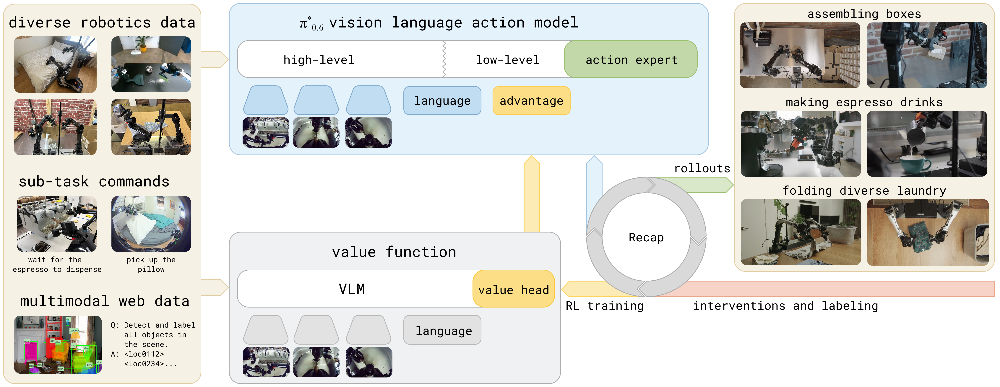
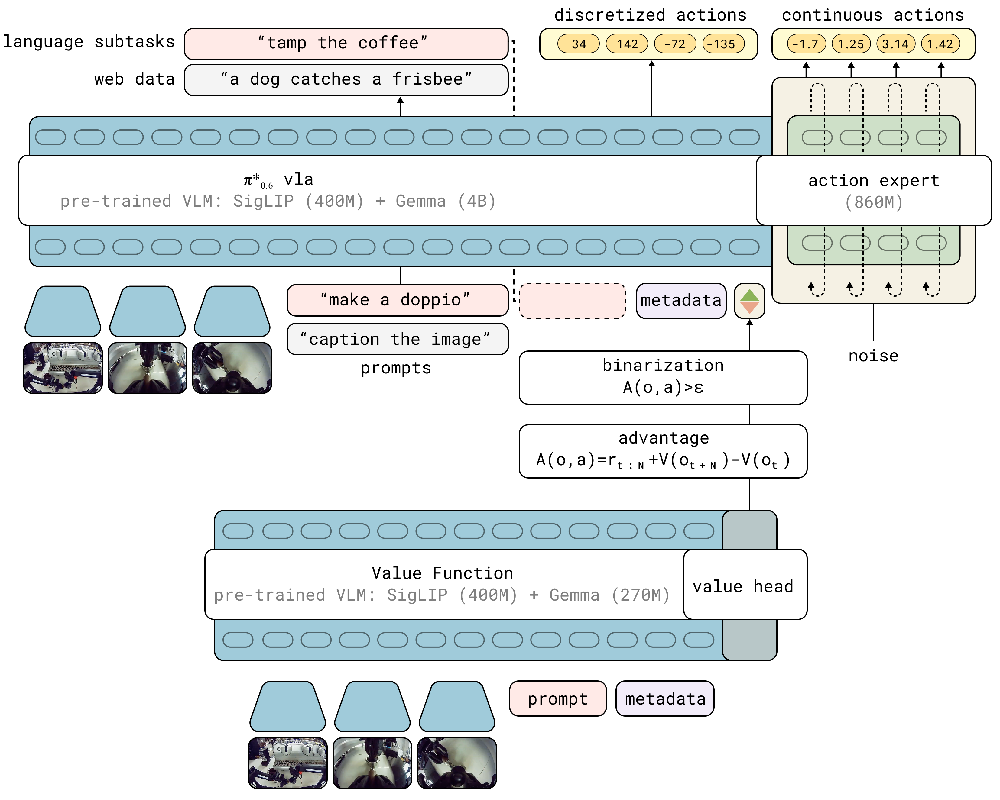

# π*0.6 复现

参考代码

| 优先级 | 项目                                                                                | Stars | 证据与价值                                                                                               |
| --- | --------------------------------------------------------------------------------- | ----- | --------------------------------------------------------------------------------------------------- |
| 1   | [**Evo-RL**](https://github.com/MINT-SJTU/Evo-RL?utm_source=chatgpt.com)          | 858   | **真机证据最强**。SO101、PiPER，论文、真机实验、视频和公开数据集。基于 LeRobot。                                                 |
| 2   | [**PiStar**](https://github.com/ybpy/pistar?utm_source=chatgpt.com)               | 142   | **最值得参考的 OpenPI Fork**。直接 Fork 官方 OpenPI，包含 π0.6 风格的 Value、Advantage 标签、策略微调，以及 PiPER/RealMan 真机代码。 |
| 3   | [**RLinf**](https://github.com/RLinf/RLinf?utm_source=chatgpt.com)                | 5,643 | **工程质量与仿真验证最强**。基于 OpenPI 的 π0.5，完整 RECAP 训练链路，公开数据、测试和量化结果；RECAP 验证主要在 LIBERO。                     |
| 4   | [**RECAP on YAM**](https://github.com/Destiny000621/RECAP?utm_source=chatgpt.com) | 11    | **针对真机的 OpenPI 改造**。基于 PiStar，适配 YAM 双臂、DAgger 数据收集、Value 训练和优势条件化微调；尚缺公开的完整性能对照。                   |

### 参考实现核对

Agent 静态阅读（2026-11-13），未运行任何一份代码。

| 项目 | 框架 | 价值模型 | return 归一化 | 第一轮 | 结果的证据 |
| --- | --- | --- | --- | --- | --- |
| Evo-RL | PyTorch / LeRobot | SigLIP so400m + Gemma3-270M，201 bin | 多种口径，见「return 的归一化」 | 未查到 | 论文 Table II：PiperX 螺丝套筒插入 SFT 22.7% → 两轮 92.2%，含人工介入 |
| PiStar | JAX | SigLIP So400m + Gemma3-270M，201 bin，默认冻结骨干 | 按每条轨迹自身长度；失败轨迹所有帧恒为 $-1$ | 只用示范，全 positive，不训 value | README 没有成功率；HEAD 静态看跑不通 |
| RLinf | PyTorch | SigLIP2-so400m + Gemma3-270M，201 bin，two-hot | 除以全局最小 return | 示范数据强制 positive | LIBERO-10 一个任务 48.8% → 66.5%：纯自主 rollout、没有人工介入，只作工程参考 |
| RECAP on YAM | JAX | 同 PiStar | 同 PiStar | 从 SFT checkpoint 起训 | 没有成功率；10 集数据，README 自述 value 过拟合 |

- 优势阈值：三家都取优势最高的 30% 为 positive。RLinf 与 PiStar 取全局分位数，Evo-RL 按任务取；论文按任务，约 40%。
- N 步：PiStar 与 Evo-RL 用 50，RLinf 默认 10。
- 价值模型都不输入本体状态，论文写的是输入。
- 优势文本：PiStar 放在 State 之后；RLinf 把负样本并入无条件，丢弃概率 0.1。

## 机理

Recap 将示范、自主 rollout 和人工纠正数据中的动作样本标为 positive 或 negative，以标签作为额外的语言条件训练 policy，连续动作仍使用 flow matching 损失。训练时保留两类数据，部署时固定输入 positive，使策略偏向更有利于任务推进的动作。从效果上看，这是通过条件标签，在混合质量的数据中提取有效经验。

> 我认为混合训练仍有价值：即使推理时不使用 negative 条件，这些样本在训练时仍提供了额外的观测—动作监督，可能帮助模型学习共享的视觉表征和动作生成能力。 因而，保留 negative 数据可能比直接删除它们更充分地利用数据；但这一解释属于机制假设，需要消融实验验证。

  

## 模型定义

  ####  Distributional value function training
  
| 项目                       | 规格                                                     |
| ------------------------ | ------------------------------------------------------ |
| **骨干模型**                 | Gemma 3 初始化的 **670M VLM**；作为对比，策略模型使用 4B VLM 骨干        |
| **输入：观测 $\mathbf{o}_t$** | 当前多视角相机图像、机器人关节与夹爪状态；本文实验使用 **1 个底座相机 + 2 个腕部相机**      |
| **输入：语言 $\ell$**         | 任务指令，以及描述任务执行方式的元数据，与 VLA 使用相同的语言输入                    |
| **直接输出**                 | **201 个离散回报区间上的概率分布** $p_\phi(V\mid\mathbf{o}_t,\ell)$ |
| **转换后的输出**               | 对各区间代表值求概率加权平均，得到标量价值 $V(\mathbf{o}_t,\ell)$           |
| **训练标签与损失**              | 从当前时刻到轨迹结束的实际累计奖励，归一化、离散化后作为标签，使用交叉熵训练                 |



> 670M 的构成论文没有写明。SigLIP So400m 约 0.4B 加 Gemma3-270M 约 0.67B，三家参考实现都这样拼（Agent 推断，2026-11-13）。

本复现的价值模型（用户决定，2026-11-13）：JAX 实现；视觉用 SigLIP So400m，权重取自 `pi05_base`；语言用 Gemma3-270M，
经 `google-deepmind/gemma` 库加载；输入 3 路相机图像与任务文本；输出 201 个 bin，中心均匀分布在 $[-1,0]$，用 two-hot
目标的交叉熵训练。与论文的差异：不输入本体状态，与三家参考实现一致。

结构：SigLIP 的图像 token 经线性层投影到 Gemma3-270M 的宽度（640），与任务文本 token、一个可学习的 CLS token 依次
拼成一条序列，送入因果注意力的 Gemma3-270M；CLS 排在最后，能看到全部图像与文本，它的输出接线性层得到 201 个 bin。
全部 681.4M 参数参与训练。RLinf 在语言模型之外另接一个小的 value expert；本复现只用一个 transformer。

权重按留出集上 $V$ 的 MAE 选最优的一步，连续若干次验证没有新低就停止训练。选 MAE 而不选交叉熵，是因为下游用的是
期望 $V$：在 cylinder-stack 上交叉熵 250 步后就回升，MAE 到 750 步才走平（见 [experiments.md](experiments.md)）。


训练价值模型
$$
\min_{\phi}
\mathbb{E}_{\tau \in \mathcal{D}}
\left[
\sum_{\mathbf{o}_t \in \tau}
H\left(
R_t^B(\tau),
p_{\phi}(V \mid \mathbf{o}_t,\ell)
\right)
\right]
\tag{1}
$$
其中，$R_t^B(\tau)$ 是剩余累计奖励 $R_t(\tau)=\sum_{t'=t}^{T}r_{t'}$ 离散到 $B=201$ 个区间后的标签；$p_\phi$ 是价值模型预测的分布；$H$ 是交叉熵；$\ell$ 是任务语言指令。
$$
r_t =
\begin{cases}
0, & t=T \text{ 且任务成功},\\
-C_{\mathrm{fail}}, & t=T \text{ 且任务失败},\\
-1, & \text{其他情况}.
\end{cases}
\tag{5}
$$
其中，$T$ 为轨迹最后一步，$C_{\mathrm{fail}}>0$ 为较大的失败惩罚常数。
即：**每个非终止步扣 1 分，成功结束不额外扣分，失败结束扣 $C_{\mathrm{fail}}$ 分。**

从当前时刻到轨迹结束的累计回报为：

$$
R_t(\tau)=\sum_{t'=t}^{T}r_{t'}
=
\begin{cases}
-(T-t), & \text{轨迹成功},\\
-(T-t)-C_{\mathrm{fail}}, & \text{轨迹失败}.
\end{cases}
$$

因此，成功轨迹的 return 等于“**实际剩余完成步数**”的负数；失败轨迹则等于 **“距离该轨迹终止的剩余步数** ”的负数，再**加上失败惩罚**。

#### return 的归一化

论文只有一句：

> Since we train on diverse tasks that have very different typical lengths, we normalize the values per task based on
> the maximum episode length of the task.

并把价值范围设为约 $[-1,0]$。论文没有给出归一化公式，也没有说明加入失败惩罚后超出该范围怎么处理。

直接除以 $L_{\max}$（$L_{\max}$ 是该任务的最大轨迹长度）是一种读法（用户推测）：

$$
\widetilde R_t=-\frac{T-t}{L_{\max}}.
$$

它对成功轨迹成立，对失败轨迹不完整：$-(T-t)-C_{\mathrm{fail}}$ 除以 $L_{\max}$ 会低于 $-1$。

参考实现的做法：

| 做法 | 公式 | 适用 |
| --- | --- | --- |
| RLinf | $R_t$ 除以所有数据中最小 return 的绝对值；$C_{\mathrm{fail}}$ 默认 300 | 单任务时与论文一致，失败不越界 |
| Evo-RL `legacy` | $\dfrac{-(T-t)-C_{\mathrm{fail}}\cdot\mathbf 1[\text{失败}]}{L_{\max}+C_{\mathrm{fail}}}$，$C_{\mathrm{fail}}=L_{\max}$，再 clip 到 $[-1,0]$ | 多任务，成功加失败数据 |
| Evo-RL `time` | 每帧 $-1$，除以任务最大成本；只接受成功 episode | 单任务，全部成功，关注执行效率 |
| Evo-RL `time_takeover` | 同 `time`，接管前一帧再减 150 | 多任务，成功数据加人工接管 |

「适用」一列是用户判断（2026-11-14）。

RLinf 的做法在多任务预训练时会把短任务压得很扁（用户判断，2026-11-14）。两个任务的成功轨迹，假设全局最小 return 为
$-1000$：

| | Task A | Task B |
| --- | --- | --- |
| 最大轨迹长度 $L_{\max}$ | 1000 | 100 |
| 当前剩余步数 | 200 | 50 |
| 原始 return | $-200$ | $-50$ |
| 除以 $L_{\max}$ | $-0.20$ | $-0.50$ |
| RLinf | $-0.20$ | $-0.05$ |
| Evo-RL `legacy`，成功 | $-0.10$ | $-0.25$ |
| Evo-RL `legacy`，同位置但轨迹失败 | $-0.60$ | $-0.75$ |

**本复现先用 Evo-RL `legacy`**（用户决定，2026-11-14）：要先吸收失败数据，并且按任务归一化。成功轨迹因此只占
$[-0.5,0]$，201 个 bin 里约 100 个；失败轨迹首帧最低到 $-1$。

- [ ] RLinf 的做法保留为对照，实际训练时两种都试，比较后再定。

###  Policy extraction via advantage conditioning

首先，将价值模型预测的回报分布转换为标量价值，即对各离散区间的代表值进行概率加权：

$$
V^{\pi_{\mathrm{ref}}}(\mathbf{o}_t,\ell)
=
\sum_{b}
p_\phi(V=b\mid\mathbf{o}_t,\ell)\,v(b),
$$

其中，$v(b)$ 是第 $b$ 个区间对应的回报值。

随后，在后训练阶段，结合同一轨迹中未来 $N$ 步的实际奖励与未来状态价值，估计动作优势：

$$
\hat A_t
=
\sum_{j=0}^{N-1}r_{t+j}
+
V^{\pi_{\mathrm{ref}}}(\mathbf{o}_{t+N},\ell)
-
V^{\pi_{\mathrm{ref}}}(\mathbf{o}_t,\ell).
$$

论文采用 $N=50$。$\hat A_t$ 是对 $A^{\pi_{\mathrm{ref}}}(\mathbf{o}_t,\mathbf{a}_t,\ell)$ 的样本估计，表示这段实际执行相对于当前状态预期回报的改善程度；奖励和价值使用相同的归一化尺度。

---


$\epsilon_\ell$ 为**任务相关的优势阈值**， 选一个阈值对$\mathcal D_\ell$ 每一frame打上 优势标签$I_t$

$\epsilon_\ell$后训练通常使每轮目标任务 rollout 中约 **40%** 的样本为 positive；T-shirt/shorts 任务只保留约 **10%** positive
因此阈值可具体写成：
$$
\epsilon_\ell=\operatorname{Quantile}_{0.6} \left(\{\hat A_t\}_{\text{任务 }\ell\text{ 的 rollout 样本}}\right)
$$
这里取第 60 百分位，对应优势最高约 40%
最后，将估计优势转为**二元**标签：

$$
I_t=
\mathbf{1}\left(
\hat A_t>\epsilon_\ell
\right).
$$

其中，超过阈值标记为 $1$，否则为 $0$。目标任务初始化数据和人工纠正动作直接设为 $I_t=1$。

 ---

由于 causal attention 掩码，模型在子任务文本之后、动作之前插入 Advantage: positive/negative 标签(**仍然是文本**)，使其影响动作生成，而不影响前面的子任务文本预测

本复现的 prompt（用户决定，2026-11-13）：

```text
Task: {task}, State: {state};\nAdvantage: positive;\nAction: 
```

Task 与 State 的先后保持 π0.5 预训练的格式，优势文本紧贴 `Action:` 之前；本复现没有子任务文本。负样本写
`Advantage: negative`，不并入无条件。条件被丢弃时去掉 `Advantage: …;\n` 这一段，与 π0.5 原格式逐字相同。

策略训练目标为：

$$
\begin{aligned}
\min_\theta\quad
\mathbb{E}_{\mathcal{D}_{\pi_{\mathrm{ref}}}}
\Big[
&-\log\pi_\theta(\mathbf{a}_t\mid\mathbf{o}_t,\ell)\\
&-\alpha\log\pi_\theta(\mathbf{a}_t\mid I_t,\mathbf{o}_t,\ell)
\Big].
\end{aligned}
\tag{3}
$$

第一项学习不带优势条件的动作分布，第二项学习带优势标签的动作分布，$\alpha$ 控制两项的相对权重。
注意，这是理论目标，实际上训练仍然采用flowmatching的mse_loss ，并且 以 **30% 概率** 去掉优势条件

30% dropout 可以直接写成：

$$
c_t= \begin{cases} \varnothing,&\text{概率 }0.3,\\ I_t,&\text{概率 }0.7, \end{cases} 
$$
最终训练损失：

$$\qquad \mathcal L=\mathbb E[\mathcal L_{\rm FM}(\theta;\mathbf o_t,\ell,c_t,\mathbf a_{t:t+H})].$$


>本复现保留 OpenPI π0.5 的连续动作 flow matching 损失，优势文本条件及 30% 条件 dropout；暂不复现原文的 FAST 离散动作与子任务文本交叉熵训练。

**训练使用全部数据，包括高优势和低优势动作；推理时指定 $I_t=1$，生成偏向高优势的动作**：

$$
\hat{\pi}(\mathbf{a}_t\mid\mathbf{o}_t,\ell)
=
\pi_\theta(\mathbf{a}_t\mid I_t=1,\mathbf{o}_t,\ell)
\qquad (\beta=1).
$$

## pipeline

**输入：** 多任务示范数据集 $\mathcal D_{\mathrm{demo}}$，目标任务 $\ell$，迭代轮数 $K$。

**第一阶段：多任务预训练**

1. 使用多任务示范数据集 $\mathcal D_{\mathrm{demo}}$，按照公式（1）训练价值模型 $V_{\mathrm{pre}}$。
2. 使用同一数据集及价值模型 $V_{\mathrm{pre}}$，按照公式（3）训练优势条件策略 $\pi_{\mathrm{pre}}$。
> pretrian 复现一开始忽略，不大规模pretrain,或者可以采用其他pretrian的reward model，比如Robometer等等

Robometer 不作为价值来源（用户决定，2026-11-13）。它是 Qwen3-VL-4B 上的进度模型：输入单路 8–16 帧视频与指令，输出
10 个 bin 的逐帧任务进度（$[0,1]$）和成功概率，没有剩余时间，也没有失败惩罚；官方下游是在线 / 离线 RL 的奖励与数据
检索，没有优势条件化的后训练。$V\approx\text{progress}-1$ 只是形状近似（Agent 推断，未验证）。可以在 $V$ 曲线可视化里
当一条对照曲线。

- [x] 做多任务预训练 $V_{\mathrm{pre}}$（用户决定，2026-11-14）。依据：单任务训练在 cylinder-stack 上不到半个 epoch 就
      过拟合，而稳态训练很快（0.37 s/步），数字见 [experiments.md](experiments.md)。
  - 价值模型只输入三路相机与任务文本，不同手臂构型的数据可以混用，条件是相机能对上 head、左腕、右腕三个位置。
  - 各数据集按相同概率采样，不按帧数（用户决定，2026-11-14）；否则最长的数据集占一半以上的样本。
  - return 仍按任务各自的 $L_{\max}$ 归一化，不因多数据集而改。
  - 预训练产出的只是另一个初始化权重。对照方式（用户决定，2026-11-14）：目标任务不进预训练；在目标任务上分别从
    $V_{\mathrm{pre}}$ 与从头初始化训练，用同一批留出 episode 比较。之后每一轮迭代都可以并列这两种初始化。
  - 结果（2026-11-15，数字见 [experiments.md](experiments.md)）：在 cylinder-stack 的纯成功数据上，从
    $V_{\mathrm{pre}}$ 出发收敛更快，最优留出 MAE 与从头没有可分辨的差别。之后每轮两种初始化并列，真正的检验等有失败
    数据（用户决定，2026-11-15）。
  - 进预训练的数据集要先过数据检查（用户决定，2026-11-15）：没有异常超长或长时间静止的 episode，元数据与数据一致。
    第一版 $V_{\mathrm{pre}}$ 用的数据没有经过检查，检查做好后重训。检查的具体判据待定。


**第二阶段：目标任务初始化**

3. 将目标任务 $\ell$ 的示范数据加入任务数据集 $\mathcal D_\ell$。
4. 从 $V_{\mathrm{pre}}$ 初始化，使用 $\mathcal D_\ell$，按照公式（1）训练任务价值模型 $V_\ell^0$。
5. 从 $\pi_{\mathrm{pre}}$ 初始化，使用 $\mathcal D_\ell$ 和 $V_\ell^0$，按照公式（3）训练任务初始策略 $\pi_\ell^0$。
>  $\pi_{\mathrm{pre}}$ 我们直接用pi05 base model了

论文的 $\pi_{\mathrm{pre}}$ 是在预训练数据上带优势条件训练过的，对本复现相当于在 π0.5 与目标任务 SFT 之间加一段
midtrain。暂不做，优先级低（用户判断，2026-11-15）：之前试过 midtrain 再 SFT，效果不明显；我们的多任务数据少，而且
全是成功示范，论文的预训练数据成功失败都有；当前更重要的是 $V$ 给出的标签准不准。未验证。

**第三阶段：执行、积累数据与迭代训练**

对 $k=1,\ldots,K$，重复以下步骤：

6. 使用上一轮策略 $\pi_\ell^{k-1}$ 执行任务并采集数据，将新数据加入 $\mathcal D_\ell$。
7. **重新从预训练价值模型 $V_{\mathrm{pre}}$ 初始化**，使用累计数据集 $\mathcal D_\ell$，按照公式（1）训练本轮价值模型 $V_\ell^k$。
8. **重新从预训练策略 $\pi_{\mathrm{pre}}$ 初始化**，使用累计数据集 $\mathcal D_\ell$ 和本轮价值模型 $V_\ell^k$，按照公式（3）训练本轮策略 $\pi_\ell^k$。

**输出：** 经过 $K$ 轮迭代后的目标任务策略 $\pi_\ell^K$。

**注意：每轮累积的是数据；价值模型和策略均从各自的预训练模型重新初始化，而不是接着上一轮模型继续训练。**

## 目标任务初始化

### 构建 任务数据集 $\mathcal D_\ell$
- 第一轮只用成功示范，全部帧 $I_t=1$（用户结论，2026-11-13）。论文没有要求第一轮混入失败数据；RLinf 对示范数据强制
  positive，PiStar 第 0 轮只用示范且不训 value。因此 $\pi_\ell^0$ 就是 prompt 带 `Advantage: positive`、30% 丢弃条件的
  SFT，训练不依赖 $V_\ell^0$。
- [ ] 推理$\pi_\ell^{k-1}$ 的时候需要record新数据，并且合并到 $\mathcal D_\ell$
- [ ] record $\mathcal D_\ell$的时候需要补充特殊字段，比如要通过pico打上正确失败的标签，value model会根据数据计算奖励; 此外，在经验改进循环的阶段，需要dagger, 需要单独设计intervention逻辑

### 训练Value model $V_\ell^0$和   $\pi_\ell^0$

参考 前面模型定义


> 来自原文：价值函数的可视化。我们训练一个多任务值函数来预测成功步骤数，并以最大任务长度归一化为（−1,0）（-1,0），其中 00 对应成功完成。 我们可视化一个成功完成的折叠任务的值函数输出（左图），以及预训练数据集中一个未成功的操作任务示例（右图）。 红色部分表示价值下降，绿色部分表示增加;顶部的图片显示了该集对应的帧。 可视化显示 VF 能够正确识别发作中的错误，并显示进展速度。


第一轮的人工门禁看 $V$ 曲线，不看优势标签（用户决定，2026-11-13）：第一轮的标签全是 positive，不来自 $V_\ell^0$。

用优势标签做下游 SFT 之前的门禁要更进一步（用户要求，2026-11-15）：在 $V$ 曲线上用颜色标出哪些片段是 positive、
哪些是 negative，人眼看过认为标得对，才用这批标签训练策略。只画 $V$ 曲线不够。画法：每个 episode 一张图，$V$ 与
return 两条曲线的背景按标签着色（positive 绿、negative 红），上排帧图的边框用该时刻标签的颜色，下面一栏画
$\hat A_t$ 与阈值线；另报三个数：$\hat A_t$ 的标准差、标签每秒翻转次数、positive 片段的中位时长。$\hat A_t$ 往后看
$N=50$ 帧，阈值按任务取，使约 40% 的帧为 positive；$t+N$ 超出末帧时没有可 bootstrap 的价值，取
$\hat A_t = R_t - \hat V_t$，这是本实现的选择，论文没有写。

$N$ 与 positive 的比例是超参数：$N=50$、40% 是论文的取值，只作起点；最终取值要看标出来的效果再选，即在门禁图上
比较不同取值下 positive 片段落在哪里（用户决定，2026-11-15）。

按 episode 留出 10% 不参与训练，在留出 episode 上看：

- $V$ 总体上升，结束时接近 0；
- 慢的 episode 起点更低，操作停顿处曲线走平；
- $V$ 与真实 return 的 MAE、相关系数，以及它与训练集 MAE 的差距随训练步数的变化。训练集上成立而留出集上不成立，
  判为过拟合。

价值模型每次只看单帧，没有时间输入，留出 episode 上的曲线上升说明它从图像里读出了任务进度。纯成功数据只能验证进度
估计；失败识别要等第一轮 rollout 里的失败数据。

cylinder-stack 上的结果（2026-11-14）：留出 episode 的 $V$ 都上升并在末帧到 0，但"慢的 episode 起点更低"不成立——首帧
预测集中在 $-0.20$ 到 $-0.30$，不随 episode 长度变化，因为从第一帧看不出这一条会做多久。误差因此主要是整条曲线的
平移：慢的 episode 被高估，快的被低估。到按 advantage 分正负时，这会让慢的示范整体偏负、快的整体偏正（Agent 推断，
未验证）。


## 经验改进循环（k = 1…K）

数据集按轮编号（用户决定，2026-11-13）：每轮采集单独存成一个数据集，初始示范是 `v0`，第 $k$ 轮 rollout 是 `v{k}`；
训练用合并集，第 1 轮用 `v0-1`，依此类推。合并用 LeRobot 官方工具。

Evo-RL 的采集字段可作参考：逐帧 `is_intervention`，episode 级的成功 / 失败，未标注的 episode 默认记失败。

- [ ] 每轮增加多少数据？
- [ ] dagger逻辑

