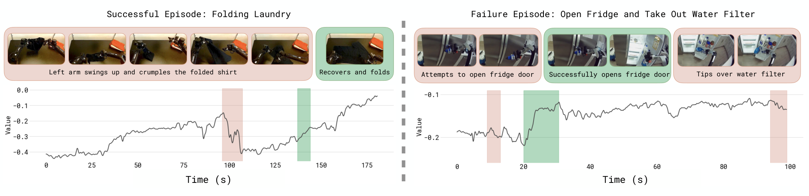

# π*0.6 复现

参考代码

| 优先级 | 项目                                                                                | Stars | 证据与价值                                                                                               |
| --- | --------------------------------------------------------------------------------- | ----- | --------------------------------------------------------------------------------------------------- |
| 1   | [**Evo-RL**](https://github.com/MINT-SJTU/Evo-RL?utm_source=chatgpt.com)          | 858   | **真机证据最强**。SO101、PiPER，论文、真机实验、视频和公开数据集。基于 LeRobot。                                                 |
| 2   | [**PiStar**](https://github.com/ybpy/pistar?utm_source=chatgpt.com)               | 142   | **最值得参考的 OpenPI Fork**。直接 Fork 官方 OpenPI，包含 π0.6 风格的 Value、Advantage 标签、策略微调，以及 PiPER/RealMan 真机代码。 |
| 3   | [**RLinf**](https://github.com/RLinf/RLinf?utm_source=chatgpt.com)                | 5,643 | **工程质量与仿真验证最强**。基于 OpenPI 的 π0.5，完整 RECAP 训练链路，公开数据、测试和量化结果；RECAP 验证主要在 LIBERO。                     |
| 4   | [**RECAP on YAM**](https://github.com/Destiny000621/RECAP?utm_source=chatgpt.com) | 11    | **针对真机的 OpenPI 改造**。基于 PiStar，适配 YAM 双臂、DAgger 数据收集、Value 训练和优势条件化微调；尚缺公开的完整性能对照。                   |
## 机理

Recap 将示范、自主 rollout 和人工纠正数据中的动作样本标为 positive 或 negative，以标签作为额外的语言条件训练 policy，连续动作仍使用 flow matching 损失。训练时保留两类数据，部署时固定输入 positive，使策略偏向更有利于任务推进的动作。从效果上看，这是通过条件标签，在混合质量的数据中提取有效经验。

> 我认为混合训练仍有价值：即使推理时不使用 negative 条件，这些样本在训练时仍提供了额外的观测—动作监督，可能帮助模型学习共享的视觉表征和动作生成能力。 因而，保留 negative 数据可能比直接删除它们更充分地利用数据；但这一解释属于机制假设，需要消融实验验证。

  

## 模型定义

  ####  Distributional value function training
  
| 项目                       | 规格                                                     |
| ------------------------ | ------------------------------------------------------ |
| **骨干模型**                 | Gemma 3 初始化的 **670M VLM**；作为对比，策略模型使用 4B VLM 骨干        |
| **输入：观测 $\mathbf{o}_t$** | 当前多视角相机图像、机器人关节与夹爪状态；本文实验使用 **1 个底座相机 + 2 个腕部相机**      |
| **输入：语言 $\ell$**         | 任务指令，以及描述任务执行方式的元数据，与 VLA 使用相同的语言输入                    |
| **直接输出**                 | **201 个离散回报区间上的概率分布** $p_\phi(V\mid\mathbf{o}_t,\ell)$ |
| **转换后的输出**               | 对各区间代表值求概率加权平均，得到标量价值 $V(\mathbf{o}_t,\ell)$           |
| **训练标签与损失**              | 从当前时刻到轨迹结束的实际累计奖励，归一化、离散化后作为标签，使用交叉熵训练                 |

训练价值模型
$$
\min_{\phi}
\mathbb{E}_{\tau \in \mathcal{D}}
\left[
\sum_{\mathbf{o}_t \in \tau}
H\left(
R_t^B(\tau),
p_{\phi}(V \mid \mathbf{o}_t,\ell)
\right)
\right]
\tag{1}
$$
其中，$R_t^B(\tau)$ 是剩余累计奖励 $R_t(\tau)=\sum_{t'=t}^{T}r_{t'}$ 离散到 $B=201$ 个区间后的标签；$p_\phi$ 是价值模型预测的分布；$H$ 是交叉熵；$\ell$ 是任务语言指令。
$$
r_t =
\begin{cases}
0, & t=T \text{ 且任务成功},\\
-C_{\mathrm{fail}}, & t=T \text{ 且任务失败},\\
-1, & \text{其他情况}.
\end{cases}
\tag{5}
$$
其中，$T$ 为轨迹最后一步，$C_{\mathrm{fail}}>0$ 为较大的失败惩罚常数。
即：**每个非终止步扣 1 分，成功结束不额外扣分，失败结束扣 $C_{\mathrm{fail}}$ 分。**

从当前时刻到轨迹结束的累计回报为：

$$
R_t(\tau)=\sum_{t'=t}^{T}r_{t'}
=
\begin{cases}
-(T-t), & \text{轨迹成功},\\
-(T-t)-C_{\mathrm{fail}}, & \text{轨迹失败}.
\end{cases}
$$

因此，成功轨迹的 return 等于“**实际剩余完成步数**”的负数；失败轨迹则等于 **“距离该轨迹终止的剩余步数** ”的负数，再**加上失败惩罚**。

论文按每个任务的**最大轨迹长度**进行归一化，而不是除以每条轨迹自身的总步数。对于成功轨迹，可写为：

$$
\widetilde R_t=-\frac{T-t}{L_{\max}},
$$

其中，$L_{\max}$ 是该任务统一采用的最大轨迹长度。例如，最大长度为 1000 步、当前距离成功结束还剩 200 步，则归一化回报为 $-0.2$。

论文将价值范围设为约 $[-1,0]$
- [ ] 但未明确说明加入失败惩罚后超出该范围的具体处理方式。

###  Policy extraction via advantage conditioning

首先，将价值模型预测的回报分布转换为标量价值，即对各离散区间的代表值进行概率加权：

$$
V^{\pi_{\mathrm{ref}}}(\mathbf{o}_t,\ell)
=
\sum_{b}
p_\phi(V=b\mid\mathbf{o}_t,\ell)\,v(b),
$$

其中，$v(b)$ 是第 $b$ 个区间对应的回报值。

随后，在后训练阶段，结合同一轨迹中未来 $N$ 步的实际奖励与未来状态价值，估计动作优势：

$$
\hat A_t
=
\sum_{j=0}^{N-1}r_{t+j}
+
V^{\pi_{\mathrm{ref}}}(\mathbf{o}_{t+N},\ell)
-
V^{\pi_{\mathrm{ref}}}(\mathbf{o}_t,\ell).
$$

论文采用 $N=50$。$\hat A_t$ 是对 $A^{\pi_{\mathrm{ref}}}(\mathbf{o}_t,\mathbf{a}_t,\ell)$ 的样本估计，表示这段实际执行相对于当前状态预期回报的改善程度；奖励和价值使用相同的归一化尺度。

---

$\epsilon_\ell$ 为**任务相关的优势阈值**， 选一个阈值对$\mathcal D_\ell$ 每一frame打上 优势标签$I_t$

$\epsilon_\ell$后训练通常使每轮目标任务 rollout 中约 **40%** 的样本为 positive；T-shirt/shorts 任务只保留约 **10%** positive
因此阈值可具体写成：
$$
\epsilon_\ell=\operatorname{Quantile}_{0.6} \left(\{\hat A_t\}_{\text{任务 }\ell\text{ 的 rollout 样本}}\right)
$$
这里取第 60 百分位，对应优势最高约 40%
最后，将估计优势转为**二元**标签：

$$
I_t=
\mathbf{1}\left(
\hat A_t>\epsilon_\ell
\right).
$$

其中，超过阈值标记为 $1$，否则为 $0$。目标任务初始化数据和人工纠正动作直接设为 $I_t=1$。

 ---

由于 causal attention 掩码，模型在子任务文本之后、动作之前插入 Advantage: positive/negative 标签(**仍然是文本**)，使其影响动作生成，而不影响前面的子任务文本预测

策略训练目标为：

$$
\begin{aligned}
\min_\theta\quad
\mathbb{E}_{\mathcal{D}_{\pi_{\mathrm{ref}}}}
\Big[
&-\log\pi_\theta(\mathbf{a}_t\mid\mathbf{o}_t,\ell)\\
&-\alpha\log\pi_\theta(\mathbf{a}_t\mid I_t,\mathbf{o}_t,\ell)
\Big].
\end{aligned}
\tag{3}
$$

第一项学习不带优势条件的动作分布，第二项学习带优势标签的动作分布，$\alpha$ 控制两项的相对权重。
注意，这是理论目标，实际上训练仍然采用flowmatching的mse_loss ，并且 以 **30% 概率** 去掉优势条件

30% dropout 可以直接写成：

$$
c_t= \begin{cases} \varnothing,&\text{概率 }0.3,\\ I_t,&\text{概率 }0.7, \end{cases} 
$$
最终训练损失：

$$\qquad \mathcal L=\mathbb E[\mathcal L_{\rm FM}(\theta;\mathbf o_t,\ell,c_t,\mathbf a_{t:t+H})].$$

>本复现保留 OpenPI π0.5 的连续动作 flow matching 损失，优势文本条件及 30% 条件 dropout；暂不复现原文的 FAST 离散动作与子任务文本交叉熵训练。

**训练使用全部数据，包括高优势和低优势动作；推理时指定 $I_t=1$，生成偏向高优势的动作**：

$$
\hat{\pi}(\mathbf{a}_t\mid\mathbf{o}_t,\ell)
=
\pi_\theta(\mathbf{a}_t\mid I_t=1,\mathbf{o}_t,\ell)
\qquad (\beta=1).
$$

## pipeline

**输入：** 多任务示范数据集 $\mathcal D_{\mathrm{demo}}$，目标任务 $\ell$，迭代轮数 $K$。

**第一阶段：多任务预训练**

1. 使用多任务示范数据集 $\mathcal D_{\mathrm{demo}}$，按照公式（1）训练价值模型 $V_{\mathrm{pre}}$。
2. 使用同一数据集及价值模型 $V_{\mathrm{pre}}$，按照公式（3）训练优势条件策略 $\pi_{\mathrm{pre}}$。
> pretrian 复现一开始忽略，不大规模pretrain,或者可以采用其他pretrian的reward model，比如Robometer等等

**第二阶段：目标任务初始化**

3. 将目标任务 $\ell$ 的示范数据加入任务数据集 $\mathcal D_\ell$。
4. 从 $V_{\mathrm{pre}}$ 初始化，使用 $\mathcal D_\ell$，按照公式（1）训练任务价值模型 $V_\ell^0$。
5. 从 $\pi_{\mathrm{pre}}$ 初始化，使用 $\mathcal D_\ell$ 和 $V_\ell^0$，按照公式（3）训练任务初始策略 $\pi_\ell^0$。
>  $\pi_{\mathrm{pre}}$ 我们直接用pi05 base model了

**第三阶段：执行、积累数据与迭代训练**

对 $k=1,\ldots,K$，重复以下步骤：

6. 使用上一轮策略 $\pi_\ell^{k-1}$ 执行任务并采集数据，将新数据加入 $\mathcal D_\ell$。
7. **重新从预训练价值模型 $V_{\mathrm{pre}}$ 初始化**，使用累计数据集 $\mathcal D_\ell$，按照公式（1）训练本轮价值模型 $V_\ell^k$。
8. **重新从预训练策略 $\pi_{\mathrm{pre}}$ 初始化**，使用累计数据集 $\mathcal D_\ell$ 和本轮价值模型 $V_\ell^k$，按照公式（3）训练本轮策略 $\pi_\ell^k$。

**输出：** 经过 $K$ 轮迭代后的目标任务策略 $\pi_\ell^K$。

**注意：每轮累积的是数据；价值模型和策略均从各自的预训练模型重新初始化，而不是接着上一轮模型继续训练。**

## 目标任务初始化

### 构建 任务数据集 $\mathcal D_\ell$
- [ ] 数据成功失败的比例问题，**轮文没有要求第一轮必须混入失败数据**，可以参考第三方实现是否混入，当前默认纯成功数据
- [ ] 推理$\pi_\ell^{k-1}$ 的时候需要record新数据，并且合并到 $\mathcal D_\ell$
- [ ] record $\mathcal D_\ell$的时候需要补充特殊字段，比如要通过pico打上正确失败的标签，value model会根据数据计算奖励; 此外，在经验改进循环的阶段，需要dagger, 需要单独设计intervention逻辑

### 训练Value model $V_\ell^0$和   $\pi_\ell^0$

参考 前面模型定义

> 来自原文：价值函数的可视化。我们训练一个多任务值函数来预测成功步骤数，并以最大任务长度归一化为（−1,0）（-1,0），其中 00 对应成功完成。 我们可视化一个成功完成的折叠任务的值函数输出（左图），以及预训练数据集中一个未成功的操作任务示例（右图）。 红色部分表示价值下降，绿色部分表示增加;顶部的图片显示了该集对应的帧。 可视化显示 VF 能够正确识别发作中的错误，并显示进展速度。

- [ ] 在训练$V_\ell^0$ 之后， 需要可视化使用$V_\ell^0$打上优势标签的 $\mathcal D_\ell$ 来判断 vlm效果好不好，这是人为验证门禁

## 经验改进循环（k = 1…K）

- [ ] 每轮增加多少数据？
- [ ] dagger逻辑

