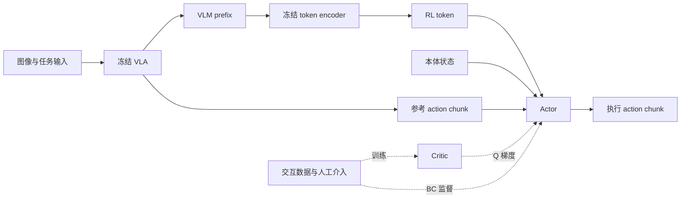
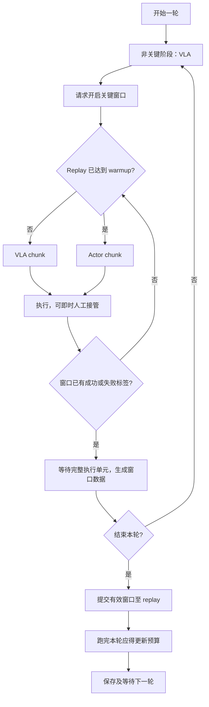

# RLToken 论文复现规格

本文说明 xense-openpi 的 RLToken 复现：整体思路、模型定义与实现选型、数据与训练 workflow，以及形成当前方案的讨论。当前选用 `corrected` 条件输入与 `direct` 动作输出；范围为同步真机 RL，RTC 不在本文范围内。

论文依据为 [RL Token，arXiv v2](https://arxiv.org/html/2604.23073v2)。实现与默认值固定对照 [xense-openpi `a11d8a6`](https://github.com/XenseRobotics-AI/xense-openpi/tree/a11d8a6a38f2ef6c9174ae51d534941a82e3e149)。实验覆盖值与结果来自 [实验记录](experiments.md) 的既有取证。本稿中的公式展开主要描述该实现，论文规定和本地选择在对应段落注明。

## 一、方法整体 Overview

RLToken 在任务的关键阶段，用轻量 actor 对 VLA 给出的参考动作 chunk 做隐式修正。Actor 根据机器人本体状态、从 VLM 表示中提炼的 RL token，以及 VLA 参考动作，输出实际执行的 action chunk。训练结合人工介入提供的动作监督，以及 critic 从交互数据中学到的动作价值，引导 actor 改进动作。训练分两阶段：先用示教观测训练 token encoder-decoder，再冻结 VLA 与 token encoder，通过在线交互训练 actor 和 critic；decoder 不参与在线决策。



图展示 phase two 关键阶段的数据流；非关键阶段和 warmup 由 VLA 驾驶。原论文的 token 提取图见 [Fig. 2](https://arxiv.org/html/2604.23073v2#S4.F2)，其中底座为 π₀.₆，本复现使用 π₀.₅。

## 二、模型定义与实现选型

### 2.1 符号与共用表示

时间索引统一使用真实执行 step。一个 chunk 包含多个 step；chunk 的 next state 是执行 C 步后的状态。

| 符号 | 含义 |
|---|---|
| \(o_t,\ell\) | 当前观测与任务指令 |
| \(s_t\in\mathbb R^p\) | 原始 absolute proprio，保留给动作编解码 |
| \(Z_t=(z_{t,1},\ldots,z_{t,M})\in\mathbb R^{M\times D}\) | VLM 最后层的 prefix embeddings |
| \(z_t^{\rm rl}\in\mathbb R^E\) | 从 encoder 输出序列的 readout token 位置提取的特征向量 |
| \(\tilde s_t\) | 按 state stats 归一化并 clip 的 proprio |
| \(x_t=(z_t^{\rm rl},\tilde s_t)\) | Actor 与 critic 的状态输入 |
| \(H,C,d\) | VLA reference 长度、RL 执行及 TD 长度、动作维度；本配置 \(C\le H\) |
| \(u\) | Absolute 执行动作，单位与机器人接口一致 |
| \(a\in[-1,1]^{C\times d}\) | Phase-two normalized action chunk |
| \(a_t^{\rm ref},a_t^{\rm exec}\) | Anchor t 的 VLA reference 前 C 步、从真实轨迹切出的 C 步执行动作，均已编码 |
| \(m_t^{\rm human}\in\{0,1\}^C\) | 每个执行 step 是否由人工接管，广播到动作维度 |
| \(b_t,c_t\) | BC target、actor 条件 reference；两者的用途分别定义 |
| \(\operatorname{vec}(a)\in\mathbb R^{Cd}\) | 实现时按时间步顺序将 \(C\times d\) 的 action chunk 展平为向量，供 MLP 拼接输入 |
| \(\mathcal B,B\) | Replay buffer、训练 batch size |
| \(\gamma,\tau\) | 每执行 step 的折扣、target critic 软更新系数 |

RL token 是连续向量，actor 输出也是连续动作。

### 2.2 VLA：prefix 和 reference 的来源

本复现使用已经完成任务微调的 π₀.₅。一次在线前向产生 VLA action chunk，并取得同一次前向的 prefix hidden states 与 mask；token encoder 将其压缩为 \(z_t^{\rm rl}\)。Reference 保留 H 步，actor 读取前 C 步。当前在线特征提取默认使用 10 次 VLA 去噪迭代；这是推理迭代数，与执行 C 步的含义不同。

当前输入采用完整有效 prefix，包含图像位置与 tokenized task input；论文实验在 token 提取阶段去掉语言 embeddings。[论文 §IV-A](https://arxiv.org/html/2604.23073v2#S4.SS1)

Ethernet 模板中，prefix 容量为三路图像各 256 个位置，加上最多 128 个任务输入位置，共 896。模型通用默认容量为 1024。容量和有效 token 数不同：padding 不参与重建 loss，不作为有效 attention key。

本体状态在 VLA 中的输入表示遵循该 VLA 的数据配置；phase-two MLP 单独读取 \(\tilde s_t\)。

### 2.3 RL token encoder-decoder

**定义与目标。** Encoder 接收 prefix 与一个可学习 readout token，产生输出序列 \(G_t\)，再取 readout token 所在位置的特征：

$$
G_t=g_\phi([P(Z_t)+P_{\rm pos},\ e_{\rm rl}+p_{\rm rl}]),
\qquad z_t^{\rm rl}=G_t[M+1].
$$

提取的 RL token 与归一化 proprio 共同组成状态输入 \(x_t=[z_t^{\rm rl},\tilde s_t]\)。

\(P\) 是需要时才使用的输入投影；D 与 E 相同时为恒等映射。Encoder 使用非因果 self-attention，让 readout 汇集所有有效 prefix 信息。

Decoder 输入右移的 teacher-forcing 序列，第 i 个输出重建第 i 个 prefix：

$$
\hat z_i=h_\phi\left(d_\phi([z^{\rm rl},P_{\rm teacher}(\operatorname{sg}(z_1)),\ldots,
P_{\rm teacher}(\operatorname{sg}(z_{M-1}))]+P_{\rm dec})_i\right).
$$

Causal mask 使第 i 个输出只能读取 RL token 与此前的目标位置；mask 同时排除无效 teacher key。VLA prefix 停止梯度，实现的重建目标是有效 token 和特征维度上的平均平方误差：

$$
L_{\rm ro}=\frac{\sum_{b,i,k}v_{b,i}(\hat z_{b,i,k}-z_{b,i,k})^2}
{\max(D\sum_{b,i}v_{b,i},1)}.
$$

这里 \(v\) 是 prefix 有效位置 mask，与人工介入 mask 不同。Decoder 是训练期的重建约束，在线仅运行 encoder。

**结构选型。** 本复现沿用移植实现的 pre-LayerNorm Transformer。每个 block 先做带残差的 self-attention，再做带残差的 GeGLU FFN；decoder 通过 causal mask 实现自回归重建，没有单独的 cross-attention 模块。

FFN 的具体宽度链为 \(E\to K\to2K\to K\to E\)，其中 \(K=4E\)：先线性映射至 K，再投影成两路 K 维向量，以 \(h\odot\mathrm{GELU}(g)\) 门控，最后投影回 E。这一具体结构属于移植实现的选择。

| 项目 | 当前结构选择 |
|---|---|
| RL token 数量 / 宽度 E | 1 / 2048 |
| Encoder / decoder 深度 | 各 2 层 |
| Attention heads | 8，每 head 256 维 |
| FFN ratio / K | 4 / 8192 |
| 归一化 / 激活 | Pre-LayerNorm，epsilon 1e-5 / GeGLU，门控使用 GELU |
| Attention dropout | 无 |
| 位置表示 | 正弦表初始化的可学习参数；readout token 与其位置参数也参与训练 |
| 投影 | D≠E 时增加 prefix 与 teacher 投影；输出线性投影回 D |
| 精度 | 矩阵计算默认 bfloat16，参数、残差流与 loss 为 float32 |
| Rematerialization | 默认关闭 |

以上为当前复现的结构配置。Phase one 的 optimizer 与训练预算见 3.1。

### 2.4 共用数据表示与 transform

**Proprio。** 保留当前 absolute state 语义，用 checkpoint 的 state quantile stats 归一化；raw state 另存用于动作转换。统计量在 phase two 固定，不从 replay 重新估计。

$$
N_q(y)=\operatorname{clip}\left(2\frac{y-q_{01}}{q_{99}-q_{01}+\epsilon}-1,-1,1\right),
\qquad\tilde s_t=N_{q^{\rm state}}(s_t),\quad\epsilon=10^{-6}.
$$

**动作。** 物理动作 u 先经过夹爪约束和旋转投影，再把 TCP 的位置及 rot6d 分量转为相对 anchor state 的 delta，夹爪保持 absolute opening：

$$
\Delta(u;s)_{\rm tcp}=u_{\rm tcp}-s_{\rm tcp},\qquad
\Delta(u;s)_{\rm grip}=u_{\rm grip}.
$$

这里的 rot6d delta 是表示分量之差，并不是轴角增量。编码得到 \(a=\operatorname{encode}(u,s)=N_{q^{\rm action}}(\Delta(u;s))\)。同一条 replay row 的所有 C 步都相对它自己的 anchor state 编码。

解码先做 inverse quantile，再将 TCP delta 加回 raw state，得到 absolute target chunk。夹爪在该表示下 clip 至 [0,1]；rot6d 两列通过 Gram–Schmidt 正交化。零向量、近共线或非有限旋转块回退到当前 state 的对应旋转。

为让 loss 中的动作经过与执行一致的变换，定义：

$$
\mathcal P_s(a)=\operatorname{encode}(\operatorname{decode}(a,s),s).
$$

Actor loss 与 critic bootstrap 使用 \(\mathcal P_s(a)\)。VLA reference、人工动作和实际 replay 动作也通过相同编码进入 normalized 表示，投影后再编码仍会 clip。

**代价。** 超过 quantile 区间的纠正会被截断，旋转正交化也可能改变数值。若 \(q_{01}=q_{99}\)，epsilon 仅避免除零，clip 仅限制幅度，不能恢复该维度的信息。Normalized 零点解码为 quantile 区间中点附近的动作，不保证零物理位移。

### 2.5 Actor

**输入输出。** Actor 接收状态 \(x_t\) 与参考动作 chunk \(c_t\in\mathbb R^{C\times d}\)，输出同形状的动作均值 \(\mu_\theta=f_\theta(x_t,c_t)\)。当前 `corrected` 基线在训练时使用：

$$
b_t=(1-m_t^{\rm human})\odot a_t^{\rm ref}+m_t^{\rm human}\odot a_t^{\rm exec},
\qquad c_t=b_t.
$$

采集时逐 step 记录实际控制来源：由人工接管执行的 step 标记为 1，由 VLA 或 actor 执行的 step 标记为 0。切出 replay window 时，同时切出对应的 human mask。原始 reference、实际执行动作与 human mask 分开保存在 replay。

训练时根据 mask，将 reference 中人工接管位置替换为实际人工动作，构成 corrected reference 和 BC target \(b_t\)；未接管位置保留 VLA reference。在线采集与部署生成动作时，actor 的条件 reference 使用当前 VLA 输出。

Reference dropout 在训练时按样本以 0.5 概率将整个条件 reference 清零；BC target 保持原值。

**动作定义。** 当前为固定标准差 Gaussian，随后 clip：

$$
\mu_\theta=f_\theta(x_t,c_t),\qquad
a_\theta=\operatorname{clip}(\mu_\theta+\sigma\xi,-1,1),\quad\xi\sim\mathcal N(0,I).
$$

严格地说 clip 后的动作分布不再是未经截断的 Gaussian。训练与在线探索使用采样动作，确定性部署使用 \(\operatorname{clip}(\mu_\theta,-1,1)\)，执行前按 2.4 解码。

**训练目标。** 用 \(\bar a_\theta=\mathcal P_{s_t}(a_\theta)\) 计算：

$$
L_\pi=\mathbb E\left[-w_Q Q_1(x_t,\bar a_\theta)
+w_{\rm BC}\frac{1}{Cd}\|\bar a_\theta-b_t\|_2^2\right].
$$

默认 \(w_Q=0.1,w_{\rm BC}=5\)，因此 BC/Q 系数比为 50:1。保留理论上的 \(-Q+\beta L_{\rm BC}\) 表达时，若 \(L_{\rm BC}\) 定义为 MSE，则 \(\beta=50\)；若直接用未经平均的平方范数，则对应 \(\beta=50/(Cd)\)。实现保留两个权重。

Q 项通过 critic 对当前 actor 动作的评价产生梯度，BC 项约束偏离 reference 或人工纠正的程度。两项梯度共同更新 actor 参数。

> **实验观察：** 在已记录的 proposal 实验末 500 次 actor 更新中，加权 BC/Q 梯度范数比中位数约为 1.85，梯度 cosine 中位数约为 −0.55，两项经常朝相反方向更新 actor。Corrected 实验末 500 次更新的范数比约为 1.40。配置系数比为 50:1，实际梯度强度已处于相近量级。数据见 [实验记录](experiments.md)。
>
> **讨论：** 当 BC 目标把 actor 拉向不合适的动作时，它可能抵消 Q 项推动的改进方向。负 cosine 表示两个目标存在冲突；判断哪一方向更合适，需要结合实际动作观察。
>
> **配置理解：** 较大的 BC 系数可理解为在训练初期加强对参考动作的约束。随着拟合程度变化，两项梯度的相对强度也会变化；当前始终使用固定的 50:1 系数比，没有后期降权日程。

**结构与初始化。**

实现时将 reference chunk 展平为 \(\operatorname{vec}(c_t)\in\mathbb R^{Cd}\)，再与 RL token、proprio 拼接。MLP 输出的 Cd 维均值重新整理成 C×d 的 action chunk。

```text
[RL token, proprio, 展平后的reference前C步]
→ Linear(256) → ReLU → Linear(256) → ReLU → Linear(C×d)
→ 加固定标准差噪声（探索时）→ clip → 动作解码
```

Actor 无 LayerNorm；隐藏层正交初始化，gain 为 √2；输出头正交初始化，gain 为 0.01√2。固定标准差为 0.002，单位是 normalized action。ReLU 是当前固定实现，并非该版本的可选配置字段；LayerNorm 与隐藏层宽度可配置。

Actor 直接输出完整 normalized chunk，隐式修正由条件输入、BC 与 Q 的训练共同形成。小输出头使未训练均值接近归一化零点；第一次上机前还经历 warmup 数据上的训练。

### 2.6 Critic 与 target critic

**输入输出。** 每个 critic 接收状态 \(x_t\) 与动作 chunk \(a\in\mathbb R^{C\times d}\)，输出该 C 步动作块的标量价值 \(Q_j(x_t,a)\)。训练当前 Q 时，a 是真实轨迹编码后的 \(a_t^{\rm exec}\)。

**TD target。** 先累计 chunk 内的 reward，再以 C 步折扣 bootstrap：

$$
R_t^{(C)}=\sum_{i=0}^{C-1}\gamma^i r_{t+i},\qquad
a'\sim\pi_\theta(\cdot\mid x_{t+C},a_{t+C}^{\rm ref}).
$$

$$
\hat Q_t=\operatorname{sg}\left[R_t^{(C)}+(1-d_t)\gamma^C
\min_{j\in\{1,2\}}Q'_j(x_{t+C},\mathcal P_{s_{t+C}}(a'))\right].
$$

d 为 terminal 标志；成功和失败的 terminal 都停止 bootstrap。代码用一次下一动作采样近似动作期望。两个 target Q 取最小值是论文附录明确规定的选择。[论文附录 B](https://arxiv.org/html/2604.23073v2#A2)

$$
L_Q=\frac{1}{2B}\sum_{b=1}^{B}\sum_{j=1}^{2}
\left(Q_j(x_b,a_b^{\rm exec})-\hat Q_b\right)^2.
$$

Bootstrap 侧始终使用下一状态的原始 VLA reference，不应用当前人工纠正，也不做 actor 训练用的 reference dropout。当前实现由 online actor 生成下一动作，只维护 target critic，没有 target actor。

**结构。** 实现时将动作 chunk 展平为 \(\operatorname{vec}(a)\)，再与 RL token、proprio 拼接。两个独立 Q head 均为：

```text
[RL token, proprio, 待评价的action chunk]
→ Linear(256) → LayerNorm → ReLU
→ Linear(256) → LayerNorm → ReLU → Linear(1)
```

输出层不加激活。隐藏层使用 Xavier 风格的 uniform variance scaling，gain 为 √2；输出权重使用标准差 0.02 的 normal 初始化。LayerNorm epsilon 为 1e-5。

使用两个 2×256 head 和 critic LayerNorm 是本复现当前配置；LayerNorm 用于缓解训练期间特征及目标尺度变化。每次 critic 更新后：

$$
\psi'_j\leftarrow(1-\tau)\psi'_j+\tau\psi_j,\qquad\tau=0.005.
$$

Actor 更新使用 Q₁。具体更新频率与优化参数见 3.5。

## 三、数据构建与训练 Workflow

### 3.1 Phase one：准备 VLA 与训练 token 表示

当前流程依次为：任务示教数据 → 任务 VLA checkpoint 及其统计量 → 冻结 VLA 提取 prefix cache → 训练 token encoder-decoder → 导出 token checkpoint。

1. 准备与 VLA 数据配置一致的相机、本体状态、任务指令及示教动作。VLA 微调用到动作监督；token 重建阶段使用观测产生的 prefix，不把动作当重建目标。
2. 完成 VLA 任务微调，或明确复用已有任务 checkpoint。锁定权重、数据处理和 norm stats。本文未固定该 VLA 的 SFT 学习率及训练步数；须由所选 checkpoint 的训练记录提供。
3. 用冻结 VLA 按 `frame_stride` 从示教序列提取 prefix 和有效 mask，生成缓存并记录对应的 VLA 权重、统计量与数据配置。当前配置为 1，即逐帧提取。
4. 从 cache 训练 encoder-decoder，按 2.3 的 masked MSE 更新 token 模块。当前路径不联合更新 VLA。
5. 保存 token 权重、结构配置和来源身份。在线加载时检查 token 对应的 VLA 权重与 norm stats，避免混用不匹配的表示。

**当前 token 训练默认参数：**

| 参数 | 值 |
|---|---:|
| Optimizer | AdamW，β₁=0.9，β₂=0.95 |
| Weight decay / 全局梯度范数上限 | 1e-10 / 1.0 |
| Global batch size | 256 |
| 训练步数 | 20,000 |
| Peak / minimum learning rate | 1e-4 / 2.5e-5 |
| Warmup / 后续 schedule | 1,000 steps / cosine decay |
| Frame stride | 1 |
| FSDP devices | 1 |
| Checkpoint 保存 / 长期保留间隔 | 1,000 / 5,000 steps |

网络结构见 2.3。表中训练步数默认为 20,000；已记录的在线实验加载的是 60,000-step token checkpoint。

### 3.2 Phase two：一次在线轮次

一轮 round 从开始操作到结束操作，可包含多个关键阶段 episode。每个有标签的关键阶段代表一次尝试。非关键阶段允许接管，但其轨迹不进入 RL replay。



图示主路径；作废、无标签结束和断连按下面的规则处理。

**窗口与按键。** A 开始或结束一轮；窗口关闭时 B 请求开窗，窗口开启时 B 标成功，Y 标失败。X 作废本轮尚未提交的已标数据并关闭当前窗口；X 本身不结束本轮。作废后的无窗口 Y 被忽略，B 可申请新窗口。

开窗在 chunk 中途提出时，从下一 chunk 起计；在服务器已为即将执行的 chunk 选好驾驶策略的间隙提出时，同样等待该 chunk 完成。这样不会把先 VLA、后 actor 的两个 chunk 误当成同一驾驶状态下的开窗。人工接管仍可改变实际动作来源。

Warmup 状态在轮末提交后变化；该轮更新完成后，下一轮窗口内才由 actor 驾驶。训练期间的旧按键不作为下一轮的操作指令。

### 3.3 人工介入、标签与轮末提交

**接管与松手。**

- 按住 grip 先进入待命，policy 继续执行。任一手柄相对按下时刻移动至少 5 mm 或旋转至少 3°才触发接管；trigger 的变化不作为运动触发。
- 接管从机器人的实际位姿开始，以手柄相对运动控制目标；人手不动时保持目标，静止帧仍记录为人工 step。
- 各手夹爪仅在对应 grip 按下时跟随 trigger；另一只手保持最近夹爪命令，没有历史命令时采用实测值。夹爪开闭不是接管前置条件，切换时的开闭跳变会告警。
- 人工介入可以在 chunk 内覆盖 policy。连续人工动作按 C 步划分执行单元；接管与开窗互不限制，握持中也可请求开窗，从后续单元边界计入。
- 松开 grip 后废弃原 policy 未执行的 remainder，重新取得观测并推理下一 chunk。若仅待命、未触发运动接管，则松开不触发 policy restart。
- 松开前约 0.2 s 内仍有超过阈值的运动，或夹爪开闭发生翻转，会告警；release 照常发生。

例如 C=10，第 3 步接管，第 8 步松手，真实轨迹为：

```text
P0 P1 P2 | H3 H4 H5 H6 H7 | P'0 P'1 ...
           人工动作          重新推理后的 policy
```

执行 step 时间轴连续，P' 不从旧 policy remainder 继续。暂停推理所消耗的墙钟时间应另行统计，不能伪造为空动作 step。

**标签与数据提交。**

- 成功或失败先挂起，当前 policy chunk 或人工单元跑满 C 步后才上报。
- 若人工 release 提前打断该单元，标签保持挂起，重启的 P' 仍处于关键阶段；等待 P' 完整结束后上报。
- 挂起标签期间按 A，先完成标签上报再结束本轮。没有挂起标签时按 A，未标的窗口丢弃。
- 有效关键阶段最后一步 reward：成功为 1、失败为 0；其余 step 为 0。两种标签都令最终 transition 为 terminal。
- 有标签的窗口先形成该轮待提交数据；正常轮末才写入 replay。X 清除本轮已标数据及当前窗口；断连导致本轮未提交数据丢弃。
- “退出控制窗口”与“形成有效 replay episode”不同：只有满足标签与完整窗口条件的数据才入库。不能将无标签关窗直接当成成功。

等待标签的代价是机器人仍会继续执行至完整单元结束；人工接管仍然可用。

### 3.4 Replay transition 与 sliding window

一行 replay 是一个 C-step transition：

$$
T_t=(x_t,a_t^{\rm exec},a_t^{\rm ref},r_{t:t+C-1},
x_{t+C},a_{t+C}^{\rm ref},d_t,m_t^{\rm human}).
$$

Raw state 与完整 reference 可作为编码及后续计算所需的附加字段保存。当前 reference 来自当前 anchor 的观测；next reference 来自 t+C 时重新推理，不能直接取当前 reference 的后 C 步代替。

| 数据 | 用途 |
|---|---|
| 实际执行动作与 reward | Critic 当前 Q 与 TD target |
| 原始 reference 与人工 mask | 动态构造 corrected 条件和 BC target |
| 当前 / next 特征 | Actor、critic 及 bootstrap |
| episode_id / round_id | 尝试归属 / 操作轮归属；round_id 从 1 起 |
| 逐步 source 与 chunk source | VLA / RL / HUMAN；混合来源标记 MIXED |
| is_critical / timestamp | Replay 内前者恒真；后者用于与视频和机器日志对齐 |

Metadata 不参与 loss。一个 chunk 来源为 MIXED 不等于所有位置都有人工监督，BC 替换依据逐步 human mask。

**滑窗。** Baseline 要求 stride k≥1 且整除 C。长度为 L 的关键阶段使用 phase-relative anchors：

$$
\mathcal A=\{0,k,2k,\ldots\}\cap[0,L-C]\ \cup\ \{L-C\},\qquad L\ge C.
$$

每个 anchor 取真实轨迹的 [t,t+C)。只有以 L 结束的 row 标 terminal；若 L−C 不在均匀网格上，额外补这一条，确保终止 reward 存在且仅属于最后一条完整 row。L<C 时无完整 row。

均匀网格有 \(\lfloor(L-C)/k\rfloor+1\) 行；算上可能补充的 terminal row，总数为 \(\lceil(L-C)/k\rceil+1\)。

机器人执行期间按 stride 保留 raw observations；窗口得到标签后，为所有 anchor 与 anchor+C 补算缺少的 VLA/token 特征。每一行使用自己的观测，不能复用最近执行 chunk 起点的特征。必要观测缺失时不能凭旧特征拼出 transition。

人工接管、release 和 policy restart 只改变逐步动作与 source，不额外增加 baseline 网格 row。比如 C=10、k=2，release 发生在第 8 步，[0,10) 与 [8,18) 会共享 P' 的前两步；若 release 发生在第 9 步，不会仅因为 restart 而添加 anchor=9。

**数量与 warmup 的解释。** 若关键阶段包含 150 个实际执行 step，C=10、k=2 会产生 71 行。按 30 Hz 且无额外停顿估算，对应约 5 秒的执行步时长，不包括网络、推理和人工等待时间。

对于相似长度的阶段，600 行约对应 600/71≈8.5 段；C=20、k=2 时同样 150 steps 产生 66 行，约对应 9.1 段。重叠 row 并非独立的新环境数据，日志应同时保留实际执行 step、阶段数和累计 row 数，估算值应标明假设。

### 3.5 Warmup 与在线更新预算

Replay 使用固定容量 FIFO，满后逐行覆写；均匀有放回采样，实际 batch 大小为 min(配置 batch size, 当前行数)。容量必须至少容纳 warmup 行数；无需填满 buffer 才训练。

设 N_committed 为累计成功提交的 row 数，N_Q 为已完成 critic 更新数，U 为 UTD：

$$
N_Q^{\rm desired}=\begin{cases}
0,&|\mathcal B|<N_{\rm warm},\\
U N_{\rm committed},&|\mathcal B|\ge N_{\rm warm},
\end{cases}\qquad
N_{\rm pending}=\max(N_Q^{\rm desired}-N_Q,0).
$$

达到 warmup 后补齐此前所有入库数据的预算。旧行被 FIFO 覆写不扣减累计预算。每轮提交后跑完全部 pending updates，没有单轮上限；代价是轮间训练暂停可能明显变长。

默认 U=5。Critic 第 2、4、6…次更新后各更新 actor 一次，第 1 次不更新 actor；target critic 每次 critic 更新后软更新。训练只更新小网络，VLA 和 token encoder 保持冻结。

例如首次达到恰好 600 行时，预算为 3,000 次 critic 更新和 1,500 次 actor 更新。若一次提交使行数从 590 跳到 660，则按 660 计算，而不是截断到 600。

**训练周期参数与配置来源。** 下表第一列来自固定代码版本，第二列来自该版本 Ethernet YAML，第三列来自已记录 corrected 实验 `test1010-2` 的实际配置。

| 参数 | 代码默认 | Ethernet 模板 | 已记录 corrected 实验 |
|---|---:|---:|---:|
| RL chunk C / reference H | 20 / 50 | 10 / 50 | 20 / 50 |
| Warmup rows | 250 | 600 | 600 |
| Replay stride / capacity | 2 / 6000 | 同左 | 同左 |
| Batch size | 256 | 256 | 256 |
| Actor / critic optimizer | Adam / Adam | 同左 | 同左 |
| Actor / critic learning rate | 3e-4 / 3e-4 | 同左 | 同左 |
| 独立全局梯度范数上限 | 各 10 | 同左 | 同左 |
| 每 step 的 gamma | 0.99 | 同左 | 同左 |
| Target soft-update tau | 0.005 | 同左 | 同左 |
| UTD / critic-to-actor 更新比 | 5 / 2 | 同左 | 同左 |
| 配置轮数上限 | 300 | 300 | 300，非实际完成轮数 |

Actor 的噪声、dropout 与 BC/Q 权重见 2.5，网络结构见第二部分。模板 C=10 时 bootstrap 折扣为 0.99¹⁰≈0.904；C=20 时为 0.99²⁰≈0.818，不能直接用 gamma 一次方。

**Checkpoint 与恢复。** 保存 actor、critic、target critic、优化器、replay、计数和随机状态，恢复时检查训练条件以及 VLA/token 身份。`input_reference` 属于训练条件，恢复时须匹配；旧 checkpoint 缺少该字段会被当前条件校验拒绝。

## 四、实验细节、讨论与选择依据

### 4.1 当前任务：局部对准，再交给 VLA 插入

当前实验将 actor 的职责限定为：从离插入口稍有距离的位置调整到对准或浅插状态，再由操作员手动关闭关键窗口，让 VLA 完成后续插入。示教也围绕这一局部阶段采集。

验收分别记录 actor 局部对准成功、操作员交接后 VLA 完整插入成功，以及过程中是否发生人工纠正。交接时机由操作员判断。

### 4.2 Corrected / proposal 的尝试与当前决定

最初的疑问是：corrected 在人工步上把相同动作同时作为条件输入和监督，actor 可能通过复制获得较低 BC loss。Reference dropout 用于削弱对条件 reference 的依赖。

Proposal 尝试保持 \(c_t=a_t^{\rm ref}\)，仅 BC target 使用人工替换后的 b_t，期望学习“VLA 建议到人工纠正”的映射。

试验中 proposal 效果不稳定，无法得出明显结论；当前停止该设计方向，恢复选用 corrected。代码仍保留两种模式。

### 4.3 Sliding 与边界 anchor 的取舍

Baseline 的滑窗网格稳定地覆盖真实轨迹，代价是 row 数和每单位真实采集数据对应的更新预算增加。改变 stride 时，需要同时解释数据覆盖与 UTD 成本。

原规格的 stride=0 为 TacXense 兼容模式，当前 JAX 不支持。其 anchor 按 policy chunk、人类段及 restart 边界产生：例如 C=10，第 3 步接管、第 23 步松手时，anchors 为 0、10、20、23，对应 [0,10)、[10,20)、[20,30)、[23,33)。其中 [20,30) 含 H20～H22 和 P'0～P'6。

无介入时，150-step 轨迹按 C=10 的边界模式约产生 15 行，而 stride=2 滑窗产生 71 行。因此 600 行 warmup 约为前者 40 段、后者 8.5 段；不能脱离切窗方式比较相同行数。该例只解释数据量，不把兼容模式纳入 JAX baseline。

### 4.4 已有实验记录与讨论

以下汇总已记录的 corrected 对准实验。

Corrected 对准实验已有 39 段含人工介入的成功示教入库，产生 2,608 条 transition；critic 更新 13,040 次、actor 更新 6,520 次，与当前预算规则一致。BC loss 持续降低。对准成功率从低于 10% 提升到约 70–80% 为操作员现场估计，未登记完整评测试次数。

该实验采用成功示教，Q 权重为 0.1。Corrected 条件、Q 项和局部示教范围对行为改善的各自贡献仍是讨论中的问题。

此前对固定官方版本的配置、TD loss 与动作空间检查为 19 passed。完整实验记录见 [experiments.md](experiments.md)，工程演变见 [log.md](log.md)。
